# Giriş

Geçen hafta İnternet'in **nasıl çalıştığını** öğrendik: ağlar, protokoller, adresler. Bu hafta aynı İnternet'i **nasıl kullandığımıza** bakıyoruz. Arama yapmaktan e-posta yazmaya, sahte bilgiyi fark etmekten e-Devlet üzerinden işlem yapmaya kadar…

Bu haftanın iki anahtarı var: **doğrulama** ve **yazışma görgüsü**. Aradığınız bilginin doğru olduğundan emin olmayı ve kurumsal hayatta yazdığınız bir e-postanın sizi doğru temsil etmesini öğreneceksiniz.

::: {.callout-note}
## Bu haftanın temel fikri

İnternet'te bilgiye ulaşmak kolay; **doğru bilgiye ulaşmak** ve **doğru biçimde yazışmak** beceri ister. Bu hafta ikisini de öğreniyoruz.
:::

# Bu Haftanın Öğrenme Çıktıları

- Etkili arama yöntemlerini kullanır ve arama sonuçlarını daraltır.
- Bir çevrimiçi kaynağın güvenilirliğini değerlendirir.
- Dezenformasyonu ve sahte içeriği tanır.
- Elektronik postayı doğru yapıda ve uygun üslupla yazar.
- Kurumsal yazışma kurallarını uygular.
- E-posta yoluyla gelen saldırıları fark eder.
- Dijital kamu hizmetlerini ve e-Devlet'i güvenli biçimde kullanır.
- e-imza ve ilgili kavramları birbirinden ayırt eder.

# Etkili Arama

İnternet'te arama yapmak herkesin yaptığı bir şey, ama **verimli** arama yapmak öğrenilen bir beceridir.

::: {#fig-arama-ornek layout-ncol=2}
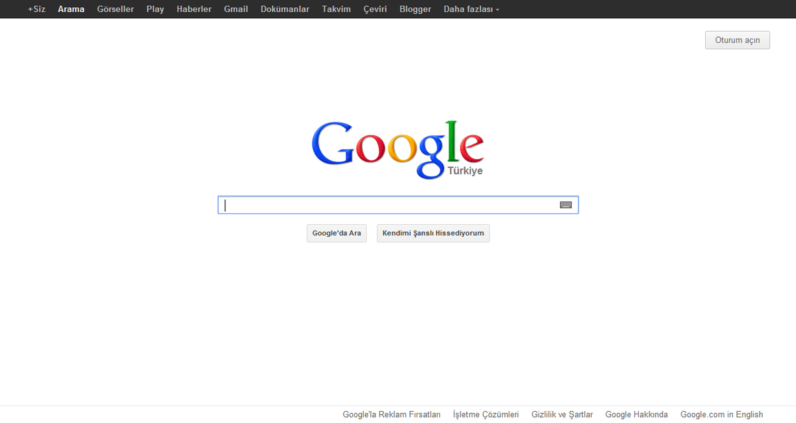{width=100%}

{width=100%}

Arama, bir metin kutusuna yazılan kelimelerin sıralı bir sonuç listesine dönüşmesidir.
:::

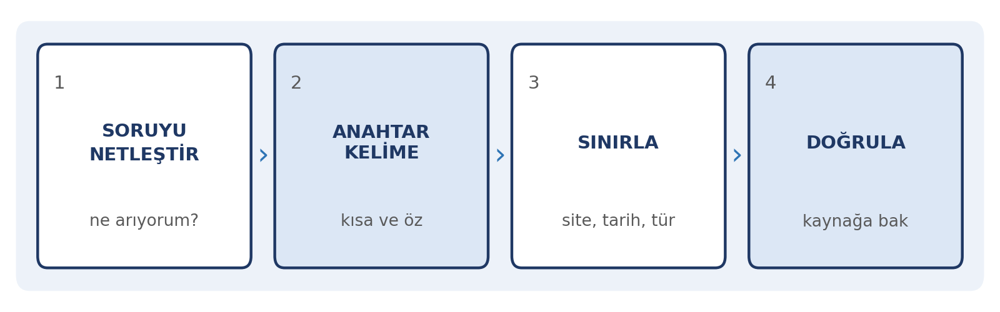{width=78%}

Dört adım, Şekil 1'deki arama kutusuna ne yazılacağını ve bulunan sonucun nasıl eleneceğini belirler.
Önce **soruyu netleştirirsiniz**: ne aradığınızı bir cümleyle söyleyebiliyorsanız doğru kelimeleri de
bulabilirsiniz. Sonra **anahtar kelime** seçilir; ardından sonuçlar **sınırlandırılır** — kurumsal bir
alan adı, bir dosya türü ya da bir tarih aralığı listeyi gözle görülür biçimde kısaltır. Son adım
**doğrulamadır**: bir sonucun listenin ilk sırasında çıkması, o bilginin doğru olduğu anlamına gelmez.

Bu adımlar tek turda bitmez. Boş ya da ilgisiz bir listeyle karşılaştığınızda sorun genellikle İnternet'te
aradığınız bilginin bulunmaması değil, yanlış soru kurmanızdır: başa dönüp soruyu ve anahtar kelimeleri
değiştirin. Doğrulama adımı ise aramayı kopyala-yapıştır işinden ayıran şeydir.

## Aramayı daraltma yolları

- **Anahtar kelime seçimi:** Uzun cümleler yerine ayırt edici kelimeler kullanın. "Nasıl ödev yazarım" yerine "akademik yazım kuralları".
- **Tırnak işareti:** `"tam ifade"` yazarak kelimelerin tam bu sırayla geçmesini istersiniz. Örneğin `"yapay zekâ okuryazarlığı"`.
- **Eksi işareti:** `-kelime` o kelimeyi sonuçlardan çıkarır. Örneğin `pardus -kurulum`.
- **Site sınırlaması:** `site:gov.tr` yazarak yalnızca o alan adındaki sonuçları görürsünüz; resmî bilgi ararken çok işe yarar.
- **Tür sınırlaması:** `filetype:pdf` yalnızca PDF sonuçları getirir; ders materyali veya rapor ararken kullanışlıdır.
- **Tarih sınırlaması:** Güncel bilgi gerektiğinde arama aracının tarih filtresini kullanın.

::: {.callout-tip}
## Dört adım bir arada: somut bir örnek

Sınav haftasında kütüphanenin kaçta açıldığını araştırdığınızı düşünün:

1. **Soruyu netleştirin:** "kütüphane açık mı" sorusu belirsizdir; hangi kütüphane ve hangi gün? Doğru soru: "Bilecik Üniversitesi kütüphanesi sınav haftasında kaçta açılıyor?"
2. **Anahtar kelimeyi seçin:** "kütüphane açık mı saat" gibi dağınık bir tamlama yerine ayırt edici kelimeler: `kütüphane çalışma saatleri`.
3. **Sınırlayın:** `site:bilecik.edu.tr` yazarak sonuçları üniversitenin sitesine indirin.
4. **Doğrulayın:** Sayfanın resmî kurum sitesinde olduğundan ve tarihin bu döneme ait olduğundan emin olun; bilgi eski bir duyuruda kalmış olabilir.
:::

## Kaynak değerlendirme

Karşılaştığınız her içerikte 1. haftanın **beş sorusunu** yeniden sorun: kaynağı, tarihini, kanıtı, amacı ve başka kaynakları sorgulayan bu sorular bir alışkanlığa dönüşmeli.

Beş soru şöyle:

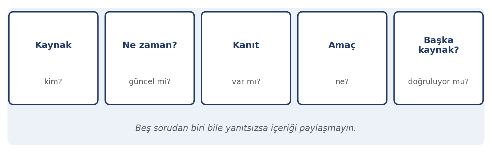{width=78%}

Kaynağa ulaşamıyorsanız ya da sorular yanıtısız kalıyorsa içeriği aktarmayın. Ödev ve araştırma için hangi kaynağa önce bakacağınız da bir sıra izler:

::: {.callout-tip}
## Akademik kaynak ararken

1. **Kütüphane veri tabanları ve akademik dergiler.** Üniversite kütüphanesinin abone olduğu, yalnızca kütüphane üzerinden erişilebilen çevrimiçi kaynak koleksiyonlarıdır; makaleler, tezler ve raporlar burada yer alır.
2. **Kurumsal ve resmî siteler** (`.edu.tr`, `.gov.tr`).
3. **Konusunda uzman kuruluşların yayınları** (ör. Dünya Sağlık Örgütü, Birleşmiş Milletler, OECD).
4. **Genel web siteleri ve haber siteleri.**
5. **Forumlar, sosyal medya, bloglar** (tek başına kaynak olarak kullanılmaz).
:::

# Dezenformasyon ve Sahte Haber

**Dezenformasyon**, kasıtlı olarak yanıltmak amacıyla üretilen yanlış bilgidir. Yanlış bilgi (misinformasyon) ile karıştırılır, ama fark önemlidir: dezenformasyonda **kötü niyet** vardır.

Uluslararası Kütüphane Dernekleri ve Kurumları Federasyonu'nun (IFLA) hazırladığı listeye dayanan aşağıdaki denetim listesi, bir içeriği paylaşmadan önce sorulması gereken soruları özetler:

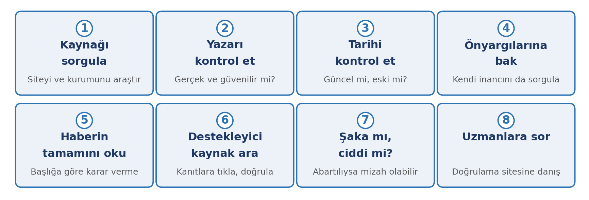{width=95%}

Kontrol listesi içeriğin kaynağını, yazarını ve tarihini sorgular; tamamını okumayı ve destekleyici kanıtlara bakmayı ister; bu, 1. haftanın beş sorusuyla aynı yaklaşımdır.

En sık karşılaşacağınız biçimler:

| Biçim | Ne yapar |
|:---|:---|
| **Başlık tuzağı** | Başlık, içeriğin söylemediği bir şeyi iddia eder |
| **Bağlamdan koparma** | Eski bir fotoğraf güncel olaymış gibi sunulur |
| **Sahte görsel** | Fotoğraf düzenlenir ya da başka olaydan alınır |
| **Yanlış alıntı** | Bir uzmana söylemediği söz atfedilir |
| **Sahte uzman** | Konuyla ilgisiz biri yetkili gibi gösterilir |

::: {.callout-warning}
## Paylaşmadan önce iki soru

1. **İçeriği kaynağından okudum mu?** Yalnızca başlığa bakıp paylaşmak, en yaygın hatadır.
2. **Tersine görsel arama yaptım mı?** Bir fotoğrafın daha önce başka bir bağlamda kullanılıp kullanılmadığını görmek için görsel arama kullanılabilir.

Yanıtı "hayır" ise **paylaşmayın**. Yanlış bilginin yayılmasına katkı, onu üretmek kadar zarar verir.
:::

# Elektronik Posta

**E-posta**, İnternet üzerinden mesaj ve dosya göndermenin en yaygın yoludur — özellikle kurumsal hayatta. Kurumsal bir e-posta, sizi ve kurumunuzu temsil eder.

## Adresin yapısı

Bir e-posta adresi, `@` işaretiyle iki yarıya ayrılır. Sol yarı **kullanıcı adıdır**: postanın o sunucuda kime teslim edileceğini belirtir. Sağ yarı **alan adıdır**: postanın hangi sunucuya, dolayısıyla hangi kuruma gideceğini belirtir.

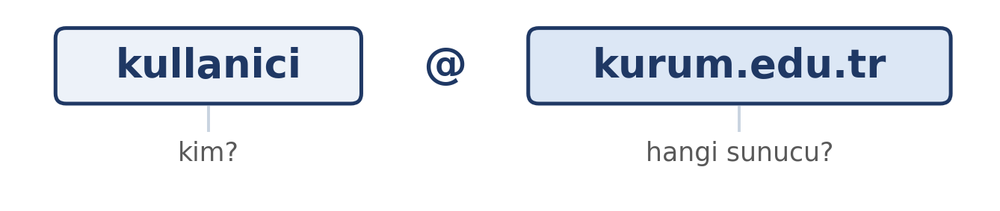{width=78%}

Alan adı ayrıca adresin hangi tür kuruma ait olduğunu da ele verir: `...edu.tr` ile biten bir adres bir eğitim kurumuna, `...gov.tr` ile biten bir adres bir kamu kurumuna aittir — kaynak değerlendirirken baktığımız aynı işaret. Adres benzersizdir ve kurumunuz tarafından verilir; kurumsal yazışmada kullanacağınız adres sizi ve kurumunuzu temsil eder.

## Bir e-postanın bölümleri

| Bölüm | Ne yazılır |
|:---|:---|
| **Alıcı (To)** | Mesajın asıl muhatabı |
| **Bilgi (CC)** | Bilgilendirilmek istenen, yanıt beklenmeyen kişiler |
| **Gizli (BCC)** | Adresleri diğer alıcılara görünmeyen kişiler |
| **Konu** | Kısa ve açıklayıcı başlık |
| **Gövde** | Hitap, mesaj, kapanış, imza |
| **Ek (attachment)** | Gönderilen dosyalar |

Bu bölümler bir e-posta penceresinde şöyle sıralanır:

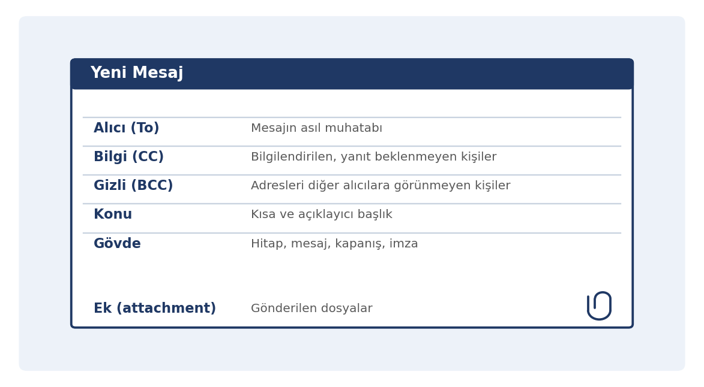{width=82%}

::: {.callout-warning}
## Gizli alıcı (BCC) ne zaman kullanılır?

Çok sayıda kişiye duyuru gönderiyorsanız adresleri **BCC** alanına yazabilirsiniz. Böylece herkes yalnızca kendi adresini görür, başkalarının adresini görmez.

Çok sayıda kişiyi **To** alanına yazmak, tüm alıcıların adreslerini başkalarına açıklamak anlamına gelir — bu bir gizlilik ihlalidir.
:::

## Kurumsal yazışma kuralları

- **Konu satırını boş bırakmayın.** "Toplantı hakkında" ile "Soru" arasındaki fark, e-postanın okunup okunmamasını belirler.
- **Hitap ile başlayın, kapanış ile bitirin.** "Sayın Hocam," / "Merhaba," … "Saygılarımla," / "İyi çalışmalar,".
- **Kısa ve net yazın.** Uzun paragraflar yerine madde madde.
- **Tam cümle kullanın.** Kurumsal yazışmada kısaltma ve emoji kullanılmaz.
- **Büyük harfle yazmayın.** Karşı taraf bunu bağırmak gibi algılar.
- **Yanıtla / Tümüne yanıtla ayrımına dikkat edin.** Yalnızca gönderene mi, tüm listeye mi yanıt veriyorsunuz?
- **Ek gönderiyorsanız dosya adını düzeltin.** `belge1.docx` yerine `enf101-odev-ad-soyad.docx`.
- **Büyük dosyaları ek olarak göndermeyin.** Posta sunucularının ek boyutu sınırı vardır (genellikle 20–25 MB); büyük bir dosyayı buluta yükleyip **bağlantısını** göndermek ya da sıkıştırmak daha güvenilirdir.
- **Göndermeden okuyun.** Yazım hatası ve yanlış alıcı, en sık yapılan iki hatadır.
- **İçeriğinden emin olmadığınız mesajı iletmeyin.** Zincirleme iletiler çoğu zaman yanlış bilgi taşır; iletirken alıcı listesini ve gereksiz ekleri temizleyin.

::: {.callout-tip}
## Yanıtlamadan önce düşünün

Tartışmalı bir e-postaya sinirliyken yanıt yazmak neredeyse her zaman pişmanlıkla biter. Taslağı yazın, kaydedin, yarım saat bekleyin, sonra okuyup gönderin. Kurumsal yazışma kayıt altındadır ve geri alınamaz.
:::

# E-posta Güvenliği

E-posta, saldırganların en çok kullandığı giriş kapısıdır. Tanımanız gereken işaretler:

| Şüpheli işaret | Neden şüpheli |
|:---|:---|
| **Acelen var** vurgusu | Baskı altında düşünmeden tıklamanızı ister |
| **Beklenmedik ek** | `.exe`, `.zip` gibi dosyalar zararlı olabilir |
| **Adres uyuşmazlığı** | Görünen ad doğru, arkasındaki adres farklı olabilir |
| **Yazım hataları** | Kurumsal e-postada beklenmez |
| **Bilgi isteği** | Kurumlar e-postayla parola sormaz |
| **Bağlantı adresi** | Bilgisayarda üzerine gelindiğinde gerçek adres görünür; yazılandan farklı olabilir. **Telefonda üzerine gelinemez**, bu yüzden bağlantıya tıklamadan önce adres çubuğunu okuyun |

Aşağıdaki örnek, sahte bir e-Devlet duyurusudur: iletide kurumun adı ve amblemi kullanılmış, kredi kartı aidat iadesi adı altında **para vaat edilmiş** ve işlemi tamamlamak için bir bağlantıya tıklamanız istenmiştir.

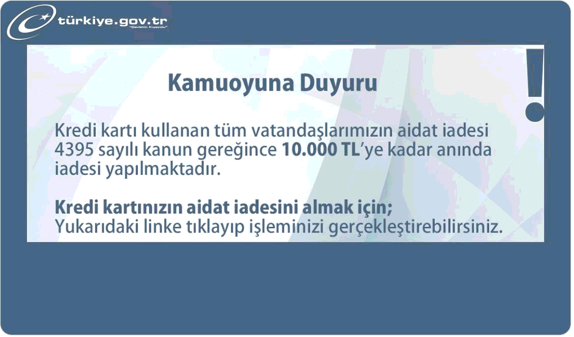{width=72%}

Bu örnekte birkaç şüpheli işaret bir arada: **gerçek olmayan bir kazanç** vaadi, işlemi **yalnızca verilen bağlantıdan** yapmaya yönlendirme ve acele ettirme. Gerçek e-Devlet size kendiliğinden böyle bir bildirim göndermez; böyle bir durumda bağlantıya tıklamadan doğrudan **turkiye.gov.tr** adresinden giriş yapıp ilgili hizmeti kendiniz kontrol edersiniz.

::: {.callout-warning}
## Şüphelendiğinizde ne yapmalısınız?

Ne eki açın ne de bağlantıya tıklayın. Gönderen ile başka bir kanaldan iletişime geçip doğrulayın. Kurumunuzdan geldiğini düşündüğünüz şüpheli bir e-postayı bilgi işlem birimine bildirin.

Unutmayın: oltalama saldırıları (phishing) genellikle sizi acele ettirir. **Acele ettiren her mesaj şüphelidir.**
:::

## E-posta gizli değildir

E-posta, yolda ve sunucularda **şifresiz** tutulabilir. Ağdaki biri ya da yanlış bir alıcı mesajınızı okuyabilir; kurumsal yazışmalar ayrıca **kayıt altındadır** ve sonradan silinse bile kurumda kalır.

Bu yüzden parola, kimlik numarası, banka bilgisi, sağlık verisi gibi bilgileri e-postayla göndermeyin; böyle bir bilgi gerekiyorsa güvenli bir kanal kullanın (10. hafta) ve kişisel veri kurallarına da dikkat edin (11. hafta).

## İstenmeyen posta (spam)

Adresiniz bir kez İnternet'te paylaşıldığında spam gönderenlerin adres listelerine düşer ve spam (istenmeyen toplu posta) gelmeye başlar:

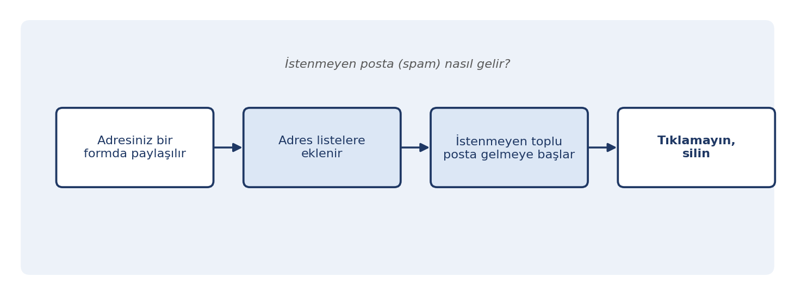{width=88%}

Yapılacaklar basittir:

- Mesajdaki bağlantılara **tıklamayın**, ekleri açmayın.
- Postayı **istenmeyen olarak işaretleyip silin**.
- "Listeden çık" bağlantısına **güvenmeyin**: tıklamanız adresinizin canlı olduğunu doğrular ve genellikle daha çok posta gelir.
- Kurumsal adresinizi alışveriş sitelerine ve formlara vermeyin.

# Dijital Kamu Hizmetleri ve e-Devlet

Kamu hizmetlerinin elektronik ortama taşınması, dijital dönüşümün en somut örneklerinden biridir. **e-Devlet**, farklı kurumların hizmetlerine tek bir giriş üzerinden erişmenizi sağlar: belge talebi, başvuru, sorgulama, ödeme.

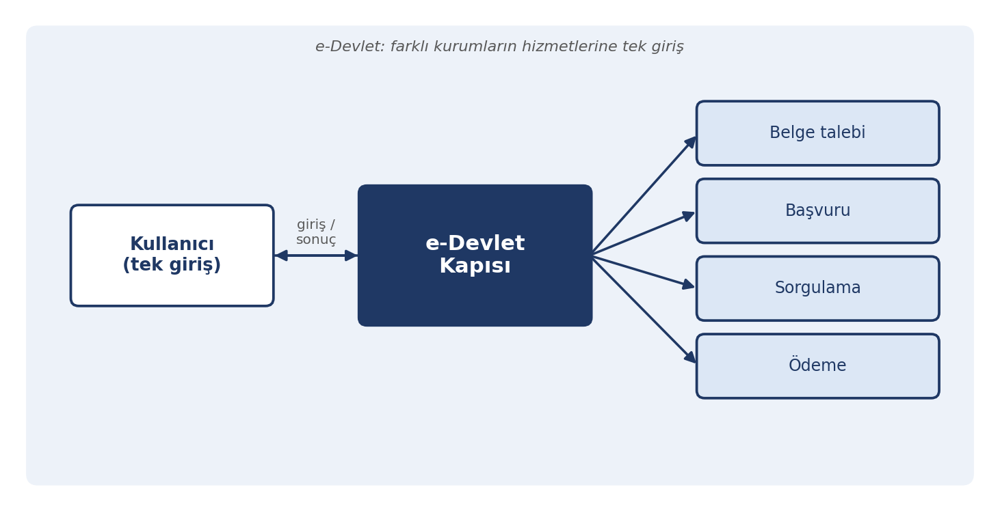{width=82%}

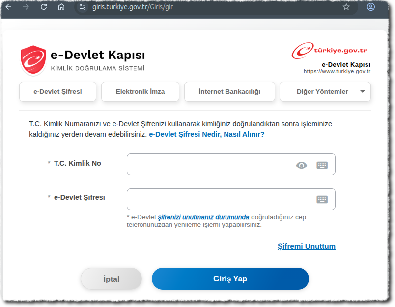{width=62%}

## Güvenli kullanım

- **Adresin doğruluğundan emin olun.** Giriş yapmadan önce adres çubuğunu kontrol edin; resmî site `gov.tr` uzantılıdır ve `https` ile şifrelidir.
- **Parolanızı kimseyle paylaşmayın.** Hiçbir kurum e-posta veya telefonla parola istemez.
- **Ortak cihazlarda oturumu kapatın.** Yalnızca sekmeyi kapatmak yetmez.
- **İşlem yaparken bağlantınıza dikkat edin.** Halka açık kablosuz ağlarda e-Devlet işlemi yapmayın; bu ağlarda trafik izlenebilir, işleminizi mobil veri üzerinden yapın.
- **Şüpheli bildirimlere karşı dikkatli olun.** e-Devlet üzerinden geldiği söylenen bağlantılar sahte olabilir; her zaman kendiniz giriş yaparak kontrol edin.

# e-imza ve İlgili Kavramlar

Kamu hizmetlerinde ve resmî işlemlerde karşınıza çıkacak üç farklı kavram vardır; bunları karıştırmamak önemlidir.

| Kavram | Ne yapar | Hukuki sonucu |
|:---|:---|:---|
| **e-Devlet şifresi** | Kimliğinizi doğrular (giriş aracı) | İmza yerine geçmez |
| **Mobil imza** | SIM kart üzerinden imzalar | Islak imza hükmündedir |
| **e-imza (nitelikli elektronik imza)** | USB token veya akıllı kart ile imzalar | Islak imza hükmündedir |

::: {#fig-imza-araclari layout-ncol=2}
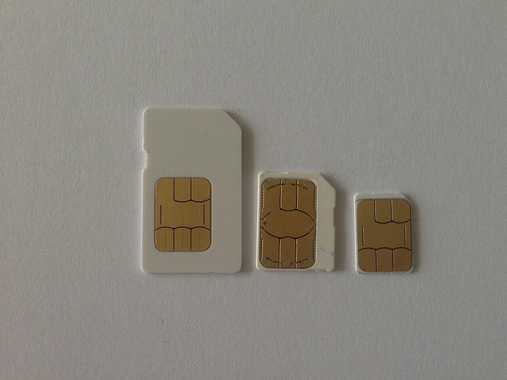{width=90%}

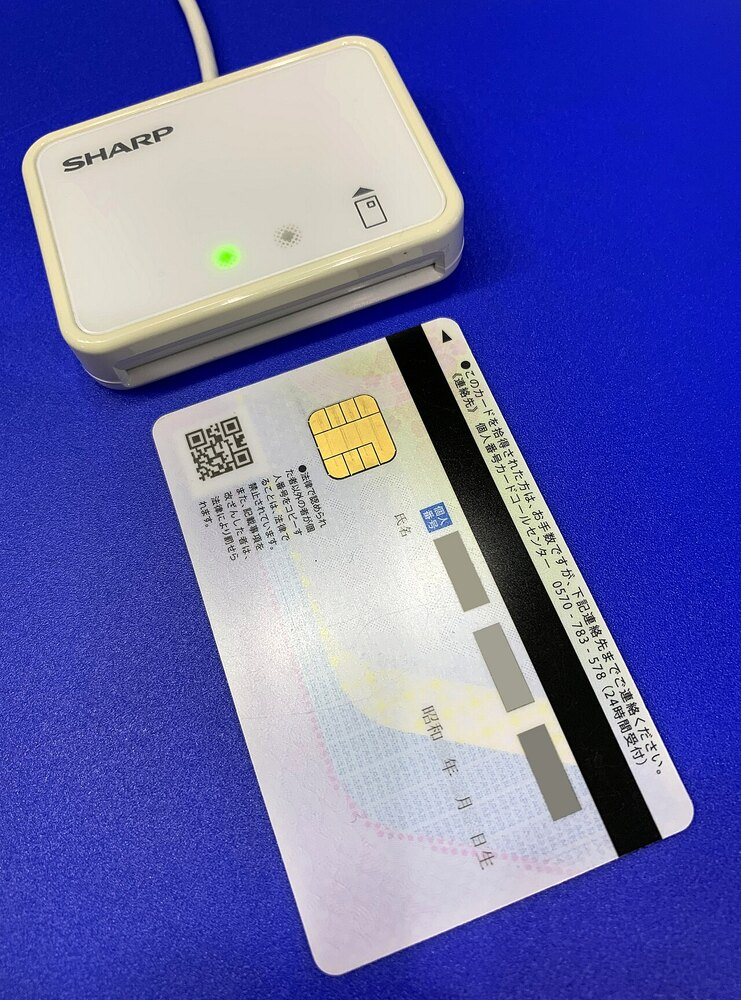{width=90%}

Mobil imza SIM kartı kullanır; e-imza ise akıllı kart ve onu okuyan bir cihazla atılır.
:::

::: {.callout-note}
## En sık karışan ayrım

**e-Devlet şifresi bir imza değildir.** Sisteme giriş yapmanızı sağlayan bir kimlik doğrulama aracıdır.

**e-imza ise hukuki bir imzadır.** Elektronik İmza Kanunu (5070) uyarınca ıslak imzayla aynı hukuki sonucu doğurur. Bir belgeyi e-imzayla imzaladığınızda, belgenin size ait olduğu ve sonradan değiştirilmediği doğrulanabilir.

Kurumlar belgeleri için e-imzanın kurumsal karşılığı olan **e-mühür**'ü kullanır; bu, bireylerin konusu değildir.
:::

# Uygulama: Bir Araştırmayı Doğrulayın

## Adım 1 — Bir iddia seçin

Son bir hafta içinde sosyal medyada ya da bir haber sitesinde gördüğünüz iddialı bir bilgi seçin.

## Adım 2 — Arama tekniklerini kullanın

Aynı konuyu üç farklı aramayla araştırın: bir kez normal, bir kez `site:gov.tr` veya `site:edu.tr` sınırlamasıyla, bir kez de `filetype:pdf` ile. Sonuçları karşılaştırın.

## Adım 3 — Kaynağı değerlendirin

Bulduğunuz kaynakları beş soruyla değerlendirin. İddia doğrulanıyor mu, çürütülüyor mu, yoksa belirsiz mi kalıyor?

## Adım 4 — Bir kurumsal e-posta yazın

Öğretim elemanınıza, konusunu belirttiğiniz kısa bir e-posta yazın. Konu satırı, hitap, gövde, kapanış ve imza kurallarına uyun. **Göndermeyin**; yalnızca taslağı yazın.

::: {.callout-tip}
## Teslim ve değerlendirme

Bu uygulama notla değerlendirilmez. Amacı, doğrulama ve yazışma becerilerini günlük hayatta kullanılır hâle getirmektir.
:::

# Özet

- **Etkili arama** dört adımdır: soruyu netleştir, anahtar kelime seç, sınırla, doğrula.
- Arama operatörleri (`"tam ifade"`, `-kelime`, `site:`, `filetype:`) sonuçları belirgin biçimde daraltır.
- **Dezenformasyon**, kötü niyetle üretilmiş yanlış bilgidir; kaynağa gitmeden paylaşmamak gerekir.
- E-postada **konu, hitap, kısa gövde, kapanış ve imza** bulunur; adres listesi için **BCC** kullanılır.
- Oltalama e-postaları genellikle **acele ettirir**; şüphelenildiğinde başka kanaldan doğrulanır.
- **e-Devlet** hizmetlerine doğru adresten, güvenli bağlantıyla girilir; ortak cihazlarda oturum kapatılır.
- **e-Devlet şifresi imza değildir**; **e-imza ve mobil imza** ıslak imza hükmündedir.

# Kendini Sınama Soruları

1. Arama yaparken tırnak işareti ve eksi işareti ne işe yarar?
2. Yalnızca resmî kurum sitelerinde arama yapmak için hangi operatörü kullanırsınız?
3. Dezenformasyon ile yanlış bilgi arasındaki fark nedir?
4. Bir içeriği paylaşmadan önce sorulacak iki soru nedir?
5. E-postada CC ve BCC arasındaki fark nedir; hangisi gizliliği korur?
6. Oltalama e-postalarının en belirgin ortak özelliği nedir?
7. e-Devlet şifresi ile e-imza arasındaki fark nedir?
8. Halka açık bir kablosuz ağda neden e-Devlet işlemi yapılmamalıdır?

# Kaynaklar

- **e-Devlet Kapısı** — kamu hizmetlerine tek noktadan erişim. (turkiye.gov.tr)
- **USOM** — oltalama ve siber güvenlik uyarıları. (usom.gov.tr)
- **BTK** — İnternet'in bilinçli ve güvenli kullanımına ilişkin yayınlar. (btk.gov.tr)
- **Kişisel Verileri Koruma Kurumu (KVKK)** — kişisel verilerin korunması ve gizlilik. (kvkk.gov.tr)

**Görsel kaynakları.** Bu haftanın şemaları dersin yazarı tarafından çizilmiştir; sahte haber denetim listesi IFLA'nın *How to Spot Fake News* listesinden uyarlanmıştır (IFLA, CC BY 4.0). Fotoğraflar Wikimedia Commons'tan alınmıştır; aşağıdaki görseller için kaynak gösterme zorunludur:

- SIM kart — *Formats de cartes SIM*, Bidouille82, CC BY-SA 3.0.
- Kart okuyucu — *IC Card Reader Writer RW-5100W*, Project Kei, CC BY-SA 4.0.
- Arama sonuçları listesi — *Search Engine Results Page (SERP) Graphic Illustration*, Muhammad Rafizeldi, CC BY 4.0.

Sahte e-Devlet duyurusu görseli, oltalama örneği olarak **temsilî biçimde** ders için hazırlanmıştır; gerçek bir kuruma ait değildir.

Haftaya özel ek okuma önerileri ve güncel bağlantılar, dersin çevrimiçi ortamında ayrıca paylaşılır.
