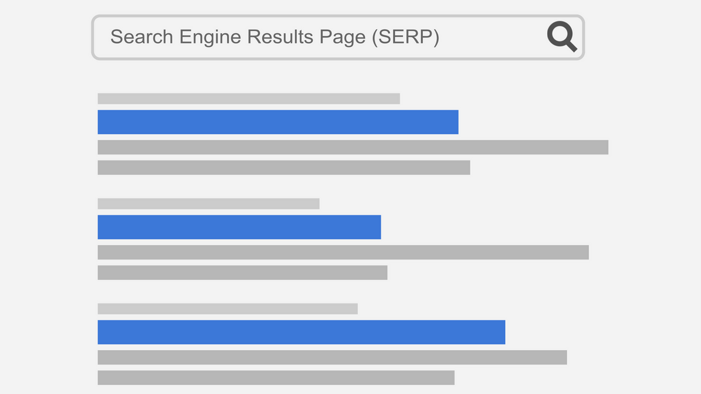
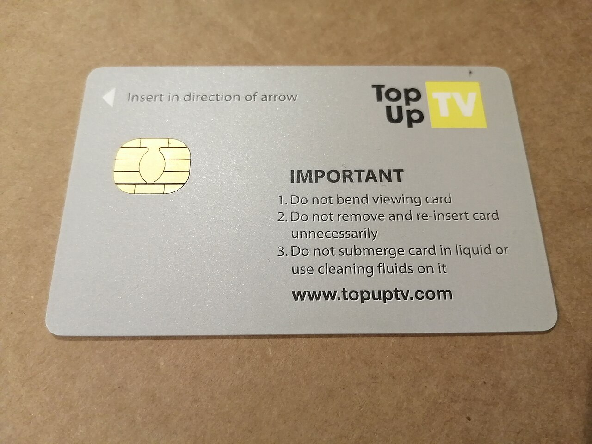

# Bu Haftanın Çerçevesi

## Öğrenme Çıktıları

- Etkili arama yöntemlerini kullanır.
- Bir çevrimiçi kaynağın güvenilirliğini değerlendirir.
- Dezenformasyonu ve sahte içeriği tanır.
- Elektronik postayı doğru yapıda yazar.
- Kurumsal yazışma kurallarını uygular.
- Oltalama saldırılarını fark eder.
- Dijital kamu hizmetlerini güvenli kullanır.
- e-imza ve ilgili kavramları ayırt eder.

# Etkili Arama

## Dört Adım

{width=78%}

## Arama Kutusu ve Sonuçlar

::: {.columns}
::: {.column width="50%"}
{width=100%}

*Google arama sayfası: sözcükler kutuya yazılır*
:::

::: {.column width="50%"}
{width=100%}

*Sonuç listesine dönüşür*
:::
:::

## Aramayı Daraltmanın Yolları

- **Anahtar kelime:** Uzun cümle yerine ayırt edici kelimeler
- **`"tam ifade"`:** Kelimeler tam bu sırayla geçsin
- **`-kelime`:** Bu kelimeyi çıkar
- **`site:gov.tr`:** Yalnızca o alan adında ara
- **`filetype:pdf`:** Yalnızca PDF getir
- **Tarih filtresi:** Güncel bilgi gerektiğinde

## Kaynak Değerlendirme

1\. haftadaki **beş soruyu** hatırlayın ve karşılaştığınız her içeriği aşağıdaki ölçütlerle sınayın.

{width=76%}

## Akademik Kaynak Önceliği

1. Kütüphane veri tabanları ve akademik dergiler
2. Resmî siteler (`.edu.tr`, `.gov.tr`)
3. Uzman kuruluşların yayınları
4. Genel web ve haber siteleri
5. Forumlar, sosyal medya, bloglar *(tek başına kaynak olmaz)*

# Dezenformasyon

## Dezenformasyon: Tanım ve Biçimler

**Dezenformasyon:** Yanıltmak amacıyla üretilmiş yanlış bilgi; farkı **kötü niyet**tir.

| Biçim | Ne yapar |
|:---|:---|
| Başlık tuzağı | Başlık, içeriğin söylemediği bir şeyi iddia eder |
| Bağlamdan koparma | Eski fotoğraf güncel gibi |
| Sahte görsel | Fotoğraf düzenlenir |
| Yanlış alıntı | Söylenmemiş söz atfedilir |
| Sahte uzman | İlgisiz kişi yetkili gibi |

## Paylaşmadan Önce İki Soru

1. **İçeriği kaynağından okudum mu?** Yalnızca başlığa bakıp paylaşmak, en yaygın hata.
2. **Tersine görsel arama yaptım mı?** Fotoğraf daha önce başka bir bağlamda kullanılmış olabilir.

Yanıt "hayır" ise **paylaşmayın**; yanlış bilginin yayılmasına katkı, onu üretmek kadar zarar verir.

## Sahte Haberi Fark Etme Listesi

Uluslararası Kütüphane Dernekleri ve Kurumları Federasyonu'nun (IFLA) listesinden uyarlanan sekiz madde:

\includegraphics[width=0.95\linewidth,height=0.72\textheight,keepaspectratio]{gorseller/diagram-sahte-haber-denetim.png}

# Elektronik Posta

## Adresin Yapısı

**E-posta**, kurumsal yazışmanın temel aracıdır; adresiniz sizi ve kurumunuzu temsil eder.

{width=72%}

- **@ işaretinin solu** kimi, **sağı** postanın hangi sunucuya gideceğini belirtir.
- Alan adı kurumu da belli eder: `...edu.tr` üniversite, `...gov.tr` kamu kurumu.
- Adres benzersizdir ve kurumunuz tarafından verilir — ciddi bir adres seçin (`ad.soyad` gibi).

## E-postanın Bölümleri

\includegraphics[width=0.92\linewidth,height=0.80\textheight,keepaspectratio]{gorseller/diagram-eposta-bolumler.png}

## BCC Ne Zaman Kullanılır?

Tanımadığınız çok sayıda kişiye duyuru gönderiyorsanız adresleri **BCC**'ye yazın.

Böylece herkes yalnızca kendi adresini görür.

**To** alanına liste yazmak, başkalarının adreslerini açıklamak demektir — gizlilik ihlali.

## Kurumsal Yazışma Kuralları

- **Konu satırını boş bırakmayın**
- **Hitap ve kapanış kullanın**
- **Kısa ve net yazın**
- **Tam cümle kurun** — kısaltma ve emoji olmaz
- **Büyük harfle yazmayın** — bağırmak gibi algılanır
- **Yanıtla / Tümüne yanıtla** ayrımına dikkat
- **Ek dosyayı adlandırın:** `belge1.docx` değil, `enf101-odev-ad-soyad.docx`
- **Göndermeden önce okuyun**

## Ekler ve İletme

- **Büyük dosyayı ek olarak göndermeyin** — sınır genellikle 20–25 MB; bulut bağlantısı ya da sıkıştırma kullanın
- **İçeriğinden emin olmadığınız mesajı iletmeyin** — zincirleme iletiler yanlış bilgi taşır
- İletirken **alıcı listesini ve gereksiz ekleri** temizleyin

**Sinirliyken yanıt yazmayın.** Taslağı yazın, kaydedin, yarım saat bekleyin, sonra gönderin. Kurumsal yazışma **kayıt altındadır** ve geri alınamaz.

# E-posta Güvenliği

## Şüpheli İşaretler

Sahte kurum adı altında ek açmanızı ya da bağlantıya tıklamanızı isteyen e-postalara **oltalama (phishing)** denir.

| İşaret | Neden şüpheli |
|:---|:---|
| "Acelen var" vurgusu | Düşünmeden tıklamanızı ister |
| Beklenmedik ek | `.exe`, `.zip` zararlı olabilir |
| Adres uyuşmazlığı | Görünen ad doğru, adres farklı |
| Yazım hataları | Kurumsal e-postada beklenmez |
| Bilgi isteği | Kurumlar parola sormaz |
| Bağlantı adresi | Bilgisayarda üzerine gelince gerçek adres görünür; telefonda üzerine gelinemez, tuzağa bu yüzden düşülür |

## Şüphelendiğinizde

- Ne eki açın ne bağlantıya tıklayın
- **Göndereni başka kanaldan arayıp doğrulayın**
- Kurumunuzun bilgi işlem birimine bildirin

**Acele ettiren her mesaj şüphelidir.**

## Örnek: Sahte e-Devlet Duyurusu

::: {.columns}
::: {.column width="58%"}
{width=100%}
:::

::: {.column width="42%"}
Gerçek kurum gibi görünür ama...

- **Para vaat eder:** "aidat iadesi 10.000 TL"
- **Bağlantıya yönlendirir:** "linke tıklayın"
- Gerçek e-Devlet **kendiliğinden bildirim göndermez**

**Bağlantıya tıklamayın; kendiniz giriş yapıp kontrol edin.**
:::
:::

## E-posta Gizli Değildir

- Yolda ve sunucularda **şifresiz** tutulabilir
- Yanlış alıcı ya da ağdaki biri okuyabilir
- Kurumsal yazışma **kayıt altındadır**

Parola, kimlik numarası, sağlık bilgisi e-postayla gönderilmez.

## İstenmeyen Posta (Spam)

- Adresiniz listelere girdiğinde spam gelmeye başlar
- Bağlantılara tıklamayın; **işaretleyip silin**
- "Listeden çık" bağlantısına güvenmeyin: adresinizin **canlı olduğunu doğrular**

{width=88%}

# Dijital Kamu Hizmetleri

## e-Devlet

Farklı kurumların hizmetlerine **tek giriş** üzerinden erişim: belge talebi, başvuru, sorgulama, ödeme.

Tek adres: **turkiye.gov.tr**

{width=75%}

## Güvenli Kullanım

- **Adresi kontrol edin:** `gov.tr` uzantılı ve `https`
- **Parolayı paylaşmayın:** Hiçbir kurum istemez
- **Ortak cihazda çıkış yapın:** Sekmeyi kapatmak yetmez
- **Halka açık ağda işlem yapmayın:** Mobil veri kullanın
- **Bildirimlere şüpheyle bakın:** Her zaman kendiniz giriş yapın

# e-imza

## Karşılaştırma

**Üçü farklı iş yapar:** biri sisteme giriş aracı, ikisi hukuken imza sayılır.

| Kavram | Ne yapar | Hukuki sonuç |
|:---|:---|:---|
| e-Devlet şifresi | Kimlik doğrular | İmza değildir |
| Mobil imza | SIM üzerinden imzalar | Islak imza hükmünde |
| e-imza | USB token / akıllı kart | Islak imza hükmünde |

## İmza Araçları

{width=30%} {width=30%} {width=20%}

Mobil imza SIM kartı, e-imza akıllı kart (veya USB token) kullanır.

## En Sık Karışan Ayrım

**e-Devlet şifresi bir imza değildir.** Sisteme giriş aracıdır.

**e-imza hukuki bir imzadır.** 5070 sayılı Elektronik İmza Kanunu uyarınca ıslak imzayla aynı sonucu doğurur.

İmzalanan belgenin kime ait olduğu ve sonradan değiştirilmediği doğrulanabilir.

::: {.callout-warning}
**e-Devlet şifresi imza yerine geçmez.** Şifre yalnızca kimliğinizi doğrular; bir belgeyi hukuken imzalamak için e-imza veya mobil imza gerekir.
:::

Kurumlar belgeleri için **e-mühür**'ü kullanır; bu, bireylerin konusu değildir.

# Kapanış

## Uygulama: Bir Araştırmayı Doğrulayın

1. Son bir haftada gördüğünüz iddialı bir bilgiyi seçin
2. Üç farklı aramayla araştırın (normal, `site:gov.tr`, `filetype:pdf`)
3. Kaynakları beş soruyla değerlendirin
4. Öğretim elemanınıza bir e-posta **taslağı** yazın (göndermeyin)

Notla değerlendirilmez.

## Özet

- **Etkili arama**: netleştir, anahtar kelime, sınırla, doğrula
- **Dezenformasyon**: içeriği kaynağından okumadan paylaşmayın
- **E-posta**: konu, hitap, kısa gövde, kapanış, imza
- **BCC**: adres gizliliği için
- **Oltalama**: acele ettirir; başka kanaldan doğrula
- **e-Devlet şifresi imza değildir**; e-imza hukuki imzadır

## Gelecek Hafta

**Kelime işlemci** — biçimlendirme, stiller, tablo ve görsel, sayfa düzeni, uzun belge yönetimi, akademik dürüstlük ve kaynak gösterme.
