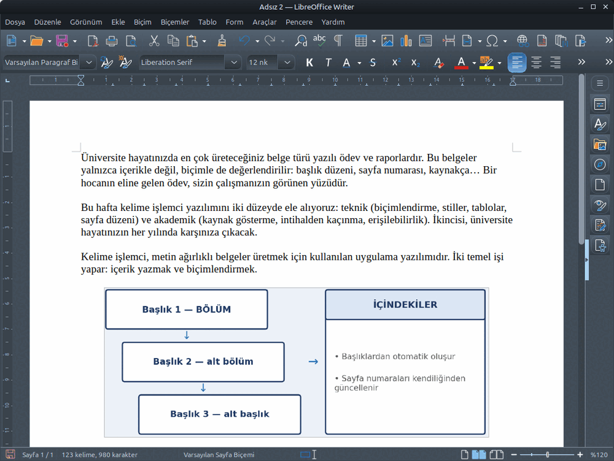
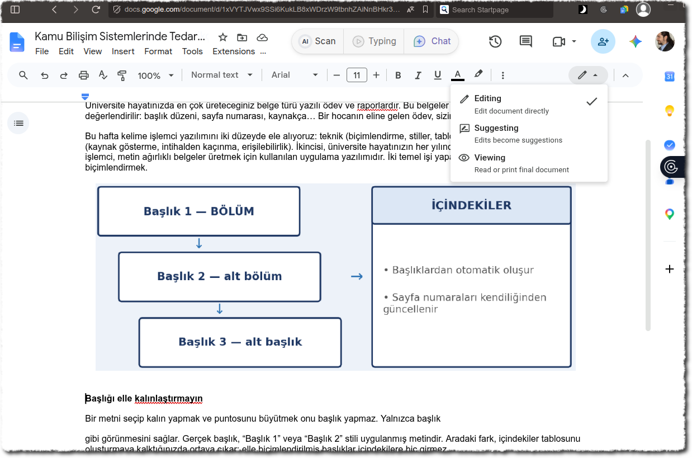
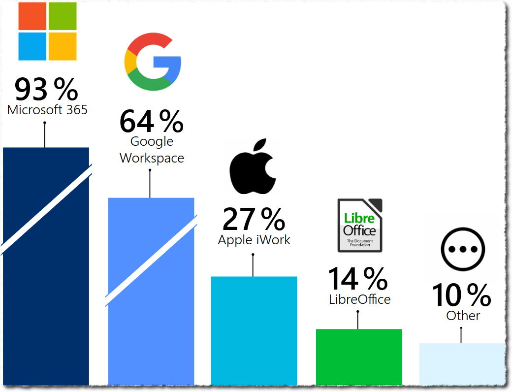
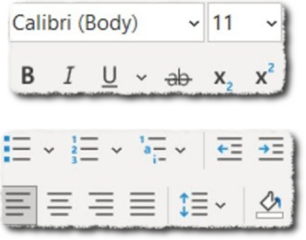
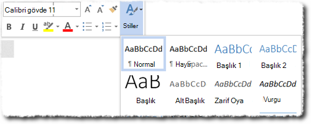
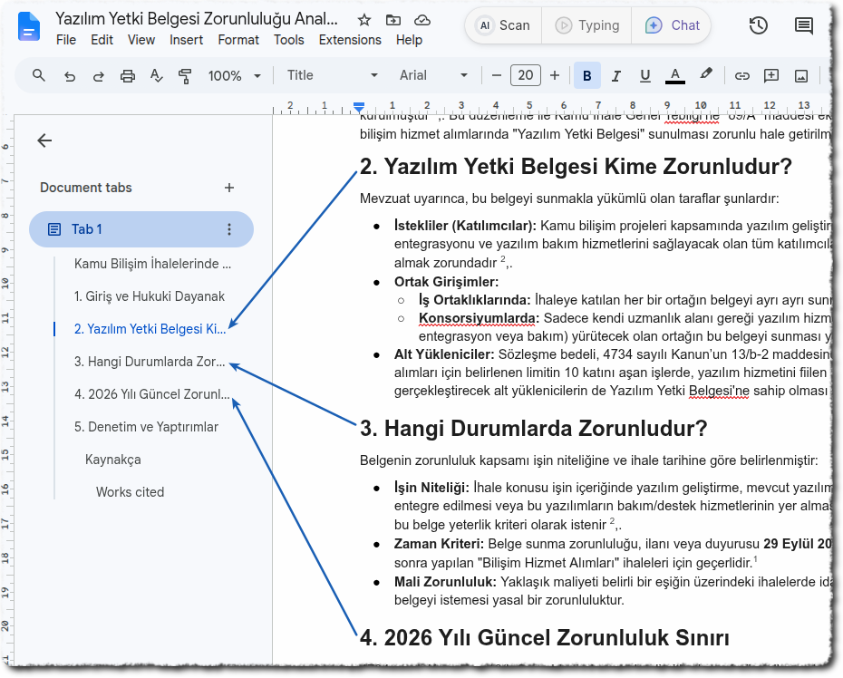
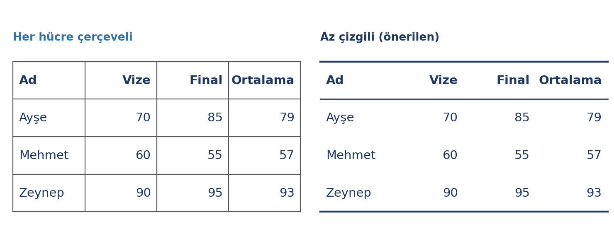
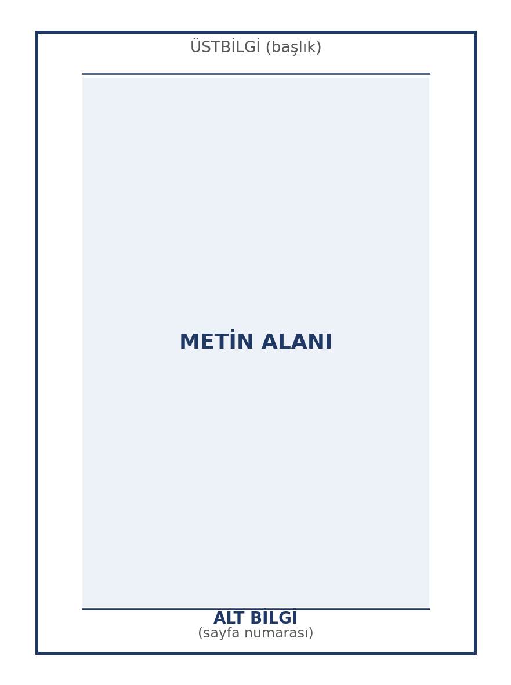
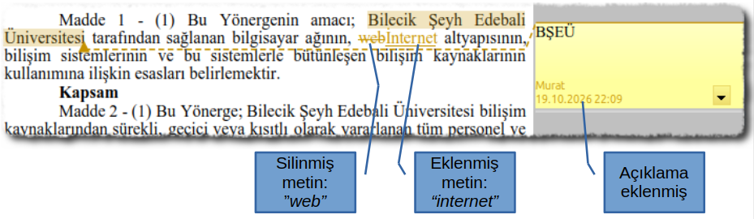

# Giriş

Üniversite hayatınızda en çok üreteceğiniz belge türü **yazılı ödev ve raporlardır**. Bu belgeler yalnızca içerikle değil, **biçimle** de değerlendirilir: başlık düzeni, sayfa numarası, kaynakça… Bir hocanın eline gelen ödev, sizin çalışmanızın görünen yüzüdür.

Bu hafta kelime işlemci yazılımını iki düzeyde ele alıyoruz: **teknik** (biçimlendirme, stiller, tablolar, sayfa düzeni) ve **akademik** (kaynak gösterme, intihalden kaçınma, erişilebilirlik). İkincisi, üniversite hayatınızın her yılında karşınıza çıkacak.

::: {.callout-note}
## Bu haftanın temel fikri

Kelime işlemciyi kullanmak, yazı yazmaktan fazlasıdır. **Stillerle** çalışmak, belgeyi elle biçimlendirmekten hem hızlı hem de güvenilirdir — üstelik içindekiler tablosu gibi şeyler ancak böyle çalışır.
:::

# Bu Haftanın Öğrenme Çıktıları

- Belge oluşturur, kaydeder ve farklı biçimlerde dışa aktarır.
- Metin ve paragraf biçimlendirmesini amaca uygun kullanır.
- Stilleri kullanarak başlık hiyerarşisi kurar.
- Tablo ve görsel ekler, sayfa düzenini ayarlar.
- Uzun belgelerde içindekiler, dipnot ve kaynakça oluşturur.
- Akademik dürüstlük ilkelerini uygular ve kaynak gösterir.
- Erişilebilir belge hazırlar.

# Temel Kavramlar

Kelime işlemci, metin ağırlıklı belgeler üretmek için kullanılan uygulama yazılımıdır. İki temel işi yapar: **içerik yazmak** ve **biçimlendirmek**.

{width=64%}

{width=64%}

{width=80%}

## Masaüstü sürüm, çevrimiçi sürüm

Bu tarz uygulamaların bazıları kendi **bilgisayarınıza kurularak** kullanılır; bazıları ise doğrudan **web üzerinden** (bulut, çevrimiçi, online) çalışır — tarayıcı yeterlidir, kurulum gerekmez. İkisi de **benzer temel işlevleri** sunar; özellikler, dosya uyumluluğu ve çevrimdışı çalışma desteği yazılıma göre değişir.

| | Masaüstü sürüm | Çevrimiçi sürüm |
|:---|:---|:---|
| Kurulum | Gerekir | Gerekmez; tarayıcı yeter |
| İnternet | Gerekmez | Genellikle gerekir |
| Erişim | Yalnızca o belgeyi açan bilgisayardan | Hesabınıza girebildiğiniz her cihazdan |
| Ortak çalışma | Sınırlı | Aynı anda birden çok kişi |
| Verinin yeri | Kendi bilgisayarınız | Hizmeti sunan şirketin sunucuları |

Çevrimiçi sürümler grup ödevlerinde ve okul ile ev arasında geçiş yaparken çok kullanışlıdır. Ancak çevrimiçi uygulamalarda belge **karşıdaki sunucuda durur**; hizmeti sunan şirketin sunucularında tutulur. Bu yüzden kişisel veya gizli bilgi içeren belgelerde dikkatli olun (11. hafta) ve çevrimiçi çalıştığınız belgelerin yerel bir kopyasını da bulundurun (4. hafta).

Ücretsiz seçenekler var: tarayıcıda çalışan **Google Docs** ya da bilgisayarınıza kurabileceğiniz **LibreOffice Writer**. İkisi de bu bölümdeki konuların hepsini destekler — stiller, içindekiler tablosu, dipnot. Menü adları farklıdır ama kavramlar aynıdır.

Aynı ayrım 8. haftadaki tablo (**Google Sheets**, **LibreOffice Calc**) ve 9. haftadaki sunum (**Google Slides**, **LibreOffice Impress**) uygulamaları için de geçerlidir.

## Kullanım oranları

Empower tarafından yayımlanan *The 2025 Office Study* araştırmasında, ABD'de en az 50 çalışanı bulunan işletmelerde görev yapan çalışanların **%93'ü Microsoft 365**, **%64'ü Google Workspace** ve **%14'ü LibreOffice** kullandığını bildirmiştir. Katılımcıların birden fazla yazılımı işaretleyebilmesi nedeniyle bu oranlar birbirini dışlayan pazar payları olarak değerlendirilmemelidir (Empower, 2025).

{width=65%}

## Belge ve biçimlendirme kavramları

| Kavram | Anlamı |
|:---|:---|
| Belge | Oluşturduğunuz dosya (`.docx` gibi) |
| Karakter biçimi | Yazı tipi, boyutu, kalın/italik, rengi |
| Paragraf biçimi | Hizalama, satır aralığı, girinti, boşluk |
| Stil | Adlandırılmış biçim kümesi (Başlık 1, Normal…) |
| Sayfa düzeni | Kenar boşlukları, yön, sayfa boyutu |

**Kaydetme ve biçimler.** Belgenizi genellikle **`.docx`** (Microsoft Word'ün biçimi) ya da **`.odt`** (LibreOffice gibi açık kaynak paketlerin OpenDocument biçimi) olarak kaydedersiniz; ikisi de düzenlenebilir kalır ve birbirine çevrilebilir. Paylaşırken ise sıklıkla **PDF**'e çevirmeniz gerekir. PDF, belgenin görünümünü farklı cihazlarda büyük ölçüde korur ve düzenlenmesi zordur — bu yüzden ödev tesliminde tercih edilir.

::: {.callout-tip}
## Belgeyi sık sık kaydedin

Kelime işlemcilerin çoğu otomatik kaydetme sunar; açık olduğundan emin olun. Kritik bir belgeyi yazarken ara ara `Ctrl + S` alışkanlığı, saatlerce süren çalışmayı kurtarır.
:::

# Metin ve Paragraf Biçimlendirme

**Karakter düzeyinde** yapılan biçimlendirme: yazı tipi, punto, kalın, italik, altı çizili, renk.

**Paragraf düzeyinde** yapılan biçimlendirme: hizalama (sol, orta, sağ, iki yana), satır aralığı, paragraf öncesi/sonrası boşluk, girinti, madde işaretleri ve numaralandırma.

::: {.callout-warning}
## Biçimlendirmede tutarlılık

Aynı belgede farklı yazı tipleri, farklı puntolar ve farklı aralıklar kullanmak belgeyi dağınık gösterir. Bir kez karar verin ve belge boyunca ona sadık kalın.

En kolay yol **stiller** kullanmaktır — bir sonraki bölümde göreceğiz.
:::

{width=52%}

# Stiller ve Başlık Hiyerarşisi

**Stil**, bir dizi biçim ayarının adlandırılmış hâlidir. Örneğin "Başlık 1" stili, belirli bir yazı tipi, punto, kalınlık ve boşluk ayarını içerir.

{width=70%}

## Neden stiller?

- **Hız:** Metni seçip stil uygulamak, on ayarı elle değiştirmekten hızlıdır.
- **Tutarlılık:** Aynı stildeki bütün başlıklar aynı görünür.
- **Yapı:** Kelime işlemci metnin hangi parçasının başlık, hangisinin gövde olduğunu **bilir**. PDF'e aktarırken başlık yapısının korunması için **etiketli PDF** seçeneğini kullanın.
- **İçindekiler tablosu:** Başlıklara göre otomatik olarak oluşturulur; bu tablo yalnızca stiller kullanıldığında çalışır.

{width=62%}

{width=76%}

::: {.callout-warning}
## Başlığı elle kalınlaştırmayın

Bir metni seçip kalın yapmak ve puntosunu büyütmek onu **başlık yapmaz**. Yalnızca başlık gibi *görünmesini* sağlar.

Gerçek başlık, "Başlık 1" veya "Başlık 2" stili uygulanmış metindir. Aradaki fark, içindekiler tablosunu oluşturmaya kalktığınızda ortaya çıkar: elle biçimlendirilmiş başlıklar içindekilere **hiç girmez**.
:::

# Tablo ve Görsel Ekleme

## Tablolar

Tablolar, karşılaştırmalı bilgi sunmanın en etkili yoludur. Bir tabloda bulunması gerekenler:

- **Başlık satırı:** Her sütunun ne içerdiğini söyler.
- **Tutarlı hizalama:** Metin sola, sayılar sağa.
- **Ölçülü çizgiler:** Her hücreyi çerçevelemek yerine az sayıda yatay çizgi kullanmak daha okunur olur.

{width=72%}

## Görseller

Görsel eklerken dikkat edilecekler:

- **Çözünürlük:** Ekranda iyi görünen bir görsel, basıldığında bulanık çıkabilir.
- **Boyut:** Görseli eklerken **en-boy oranını koruyun**; düşük çözünürlüklü bir görseli büyütmek onu bulanıklaştırır.
- **Konumlandırma:** Metinle görselin ilişkisi (üstünde, altında, yanında) belirlenmelidir.
- **Altyazı:** Her görsele numara ve açıklama ekleyin (Şekil 1: …). Metinde bu numaraya atıf yapın.
- **Telif:** Başkasının görselini kullanıyorsanız kaynak göstermelisiniz.

# Sayfa Düzeni

{width=32%}

Sayfa düzeninde ayarlanacak temel öğeler:

| Öğe | Ne yapar |
|:---|:---|
| Kenar boşlukları | Metnin sayfa kenarıyla arasındaki boşluk |
| Yönlendirme | Dikey (portre) veya yatay (manzara) |
| Sayfa boyutu | A3, A4, A5, vb. |
| Üstbilgi / altbilgi | Her sayfada tekrarlanan bilgi |
| Sayfa numarası | Genellikle altbilgiye eklenir |

Yeni sayfaya geçmek için art arda `Enter`'a basmak yerine **sayfa sonu** kullanın; farklı numaralandırma ya da yön gereken yerlerde **bölüm sonu** gerekir. Bu ayrım, sayfa numaralarının istediğiniz yerden başlamasını da sağlar.

::: {.callout-tip}
## Sayfa numarası neden gerekli?

Sayfa numarası olmayan bir ödevde hocanın "3. sayfadaki tabloya bakın" demesi mümkün değildir. Sayfa numarası, belgeyi **başvurulabilir** kılar.

Sayfa numarasıyla birlikte **sayfa sayısı** da yazılırsa (ör. *Sayfa: 3/12*) okuyucu belgenin uzunluğunu da görür.

Kapak sayfasında numara görünmemesi isteniyorsa, numaralandırma ikinci sayfadan başlatılabilir.
:::

# Uzun Belge Yönetimi

Uzun belgelerde tutarlı biçimlendirme, kolay gezinme ve otomatik güncelleme önemlidir. Başlık stilleri, sayfa numaraları, içindekiler tablosu ve kaynakça gibi özellikler belge yönetimini kolaylaştırır; bu özellikler belgenin türüne ve ihtiyacına göre kullanılır.

Stiller bölümünde anlatılan **başlık stilleri** belgenin yapısını kurar, sayfa düzeni bölümündeki ayarlar da sayfa numaralarını ve yerleşimi belirler. Bu bölüm o temellerin üzerine kurulur.

## İçindekiler tablosu

Başlık stillerini kullanarak yazdıysanız, **içindekiler tablosu** tek komutla oluşturulur ve belge değiştikçe güncellenebilir. Elle yazılan içindekiler, sayfa numaraları değiştiğinde yanlış hâle gelir.

**Şekiller ve tablolar listesi.** Altyazı eklediğiniz şekil ve tablolar için de birer liste oluşturulabilir. Bu listeler **altyazılardan** üretilir; altyazısı olmayan bir öğe listede görünmez.

## Dipnot

Sayfa altına düşülen kısa açıklama veya kaynak notudur. Metnin akışını bozmadan ek bilgi vermenin yoludur. Dipnot, her durumda kaynak göstermenin yerine geçmez; kullanılan atıf yöntemine uyulmalıdır.

## Kaynakça

Yararlandığınız kaynakların belge sonunda listelendiği bölümdür. Kaynakçadaki her giriş, metin içinde mutlaka anılmalıdır — ve tersi de geçerlidir.

## Değişiklikleri izleme

Belgenin uzunluğuyla ilgili değildir ama bir belgeyi başkasıyla paylaşıp üzerinde çalıştığınızda bu özellik gerekir. **Değişiklikleri izleme** açıkken yapılan her ekleme ve silme işaretlenir; siz bunları **kabul** ya da **reddedebilirsiniz**.

İki durumda işe yarar:

- **Danışman veya hoca düzeltmeleri:** Metninizde yapılan değişiklikleri görür, katılmadıklarınızı reddedersiniz.
- **Grup ödevi:** Kimin neyi değiştirdiği kayıtlı kalır.

**Yorumlar** da metni doğrudan değiştirmeden geri bildirim vermeyi sağlar.

{width=70%}

## Belgeyi son hâline getirme

Belge tamamlandığında **içindekiler tablosu** ve **sayfa numaraları** güncellenmeli, yazım denetimi yapılmalı ve sayfa düzeni gözden geçirilmelidir. Belgenin farklı bilgisayarlarda aynı görünmesi için **PDF**'e aktarmak güvenlidir.

Teslimden önce belgede **kabul ya da reddedilmemiş değişiklik** ve **çözülmemiş yorum** kalmadığından emin olun; çoğu kurum bunu son okuma adımı olarak ister.

# Akademik Dürüstlük ve Kaynak Gösterme

Bu bölüm, akademik çalışmalarda güvenilirliğin ve etik sorumluluğun temelini oluşturur.

{width=76%}

## İntihal nedir?

**İntihal**, başkasının fikrini, cümlesini veya eserini **kaynak göstermeden** kendi çalışmanız gibi sunmaktır. Kasıtlı yapılabileceği gibi dikkatsizlikten de kaynaklanabilir; her iki durumda da akademik dürüstlük açısından sorun oluşturur. Değerlendirme ve yaptırımlar kurumun kurallarına göre değişir.

::: {.callout-warning}
## İntihal yalnızca kopyala-yapıştır değildir

Şu durumlar da intihaldir:

- Bir cümleyi birkaç kelimesini değiştirerek kaynak göstermeden kullanmak
- Bir kaynaktaki fikri kendi cümlelerinizle anlatıp kaynağı belirtmemek
- Başkasına ait görsel, tablo veya verileri kaynak göstermeden kullanmak
- Başkasının ödevini veya çalışmasını kendi adınıza teslim etmek
- Yapay zekâ ile üretilmiş içeriği, dersin veya kurumun kurallarına aykırı biçimde kendi çalışmanız gibi sunmak

**Doğru yol:** Doğrudan alıntı yapıyorsanız tırnak içinde gösterip kaynak belirtin; bir fikri kendi cümlelerinizle anlatıyorsanız yine kaynak gösterin.
:::

## Kaynak nasıl gösterilir?

Bir kaynağı gösterirken şu bilgiler gerekir:

- **Yazar veya sorumlu kurum**
- **Eserin başlığı**
- **Yayın yılı veya tarihi**
- **Sayfa numarası** (özellikle doğrudan alıntılarda)
- **Yayıncı, dergi veya web sitesi**
- **DOI veya web adresi** (varsa)

Metin içinde kısa atıf yapılır, belge sonunda ayrıntılı künye verilir. Hangi biçimin kullanılacağı (APA, MLA, IEEE gibi) bölümünüzün kurallarına göre belirlenir; **önemli olan tutarlılıktır**.

Aşağıdaki tablo, aynı kaynağın üç yaygın biçimde nasıl gösterildiğini karşılaştırır:

| Atıf Biçimi | Odak Alanı | Metin İçi Atıf | Kaynakça Gösterimi |
| :--- | :--- | :--- | :--- |
| **APA** | Sosyal bilimler | (Yılmaz, 2023, s. 45) | Yılmaz, A. (2023). *Dijital çağda bilgi yönetimi*. Bilge Yayınları. |
| **MLA** | Beşeri bilimler | (Yılmaz 45) | Yılmaz, Ahmet. *Dijital Çağda Bilgi Yönetimi*. Bilge Yayınları, 2023. |
| **IEEE** | Mühendislik ve teknoloji | [1, s. 45] | [1] A. Yılmaz, *Dijital Çağda Bilgi Yönetimi*. İstanbul: Bilge Yayınları, 2023. |

**Temel kural:** Metindeki atıflar ile kaynakça birbiriyle tutarlı olmalıdır. Kaynakça eklemek, metin içinde gerekli atıfları yapmanın yerine geçmez. Kaynağın güvenilirliğini değerlendirme **6. haftada**, yapay zekâya ilişkin kurallar **13. haftada** ele alınıyor.

## Kaynak yönetimi araçları

Kaynakları elle listelemek, sayıları arttıkça zorlaşır. **Ücretsiz kaynak yönetimi araçları** (örneğin **Zotero** ve **Mendeley**) şunları yapar:

- Web sayfasından kaynağı tek tıkla kaydeder
- Metin içi atıfları otomatik oluşturur
- Kaynakçayı istediğiniz biçimde üretir
- Yazdığınız belgeyle bütünleşir

**Zotero** açık kaynak bir araçtır; **Mendeley** ise ücretsiz ama kapalı kaynak bir araçtır. İkisi de aynı işi yapar; seçim size kalır.

**Unutmayın:** Bu araçlar atıfları düzenlemeye yardımcı olur; yanlış künyeleri, eksik atıfları veya intihali kendiliğinden önlemez. Ürettikleri kaynakça mutlaka kontrol edilmelidir.

# Erişilebilir Belge Hazırlama

Hazırladığınız belgeyi yalnızca siz okumayacaksınız. Göz sağlığı sorunu yaşayan, ekran okuyucu kullanan ya da farklı bir cihazda açan kişiler için belgeyi **erişilebilir** kılmak gerekir.

- **Gerçek başlık stilleri kullanın:** Ekran okuyucular belgeyi başlıklara göre gezinir.
- **Görsellere alternatif metin ekleyin:** Görselin ne anlattığını kısa biçimde yazın.
- **Yalnızca renkle anlatmayın:** "Kırmızı satırlar hatalıdır" demek yerine metinle de belirtin.
- **Okunabilir punto kullanın:** Gövde metni için 11–12 punto uygundur.
- **Yeterli kontrast sağlayın:** Açık gri metin beyaz zeminde okunmaz.
- **Tablolarda başlık satırı tanımlayın.**

::: {.callout-note}
## Alternatif metin (alt text)

Bir resmi belgeye eklediğinizde, "bu resim ne anlatıyor?" sorusunun kısa yanıtını bir alana yazabilirsiniz. Görmeyen bir okuyucu için belge bu sayede anlamlı olur.

Örnek: "2019–2026 yılları arasında öğrenci sayısının sürekli arttığını gösteren çizgi grafik."
:::

# Uygulama: Kendi Ödevinizi Biçimlendirin

**Hangi araçla:** tarayıcıda çalışan ücretsiz bir araç (Google Docs gibi) ya da bilgisayarınıza kurulabilen ücretsiz bir paket (LibreOffice Writer gibi). Aşağıdaki adımlar ikisinde de aynıdır.

## Adım 1 — Kısa bir belge yazın

Yaklaşık bir sayfalık bir metin yazın. En az üç başlık kullanın ve bunları **stil** olarak uygulayın (elle kalınlaştırmayın).

## Adım 2 — Yapıyı tamamlayın

Belgeye bir tablo ve bir görsel ekleyin. Görsele altyazı yazın ve metinde ona atıf yapın. **Sayfa numarası** ekleyin.

## Adım 3 — İçindekiler oluşturun

Stilleri kullandıysanız içindekiler tablosunu oluşturun. Çalışıyor mu? Çalışmıyorsa hangi başlığı stil olarak uygulamayı unuttunuz?

## Adım 4 — Kaynak gösterin

Metninize bir alıntı ekleyin ve kaynağını hem metin içinde hem belge sonunda gösterin.

## Adım 5 — Erişilebilirliği kontrol edin

Görselinize alternatif metin ekleyin. Belgeyi PDF olarak kaydedin.

::: {.callout-tip}
## Teslim ve değerlendirme

Bu uygulama notla değerlendirilmez. Amacı, uzun belge üretiminin bütün adımlarını bir kez baştan sona deneyimlemenizdir.
:::

# Özet

- Kelime işlemci iki iş yapar: **içerik yazmak** ve **biçimlendirmek**.
- **Karakter** ve **paragraf** düzeyinde biçimlendirme ayrı ayrı yapılır.
- **Stiller**, elle biçimlendirmeye göre daha hızlı ve tutarlıdır; **içindekiler tablosu yalnızca stillerle** çalışır.
- Uzun belgelerde **içindekiler, dipnot ve kaynakça** belgenin türüne göre kullanılır.
- **İntihal**, kaynak göstermeden başkasının çalışmasını kullanmaktır; yalnızca kopyala-yapıştır değildir.
- **Kaynak yönetimi araçları**, kaynak göstermeyi kolaylaştırır; ama intihali kendiliğinden önlemez.
- **Erişilebilir belge**, gerçek başlık stilleri, alternatif metin ve yeterli kontrastla hazırlanır.

# Kendini Sınama Soruları

1. Bir metni elle kalınlaştırmak ile "Başlık 1" stili uygulamak arasındaki fark nedir?
2. İçindekiler tablosu neden yalnızca stillerle çalışır?
3. İntihalin kopyala-yapıştır dışındaki iki biçimini yazın.
4. Kaynak gösterirken hangi bilgiler yer almalıdır?
5. Kaynak yönetimi araçları ne işe yarar; neyi kendiliğinden önlemez?
6. Alternatif metin (alt text) nedir, kimin için gereklidir?
7. Sayfa numarası neden gereklidir?
8. Bir görseli belgeye eklerken nelere dikkat edilir?
9. Şu üç durumu akademik dürüstlük açısından değerlendirin: (a) bir paragrafı birkaç kelimesini değiştirerek kaynak göstermeden kullanmak, (b) bir kaynaktaki fikri kendi cümlelerinizle anlatıp kaynak göstermek, (c) yapay zekâ metnini kurallara aykırı biçimde kendi çalışmanız gibi teslim etmek.

# Kaynaklar

- **Kullanılan kelime işlemci yazılımının resmî kılavuzu** — stiller, içindekiler ve erişilebilirlik belgeleri.
- **Zotero** — ücretsiz ve açık kaynak kaynak yönetimi aracı. (zotero.org)
- **Mendeley** — ücretsiz, kapalı kaynak kaynak yönetimi aracı. (mendeley.com)
- **YÖK ve üniversite kütüphanelerinin intihal politikaları** — akademik dürüstlük kılavuzları.
- **W3C Erişilebilirlik Girişimi** — belge erişilebilirliği ilkeleri. (w3.org/WAI)
- **Görsel kaynakları:** "Yerel ve bulut kelime işlemciler" karşılaştırma görseli — yapay zekâ (Google Gemini) ile üretilmiştir. "LibreOffice Writer penceresi" ekran görüntüsü — ücretsiz ve açık kaynak LibreOffice Writer uygulamasından alınmıştır. "Google Docs penceresi" ekran görüntüsü — Google Docs uygulamasından alınmıştır. "2025 Office Study" grafiği — Empower (2025) araştırmasından alınmıştır. Stil galerisi ve yazı tipi araçları ekran görüntüleri — Microsoft Word uygulamasından alınmıştır. Değişiklik izleme ekran görüntüsü — LibreOffice Writer uygulamasından alınmıştır.

Haftaya özel ek okuma önerileri ve güncel bağlantılar, dersin çevrimiçi ortamında ayrıca paylaşılır.
