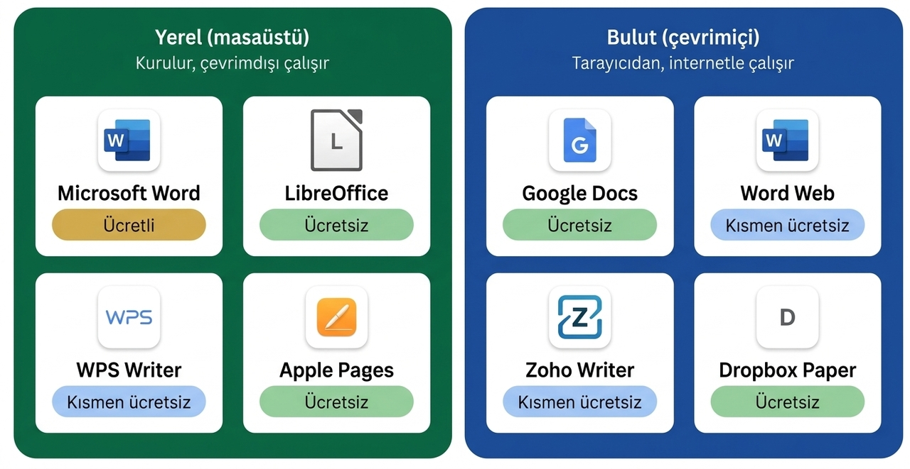
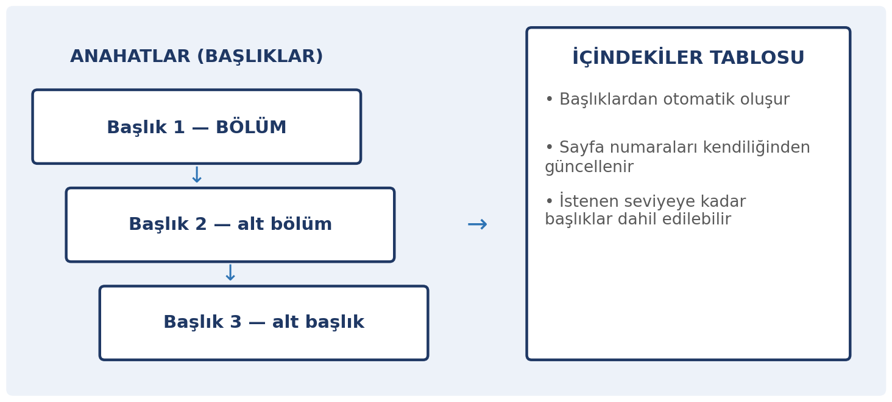
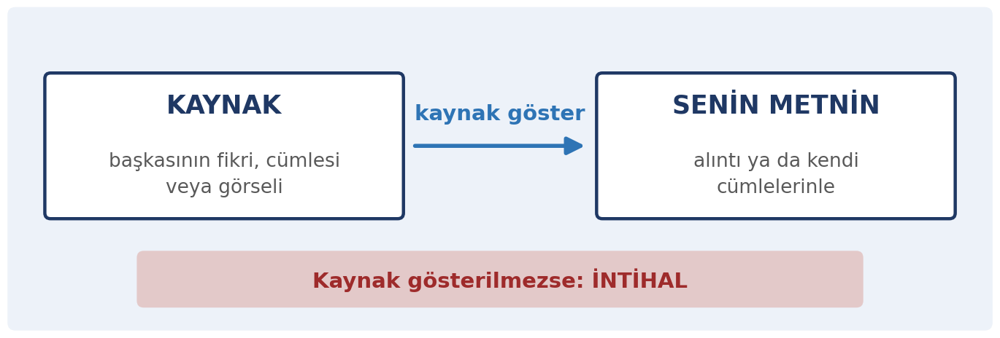

# Bu Haftanın Çerçevesi

## Öğrenme Çıktıları

- Belge oluşturur, kaydeder ve dışa aktarır.
- Metin ve paragraf biçimlendirmesini kullanır.
- Stillerle başlık hiyerarşisi kurar.
- Tablo ve görsel ekler, sayfa düzenini ayarlar.
- İçindekiler, dipnot ve kaynakça oluşturur.
- Akademik dürüstlük ilkelerini uygular.
- Erişilebilir belge hazırlar.

# Temel Kavramlar

## Kelime İşlemci Nedir?

Kelime işlemci, metin ağırlıklı belgeler üretir: **içerik yazmak** ve **biçimlendirmek**.

::: {.columns}
::: {.column width="58%"}

```{=latex}
\includegraphics[width=\linewidth,height=0.92\textheight,keepaspectratio]{gorseller/ekran-libreoffice-writer.png}
```

:::

::: {.column width="40%"}

```{=latex}
\vspace*{\baselineskip}
```

LibreOffice Writer, açık kaynaklı ve ücretsiz bir kelime işlemci uygulamasıdır.
:::
:::

## Çevrimiçi Kelime İşlemci: Google Docs

```{=latex}
\begin{center}
\includegraphics[width=0.80\linewidth,height=\textheight,keepaspectratio]{gorseller/ekran-google-docs.png}
\end{center}
```

## Popüler Kelime İşlemciler

{width=100%}

## Masaüstü mü, Çevrimiçi mi?

Bu tarz uygulamaların bazıları kendi **bilgisayarınıza kurularak** kullanılır, bazıları ise doğrudan **web üzerinden** (bulut, çevrimiçi, online) kullanılır.

| | Masaüstü | Çevrimiçi |
|:---|:---|:---|
| Kurulum | Gerekir | Gerekmez |
| İnternet | Gerekmez | Gerekir |
| Ortak çalışma | Sınırlı | Aynı anda çok kişi |
| Verinin yeri | Kendi bilgisayarınız | Sağlayıcının sunucusu |

Çevrimiçi uygulamalarda belge **karşıdaki sunucuda durur**; kişisel bilgi içeren belgelerde dikkatli olun.

## Ofis Uygulamaları

```{=latex}
\vspace*{5mm}
```

Kelime işlemci, hesap tablosu ve sunu uygulaması gibi programların **bir arada** bulunduğu yazılımlara **ofis uygulamaları** (ofis paketi) denir. Bu hafta **kelime işlemciyi**, 8. hafta **hesap tablosunu**, 9. hafta **sunuyu** ele alacağız.

| Uygulama | Microsoft | LibreOffice | Google | Apple |
|:---|:---|:---|:---|:---|
| **Kelime işlemci** | Word | Writer | Docs | Pages |
| **Hesap tablosu** | Excel | Calc | Sheets | Numbers |
| **Sunu** | PowerPoint | Impress | Slides | Keynote |

```{=latex}
\begin{center}
\vspace*{4mm}
\includegraphics[width=0.64\linewidth,height=0.3\textheight,keepaspectratio]{gorseller/gorsel-ofis-ikonlari.png}
\end{center}
```

## Kullanım Oranları

::: {.columns}
::: {.column width="52%"}

```{=latex}
\includegraphics[width=\linewidth,height=\textheight,keepaspectratio]{gorseller/gorsel-office-study.png}
```

:::

::: {.column width="44%"}
Empower tarafından yayımlanan *The 2025 Office Study* araştırmasında, ABD'de en az 50 çalışanı bulunan işletmelerde görev yapan çalışanların **%93'ü Microsoft 365**, **%64'ü Google Workspace** ve **%14'ü LibreOffice** kullandığını bildirmiştir. Katılımcıların birden fazla yazılımı işaretleyebilmesi nedeniyle bu oranlar birbirini dışlayan pazar payları olarak değerlendirilmemelidir (Empower, 2025).
:::
:::

## Kaydetme ve Biçimler

- **`.docx`:** Microsoft Word'ün düzenlenebilir biçimi
- **`.odt`:** LibreOffice gibi açık kaynak paketlerin biçimi
- **`.pdf`:** Paylaşım ve teslim için; bozulmaz, düzenlenmesi zor
- **Kaydetme alışkanlığı:** otomatik kaydetmeyi açık tutun, ayrıca `Ctrl + S`

Ödev tesliminde genellikle **PDF** istenir.

```{=latex}
\begin{center}
\vspace*{5mm}
\includegraphics[width=0.40\linewidth,height=0.55\textheight,keepaspectratio]{gorseller/gorsel-dosya-bicimleri.png}
\end{center}
```

# Biçimlendirme

## Metin ve Paragraf Biçimlendirme

::: {.columns}
::: {.column width="62%"}

```{=latex}
\vspace*{6mm}
```

- **Karakter:** yazı tipi, punto, kalın, italik, renk
- **Paragraf:** hizalama, satır aralığı, girinti, listeler

```{=latex}
\vspace*{\baselineskip}
```

**Tutarlılık:** aynı belgede farklı yazı tipleri ve puntolar dağınık görünür. Bir kez karar verin, belge boyunca ona sadık kalın — en kolay yol stillerdir.

:::

::: {.column width="34%"}

```{=latex}
\begin{center}
\includegraphics[width=\linewidth,height=0.60\textheight,keepaspectratio]{gorseller/ekran-yazi-tipi.png}\\[-1mm]
{\scriptsize\emph{Microsoft Word: karakter ve paragraf biçimleri}}
\end{center}
```

:::
:::

# Stiller

## Stil Nedir?

Bir dizi biçim ayarının **adlandırılmış** hâlidir.

Örneğin "Başlık 1" stili; belirli bir yazı tipi, punto, kalınlık ve boşluğu içerir.

```{=latex}
\begin{center}
\vspace*{4mm}
\includegraphics[width=0.70\linewidth,height=0.45\textheight,keepaspectratio]{gorseller/ekran-stiller.png}\\[-1mm]
{\scriptsize\emph{Microsoft Word'ün stil galerisi}}
\end{center}
```

## Stillerin Sağladıkları

::: {.columns}
::: {.column width="48%"}

```{=latex}
\vspace*{9mm}
```

- **Hız:** seç, uygula
- **Tutarlılık:** aynı stil = aynı görünüm
- **Yapı:** program hangi metnin başlık olduğunu bilir. PDF'e bile çevirseniz, başlıklar takip edilebilir
- **İçindekiler tablosu:** Başlıklara göre otomatik olarak oluşturulur

:::

::: {.column width="48%"}

```{=latex}
\begin{center}
\includegraphics[width=\linewidth,height=0.85\textheight,keepaspectratio]{gorseller/ekran-google-docs-belge.png}\\[-1mm]
{\scriptsize\emph{Google Docs: metin anahatları (başlıklar)}}
\end{center}
```

:::
:::

## Başlık Hiyerarşisi

{width=100%}

## Başlığı Elle Kalınlaştırmayın

Metni kalın yapıp puntosunu büyütmek onu **başlık yapmaz** — yalnızca başlık gibi *gösterir*.

Gerçek başlık, stil uygulanmış metindir.

**Fark nerede çıkar?** İçindekiler oluşturmaya kalktığınızda: elle biçimlendirilmiş başlıklar içindekilere hiç girmez.

::: {.callout-warning}
**Elle kalınlaştırılan başlık içindekilere girmez.** Başlıkları her zaman stillerle biçimlendirin; aksi hâlde içindekiler tablosu boş kalır.
:::

# Tablo ve Görsel

## Tablolar

- **Başlık satırı** bulunsun
- Metin sola, **sayılar sağa** hizalansın
- **Her hücreyi çizgi ile çerçevelemeye gerek olmayabilir**

```{=latex}
\begin{center}
\vspace*{4mm}
\includegraphics[width=0.95\linewidth,height=0.60\textheight,keepaspectratio]{gorseller/diagram-tablo-ornek.png}
\end{center}
```

## Görseller

- **Çözünürlük:** Ekranda iyi görünen bir görsel, basıldığında bulanık çıkabilir.
- **Boyut:** Görseli sürükleyerek büyütmek onu bozar; gerçek boyutunda ekleyip ölçeklemek gerekir.
- **Konumlandırma:** Metinle görselin ilişkisi (üstünde, altında, yanında) belirlenmelidir.
- **Altyazı:** Her görsele numara ve açıklama ekleyin (Şekil 1: …); metinde bu numaraya atıf yapın.
- **Telif:** Başkasının görselini kullanıyorsanız kaynak göstermelisiniz.

# Sayfa Düzeni

## Ayarlanacak Öğeler

::: {.columns}
::: {.column width="55%"}

```{=latex}
\vspace*{17mm}
```

| Öğe | Ne yapar |
|:---|:---|
| Kenar boşlukları | Metin ile kenar arası |
| Yönlendirme | Dikey / yatay |
| Sayfa boyutu | A3, A4, A5, vb. |
| Üstbilgi / altbilgi | Tekrarlanan bilgi |
| Sayfa numarası | Altbilgiye eklenir |

:::

::: {.column width="40%"}

```{=latex}
\begin{center}
\includegraphics[width=\linewidth,height=0.86\textheight,keepaspectratio]{gorseller/diagram-sayfa-duzeni.png}
\end{center}
```

:::
:::

## Sayfa Numarası Neden Gerekli?

- Numarasız bir belgede "3. sayfadaki tabloya bakın" denemez.
- Sayfa numarası belgeyi **başvurulabilir** kılar.
- Sayfa numarası ile beraber **sayfa sayısı** da yazılırsa daha güzel olur (*Sayfa: X/Y* şeklinde).
- Kapak sayfasında numara görünmesi istenmiyorsa numaralandırma ikinci sayfadan başlatılabilir.

# Uzun Belge Yönetimi

## Uzun Belgede Üç Özellik

- **İçindekiler:** yalnızca stillerle çalışır
- **Dipnot:** sayfa altında ek bilgi
- **Kaynakça:** yararlanılan kaynakların listesi

Kaynakçadaki her giriş metinde anılmalı; metinde anılan her kaynak kaynakçada olmalı.

## Değişiklikleri İzleme

Belgeyi başkasıyla paylaşıp üzerinde çalışırken kullanılır.

- Eklenen ve silinen her şey **işaretlenir**
- Kimin ne zaman değiştirdiği görülür
- Her değişiklik **kabul** ya da **reddedilir**

Danışman/hoca düzeltmelerinde ve grup ödevinde işe yarar.

```{=latex}
\begin{center}
\vspace*{4mm}
\includegraphics[width=0.75\linewidth,height=0.5\textheight,keepaspectratio]{gorseller/ekran-degisiklik-izleme.png}\\[-1mm]
{\scriptsize\emph{LibreOffice Writer'da izlenen değişiklikler ve yorum}}
\end{center}
```

# Akademik Dürüstlük

## Bir Bakışta Akademik Dürüstlük

{width=74%}

## İntihal Nedir?

Başkasının fikrini, cümlesini veya eserini **kaynak göstermeden** kendi çalışmanız gibi sunmaktır.

Kasten olabileceği gibi dikkatsizlikten de olur — sonucu aynıdır.

## İntihal Yalnızca Kopyala-Yapıştır Değildir

- Bir cümleyi birkaç kelimesini değiştirip kullanmak
- Yapay zekâ metnini kendi çalışmanız gibi sunmak
- Bir fikri kaynak göstermeden kendi fikriniz gibi yazmak
- Başkasının ödevini kendi adınıza teslim etmek

## Doğru Yol

- **Alıntı** yapıyorsanız: tırnak içinde gösterin + kaynak belirtin
- **Kendi cümlelerinizle** anlatıyorsanız: yine kaynak belirtin

## Kaynak Nasıl Gösterilir?

- **Yazar** adı
- **Eser** adı
- **Yayın yılı**
- **Sayfa numarası** (alıntıysa)
- **Nereden erişildiği**

Hangi biçim (APA, MLA, IEEE) kullanılacaksa **tutarlı** olunmalıdır.

## Kaynak Yönetimi Araçları

İki yaygın ücretsiz araç: **Zotero** (açık kaynak) ve **Mendeley** (kapalı kaynak).

- Kaynağı tek tıkla kaydeder
- Metin içi atıfları oluşturur
- Kaynakçayı istenen biçimde üretir
- Belgeyle bütünleşir

Kaynak göstermeyi kolaylaştırarak **intihali önler**.

# Erişilebilirlik

## Belgenizi Herkes Okuyacak

- **Gerçek başlık stilleri** kullanın (ekran okuyucular başlıklarla gezinir)
- **Görsellere alternatif metin** ekleyin
- **Yalnızca renkle anlatmayın**
- **Okunabilir punto:** gövde metni 11–12
- **Yeterli kontrast** sağlayın
- **Tablo başlık satırını** tanımlayın

## Alternatif Metin (Alt Text)

"Bu resim ne anlatıyor?" sorusunun kısa yanıtı.

Örnek: *"2019–2026 arasında öğrenci sayısının sürekli arttığını gösteren çizgi grafik."*

# Kapanış

## Uygulama: Kendi Ödevinizi Biçimlendirin

**Hangi araçla:** Google Docs gibi çevrimiçi bir araç ya da LibreOffice Writer gibi kurulabilen bir paket.

1. Üç başlıklı kısa bir metin yazın — başlıkları **stil** olarak uygulayın
2. Tablo ve görsel ekleyin; altyazı yazın
3. **İçindekiler** oluşturun — çalışıyor mu?
4. Bir alıntı ekleyip kaynağını gösterin
5. Görsele alternatif metin ekleyip PDF olarak kaydedin

Notla değerlendirilmez.

## Özet

- **İçerik** ve **biçim** ayrı işler
- **Stiller**: hız, tutarlılık, yapı, otomatik içindekiler
- Uzun belgede **içindekiler, dipnot, kaynakça**
- **İntihal** yalnızca kopyala-yapıştır değildir
- **Kaynak yönetimi araçları** intihali önler
- **Erişilebilirlik**: gerçek başlıklar, alt metin, kontrast

## Gelecek Hafta

**Elektronik tablo ve grafik okuma** — formüller, fonksiyonlar, sıralama, grafik oluşturma ve yanıltıcı grafikler.
