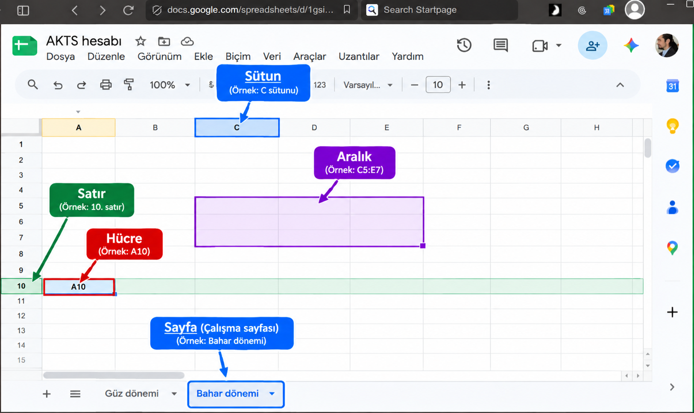
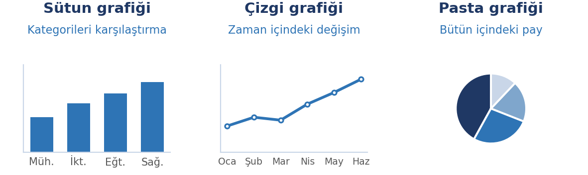
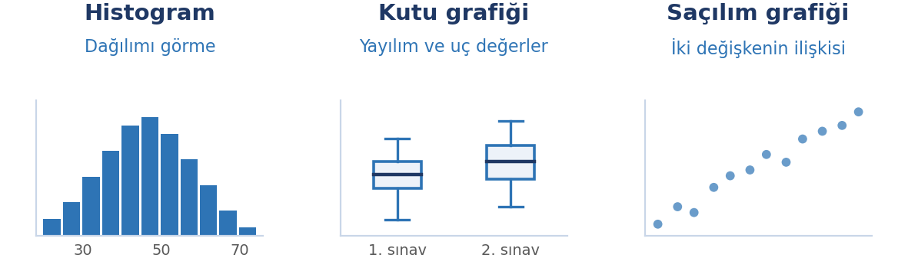
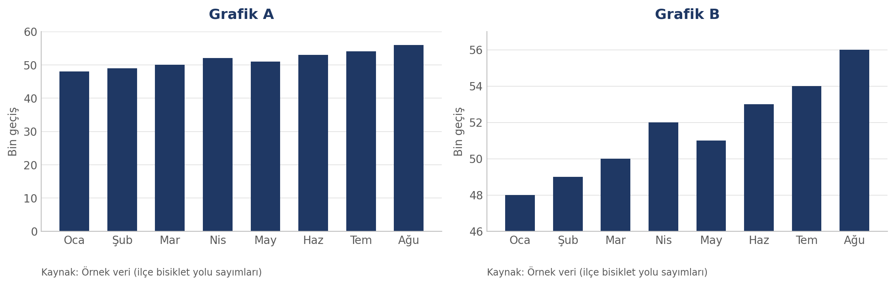

# Bu Haftanın Çerçevesi

## Öğrenme Çıktıları

- Hesap tablosunun temel kavramlarını tanır.
- Formül yazar; göreli ve mutlak başvuruyu ayırt eder.
- Temel fonksiyonları amaca uygun kullanır.
- Veriyi biçimlendirir, sıralar ve filtreler.
- Veri türüne uygun grafiği seçip grafik oluşturur.
- Bir grafiği eleştirel biçimde okur; yanıltıcı görselleri teşhis eder.
- Yüzde değişim ile yüzde puanı, ortalama ile ortancayı ayırt eder.

# Hesap Tablosu

## Hesap Tablosu Nedir?

::: {.columns}
::: {.column width="58%"}

Verinin hücrelerde tutulduğu ve bu hücreler arasında **formüllerle ilişki kurulabildiği** yazılımdır.

- Bir hücreye yazılan formül, başka hücreleri girdi olarak kullanır.
- Girdi değişince sonuç **kendiliğinden** güncellenir.
- Aynı zamanda küçük bir veri tabanı ve görselleştirme aracıdır.

Kullanım alanları: bütçe takibi, not dökümü, anket sonuçları, stok listeleri, ölçüm karşılaştırmaları.

:::

::: {.column width="40%"}

```{=latex}
\begin{center}
\includegraphics[width=4.6cm,height=5cm,keepaspectratio]{gorseller/ekran-libreoffice-calc.png}\\[-0.5mm]
{\scriptsize\emph{LibreOffice Calc penceresi}}
\end{center}
```

:::
:::

## Google Sheets: Hücre, Satır, Sütun, Aralık, Sayfa

{width=82%}

## Temel Kavramlar

| Kavram | Ne demek | Örnek |
|:---|:---|:---|
| Hücre | Satır ve sütunun kesişimi | B3 |
| Satır | Yatay sıra (numarayla) | 5. satır |
| Sütun | Dikey sıra (harfle) | C sütunu |
| Aralık | Birden çok hücre | A2:A20 |
| Sayfa | Aynı dosya içindeki ayrı tablo yüzeyi | Sayfa1, Sayfa2 |
| Çalışma kitabı | Hesap tablosu dosyasının tamamı | `butce.xlsx` |

## Veri Türleri

| Tür | Örnek | Hizalama |
|:---|:---|:---|
| Metin | "Ankara" | Sola |
| Sayı | 1250; 3,14 | Sağa |
| Tarih / saat | 12.03.2026 | Sağa |
| Mantıksal | DOĞRU / YANLIŞ | Programa göre değişir |
| Formül | `=A1+A2` | Sonucun türüne göre |

Türkçede ondalık ayraç virgüldür (ör: 3,14). İngilizce oluşturulan belgelerde nokta kullanılmış olabilir.

Sayı sola yaslanıyorsa içinde boşluk ya da harf vardır ve **hesaba katılmaz**.

## CSV: Veriyi Taşıyan Sade Biçim

::: {.columns}
::: {.column width="58%"}

Hesap tablolarını başka programlara aktarmanın ortak yolu: **CSV** (virgülle ayrılmış değerler).

- Aslında **düz metindir**: her satır bir kayıt, alanlar birer sütun
- **Değerleri taşır, biçimlendirmeyi taşımaz** — renk, formül ve grafik CSV'ye geçmez
- Neredeyse her program CSV okuyabilir; bu yüzden ortak biçimdir

Örnekte ayraç **noktalı virgül**: Türkçe bölge ayarında ondalık ayraç virgül olduğundan alanlar noktalı virgülle ayrılır. Sütunlar birleşmiş görünüyorsa sorun **ayraç uyumsuzluğudur**.

:::

::: {.column width="40%"}

```text
Ad;Yaş;Not;Şehir
Ahmet;21;85;Bilecik
Ayşe;22;92;Eskişehir
```

:::
:::

## Formüller Nasıl Yazılır

Formüller **eşittir işaretiyle** başlar; aksi hâlde yazılanlar metin olarak kabul edilir. Örneğin `=` olmadan yazılan `TOPLA(B2:B50)` formül değil, düz metindir.

| Yazım | Anlamı |
|:---|:---|
| `=A1+A2` | Toplar |
| `=A1-B1` | Çıkarır |
| `=A1*B1` | Çarpar |
| `=A1/B1` | Böler |
| `=(A1+A2)/2` | Parantez önce işlenir |

Formülde kullanılan hücre adreslerindeki (A2, B7 gibi) değerler değişince formül sonucu da güncellenir.

## Göreli ve Mutlak Başvuru

::: {.columns}
::: {.column width="56%"}

```{=latex}
\begin{minipage}[c][6.4cm][c]{\linewidth}
\begin{itemize}
\setlength{\itemsep}{0.9em}
\item \textbf{Göreli (\texttt{A1}):} Kopyalandığı yöne göre kayar. Bir satır aşağı → \texttt{A2}.
\item \textbf{Mutlak (\texttt{\$A\$1}):} Kopyalansa da sabit kalır. \texttt{\$} sütunu veya satırı kilitler.
\end{itemize}

Sabit bir değere göre oranlarken toplam hücresi mutlak yazılır: \texttt{=B2/\$B\$10}
\end{minipage}
```

:::

::: {.column width="42%"}

```{=latex}
\begin{center}
\includegraphics[width=5cm,height=4.8cm,keepaspectratio]{gorseller/ekran-excel-oran.png}\\[-0.5mm]
{\scriptsize\emph{Microsoft Excel'de oran sütunu (=B3/\$B\$10) ve toplam (=TOPLAM(B3:B7))}}
\end{center}
```

:::
:::

## Yüzde Puan ve Göreli Değişim

**Yüzde puan**, iki oran arasındaki doğrudan farktır; **göreli değişim** ise bu farkın tabana bölümüdür.

```{=latex}
\begin{center}
\includegraphics[width=6.2cm,height=2.4cm,keepaspectratio]{gorseller/diagram-yuzde-puan-goreli.png}\hspace{0.6cm}%
\includegraphics[width=6.2cm,height=2.4cm,keepaspectratio]{gorseller/ekran-yuzde-formulleri.png}
\end{center}
```

Aynı 5 puan; taban %20 iken **%25**, taban %50 iken **%10**'dur: taban küçüldükçe, aynı puan farkının etkisi büyür.

2 vakadan 6'ya çıkış "%200 arttı" demektir; ama arada yalnızca **4 vaka** var. Sayılar bu kadar küçükken birkaç vaka artışı, artışın süreceği anlamına gelmez. Oran içeren bir haberde ilk soru şu olmalı: **neyin yüzde kaçı, tabanı kaç?**

# Temel Fonksiyonlar (İşlevler)

## Sık Kullanılan Fonksiyonlar

| Fonksiyon | İngilizce | Ne yapar |
|:---|:---|:---|
| `TOPLA` | `SUM` | Aralıktaki sayıları toplar |
| `ORTALAMA` | `AVERAGE` | Aritmetik ortalamayı verir |
| `ORTANCA` | `MEDIAN` | Sıradaki ortadaki değeri verir |
| `MAK` / `MİN` | `MAX` / `MIN` | En büyük ve en küçük değer |
| `EĞERSAY` | `COUNTIF` | Koşulu sağlayanları sayar |
| `EĞER` | `IF` | Koşula göre iki sonuç döndürür |
| `SAY` | `COUNT` | Sayı içeren hücreleri sayar |

## Ortalama ve Ortanca

9 öğrenci 40 puan, 1 öğrenci 100 puan aldı.

- Aritmetik ortalama: **46**
- Ortanca: **40**

Tek bir uç değer ortalamayı yukarı çeker; ortanca etkilenmez. Veride uç değer kuşkusu varsa (gelir, harcama, görüntülenme) ikisini karşılaştırın; aralarındaki büyük fark dağılımın çarpık olduğunu gösterir.

# Biçimlendirme

## Biçimlendirme Türleri

- **Sayı biçimi:** ondalık, binlik ayırıcı, para birimi, yüzde
- **Tarih biçimi:** görünüşü değişir, değeri değişmez
- **Kenarlık ve dolgu:** başlıkları ayırmak için
- **Koşullu biçimlendirme:** eşiğin altındakiler kendiliğinden renklenir
- **Sütun genişliği:** hücrede `###` görüyorsanız sütun dardır

## Birleştirilmiş Hücrelerden Kaçının

::: {.callout-warning}
**Birleştirilmiş hücreler sıralama ve filtrelemeyi bozar**, formül aralıklarını şaşırtır. Görsel olarak düzenli görünse de veriyi işlemeyi zorlaştırır.

Başlığı ortalamak için hücre birleştirmek yerine **ortala** hizalamasını kullanın.
:::

# Sıralama ve Filtreleme

## Aralarındaki Fark

| | Sıralama | Filtreleme |
|:---|:---|:---|
| Ne yapar | Satırların yerini değiştirir | Uygun olanları gösterir |
| Veriye etkisi | Kalıcı olarak düzenler | Silmez, geçici gizler |
| Tipik kullanım | Büyükten küçüğe listeleme | Tek sınıfın kayıtları |

Sıralarken **bütün satırı** seçin; yalnızca bir sütunu sıralarsanız satırlar arasındaki bağ kopar.

::: {.callout-warning}
**Sıralama veriyi kalıcı olarak değiştirir, filtreleme değiştirmez.** Sıralamadan önce verinizin tümünü seçtiğinizden emin olun.
:::

# Grafik

## Grafik Oluşturmanın Üç Adımı

1. **Veriyi seçin** — başlık satırıyla birlikte.
2. **Grafik türünü seçin** — verinin türüne göre.
3. **Etiketleri ekleyin** — grafik başlığı, eksen etiketleri ve birimler, kaynak notu.

Bu üçüncü adım, grafiği "çizilmiş" olmaktan çıkarıp "anlaşılır" hâle getirir.

## Hangi Veri İçin Hangi Grafik

| Amaç | Uygun grafik |
|:---|:---|
| Kategorileri karşılaştırmak | Sütun veya çubuk |
| Zaman içindeki değişim | Çizgi |
| Bütün içindeki pay | Pasta veya yığılmış çubuk |
| Dağılım | Histogram, kutu grafiği |
| İki değişken arasındaki ilişki | Dağılım (saçılım) |
| Coğrafi dağılım | Harita (büyük alan, büyük değer değildir) |

::: {.callout-warning}
**Pasta grafik ancak az sayıda dilim ve belirgin biçimde farklı oranlarla** okunur; altı yedi dilimli, oranları yakın pastalar okunamaz.
:::

## Örnekler: Sütun, Çizgi, Pasta

{width=88%}

## Örnekler: Histogram, Kutu, Saçılım

{width=88%}

# Grafiklerin Doğru Okunması

## Grafik Tarafsız mı?

Grafik, tarafsız bir resim değil, **tercihlerle kurulmuş bir iddiadır**.

Grafiği hazırlayan şu kararları verir: hangi veriyi alacağı, hangi aralığı göstereceği, ekseni nereden başlatacağı, neyi vurgulayacağı.

## Yanıltma: Eksen Kaynaklı

- **Kesilmiş eksen:** Dikey eksen sıfırdan başlamaz; küçük fark devasa görünür.
- **Ters çevrilmiş eksen:** Artış aşağı doğru gösterilir.
- **Ölçek aralığı oynama:** Aynı veri iki farklı hikâye anlatır.

## Yanıltma: Ölçek ve Oran

- **Alan ve hacim yanılsaması:** İki kat büyük değer, iki boyutta büyütülünce **dört kat** görünür.
- **Üç boyutlu efekt:** Perspektif uzaktaki dilimi küçültür.
- **Çift eksen:** İlgisiz iki seri, olmayan bir ilişki varmış gibi görünür.

## Yanıltma: Seçme ve Gizleme

- **Seçilmiş zaman aralığı:** Başlangıç ve bitiş noktası özenle seçilir.
- **Eksik veri ve "diğer" kovası:** Kayıp noktalar gizlenir.
- **Seçilmiş karşılaştırma grubu:** Sonucu belirleyen, kiminle karşılaştırıldığıdır.

## Yanıltma: Tasarım Kaynaklı

- **Renk ve vurgu:** İstenen seri canlı, diğerleri soluk.
- **Kalabalık gösterim:** Süsleme asıl veriyi görünmez kılar.
- **Başlıkla verinin uyuşmaması:** En zor fark edileni.

## Kontrol Listesi

1. Eksen sıfırdan mı başlıyor?
2. Birimler ve ölçek yazılı mı?
3. Kaynak ve tarih var mı?
4. Kaç veri noktası var; kayıp veri gizli mi?
5. Başlık verinin söylediğiyle uyumlu mu?
6. Karşılaştırma grubu adil mi?
7. Renkler bir şey mi ima ediyor?
8. Tam veri kümesine erişilebiliyor mu?
9. Grafik, eşlik ettiği metinle aynı şeyi mi söylüyor?

## Uygulama: Aynı Veri, İki Grafik

**Hangi araçla:** Google Sheets gibi çevrimiçi bir araç ya da LibreOffice Calc gibi kurulabilen bir paket.



## Fark Nerede?

- İki grafikteki sayılar **birebir aynı**.
- Aylar, renkler ve kaynak notu da aynı.
- Peki neden biri sakin bir eğilim, diğeri dik bir tırmanış gösteriyor?

Dikey eksenlere bakın: **nereden başlıyorlar?**

## Yanıt: Kesilmiş Eksen

- **Grafik A:** dikey eksen 0'dan başlıyor.
- **Grafik B:** dikey eksen 46'dan başlıyor.
- Aynı %17'lik artış, B'de kat kat büyük görünüyor.

::: {.callout-warning}
**Sütun grafiğinde dikey eksen sıfırdan başlamalıdır.** Sütun yüksekliği doğrudan değeri temsil ettiği için eksen kesilirse okuma bozulur.
:::

## Kendiniz Üretin

1. Küçük bir veri kümesi girin.
2. Bir kez **kasten yanıltıcı**, bir kez **dürüst** grafik oluşturun.
3. İkisini karşılaştırıp hangi kararları değiştirdiğinizi not edin.

Kendi elinizle yanıltıcı bir grafik çizmek, o taktikleri bir daha unutmayacak biçimde öğretir.

## Özet

- Hesap tablosu, hücreler arasında **formüllerle ilişki kuran** bir yazılımdır.
- **Göreli** başvuru kopyalanınca kayar, **mutlak** (`$A$1`) sabit kalır.
- **Yüzde puan** ile **göreli değişim** farklıdır.
- **Ortalama** uç değerden etkilenir, **ortanca** etkilenmez.
- **Sıralama** düzenler, **filtreleme** gösterir.
- Yanıltma taktikleri dört grupta toplanır: eksen, ölçek ve oran, seçme ve gizleme, tasarım.
- Grafiğe her bakışta sorulacak **dokuz soruluk** bir kontrol listesi vardır.

## Gelecek Hafta

**Sunum uygulamaları** — bir sunumun yapısı, slayt tasarımı, görsel seçimi ve telif, etkili sunum teknikleri.
