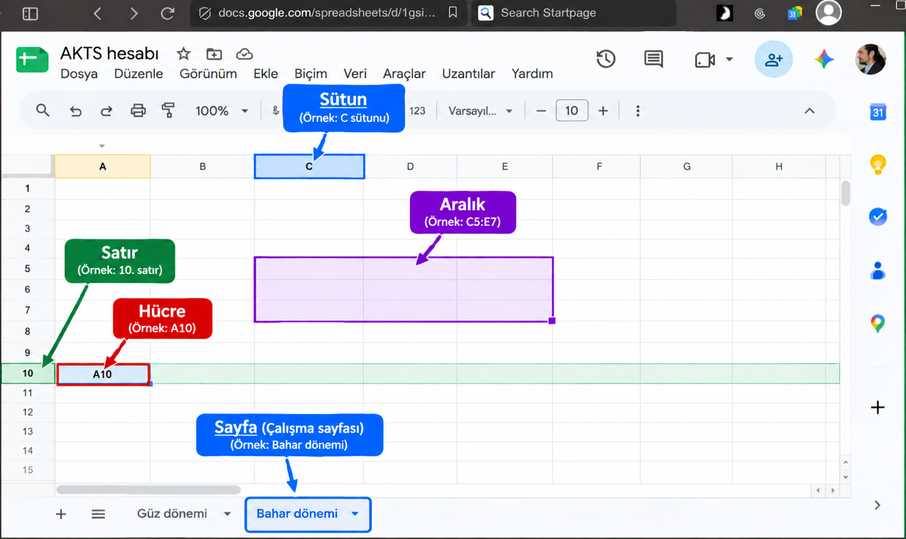
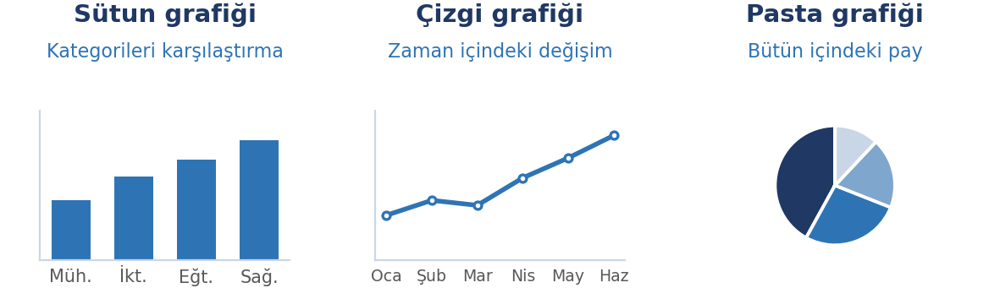
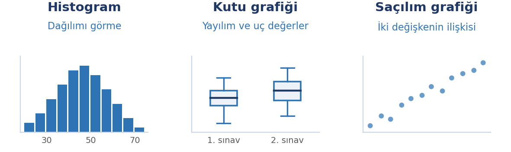
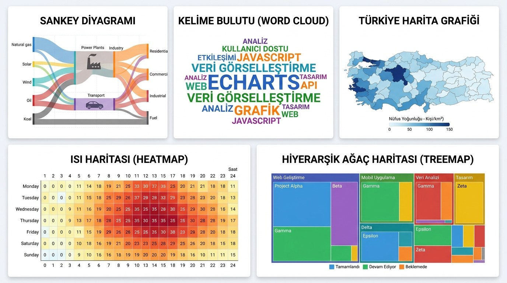

# Bu Haftanın Çerçevesi

## Öğrenme Çıktıları

- Hesap tablosunun temel kavramlarını tanır.
- Formül yazar; göreli ve mutlak başvuruyu ayırt eder.
- Temel işlevleri amaca uygun kullanır.
- Veriyi biçimlendirir, sıralar ve filtreler.
- Veri türüne uygun grafiği seçip grafik oluşturur.
- Bir grafiği eleştirel biçimde okur; yanıltıcı görselleri teşhis eder.

# Hesap Tablosu

## Hesap Tablosu Nedir?

::: {.columns}
::: {.column width="64%"}

Verinin hücrelerde tutulduğu ve bu hücreler arasında **formüllerle ilişki kurulabildiği** yazılımdır.

- Bir hücreye yazılan formül, başka hücreleri girdi olarak kullanır.
- Girdi değişince sonuç **kendiliğinden** güncellenir.
- Aynı zamanda küçük bir veri tabanı ve görselleştirme aracıdır.

Kullanım alanları: bütçe takibi, not dökümü, anket sonuçları, stok listeleri, ölçüm karşılaştırmaları.

En yaygın uygulamalar: **Excel**, **Google Sheets**, **LibreOffice Calc**, **Apple Numbers**.

:::

::: {.column width="32%"}

```{=latex}
\begin{center}
\includegraphics[width=4.4cm,height=5cm,keepaspectratio]{gorseller/ekran-libreoffice-calc.png}\\[-0.5mm]
{\scriptsize\emph{LibreOffice Calc penceresi}}
\end{center}
```

:::
:::

## Google Sheets: Hücre, Satır, Sütun, Aralık, Sayfa

{width=82%}

## Temel Kavramlar

| Kavram | Ne demek | Örnek |
|:---|:---|:---|
| Hücre | Satır ve sütunun kesişimi | B3 |
| Satır | Yatay sıra (numarayla) | 5. satır |
| Sütun | Dikey sıra (harfle) | C sütunu |
| Aralık | Birden çok hücre | A2:A20 |
| Sayfa | Aynı dosya içindeki ayrı tablo yüzeyi | Sayfa1, Sayfa2 |
| Çalışma kitabı | Hesap tablosu dosyasının tamamı | `butce.xlsx` |

## Veri Türleri

| Tür | Örnek | Hizalama |
|:---|:---|:---|
| Metin | "Ankara" | Sola |
| Sayı | 1250; 3,14 | Sağa |
| Tarih / saat | 12.03.2026 | Sağa |
| Mantıksal | DOĞRU / YANLIŞ | Programa göre değişir |
| Formül | `=A1+A2` | Sonucun türüne göre |

Türkçede ondalık ayraç virgüldür (ör: 3,14). İngilizce oluşturulan belgelerde nokta kullanılmış olabilir.

Sayı sola yaslanıyorsa içinde boşluk ya da harf vardır ve **hesaba katılmaz**.

## CSV: Veriyi Taşıyan Sade Biçim

Hesap tablolarını başka programlara aktarmanın ortak yolu: **CSV** (virgülle ayrılmış değerler).

- Aslında **düz metindir**: her satır bir kayıt, alanlar birer sütun
- **Değerleri taşır, biçimlendirmeyi taşımaz** — renk, formül ve grafik CSV'ye geçmez
- Neredeyse her program CSV okuyabilir; bu yüzden ortak biçimdir

Örnekte ayraç **noktalı virgül**: Türkçe bölge ayarında ondalık ayraç virgül olduğundan alanlar noktalı virgülle ayrılır. Sütunlar birleşmiş görünüyorsa sorun **ayraç uyumsuzluğudur**.

```{=latex}
\begin{center}
\begin{minipage}{6.4cm}
```

```text
Ad;Yaş;Not;Şehir
Ahmet;21;85;Bilecik
Ayşe;22;92;Eskişehir
```

```{=latex}
\end{minipage}
\end{center}
```

## Formüller Nasıl Yazılır

Formüller **eşittir işaretiyle** başlar; aksi hâlde yazılanlar metin olarak kabul edilir. Örneğin `=` olmadan yazılan `TOPLA(B2:B50)` formül değil, düz metindir.

| Yazım | Anlamı |
|:---|:---|
| `=A1+A2` | Toplar |
| `=A1-B1` | Çıkarır |
| `=A1*B1` | Çarpar |
| `=A1/B1` | Böler |
| `=(A1+A2)/2` | Parantez önce işlenir |

Formülde kullanılan hücre adreslerindeki (A2, B7 gibi) değerler değişince formül sonucu da güncellenir.

## Göreli ve Mutlak Başvuru

- **Göreli (`A1`):** Kopyalandığı yöne göre kayar. Bir satır aşağı → `A2`; iki hücre sağa → `C1`.
- **Mutlak (`$A$1`):** Kopyalansa da sabit kalır. `$` sütunu veya satırı kilitler.

Sabit bir değere göre oranlarken toplam hücresinin satırı kilitlenir: `=B2/B$9`

```{=latex}
\begin{center}
\includegraphics[width=8.6cm,keepaspectratio]{gorseller/ekran-excel-oran.png}
\end{center}
```

# İşlevler (Fonksiyonlar)

## Örnek Veri: TOPLA, ORTALAMA, MAK, MİN

::: {.columns}
::: {.column width="46%"}

```{=latex}
\begin{center}
{\scriptsize
\setlength{\arrayrulewidth}{0.4pt}%
\renewcommand{\arraystretch}{1.15}%
\begin{tabular}{|>{\centering\arraybackslash}p{0.55cm}|>{\raggedright\arraybackslash}p{1.8cm}|>{\raggedleft\arraybackslash}p{1.2cm}|>{\raggedleft\arraybackslash}p{0.8cm}|}
\hline
 & \multicolumn{1}{>{\centering\arraybackslash}p{1.8cm}|}{\textbf{A}} & \multicolumn{1}{>{\centering\arraybackslash}p{1.2cm}|}{\textbf{B}} & \multicolumn{1}{>{\centering\arraybackslash}p{0.8cm}|}{\textbf{C}}\\
\hline
\textbf{1} & \textbf{Öğrenci} & \textbf{Vize} & \textbf{Final}\\
\hline
\textbf{2} & Ayşe & 60 & 70\\
\hline
\textbf{3} & Berk & 70 & 45\\
\hline
\textbf{4} & Ceren & 80 & 90\\
\hline
\textbf{5} & Deniz & 90 & 55\\
\hline
\textbf{6} & Efe & 50 & 40\\
\hline
\textbf{7} & Fatma & 100 & 85\\
\hline
\textbf{8} & Gökhan & \emph{Girmedi} & 60\\
\hline
\end{tabular}}
\end{center}
```

:::

::: {.column width="52%"}

```{=latex}
\vspace*{6pt}
{\small
\begin{tabular}{@{}l@{\hspace{5mm}}r@{}}
\texttt{=TOPLA(B2:B8)} & \textbf{450}\\[1mm]
\texttt{=ORTALAMA(B2:B8)} & \textbf{75}\\[1mm]
\texttt{=MAK(B2:B8)} & \textbf{100}\\[1mm]
\texttt{=MİN(B2:B8)} & \textbf{50}\\
\end{tabular}}
```

:::
:::

**Girmedi** bir metindir: TOPLA, ORTALAMA, MAK ve MİN onu hesaba katmaz. Ortalama 450 ÷ **6** = **75** olur.

## Örnek Veri: EĞERSAY, SAY

::: {.columns}
::: {.column width="46%"}

```{=latex}
\begin{center}
{\scriptsize
\setlength{\arrayrulewidth}{0.4pt}%
\renewcommand{\arraystretch}{1.15}%
\begin{tabular}{|>{\centering\arraybackslash}p{0.55cm}|>{\raggedright\arraybackslash}p{1.8cm}|>{\raggedleft\arraybackslash}p{1.2cm}|>{\raggedleft\arraybackslash}p{0.8cm}|}
\hline
 & \multicolumn{1}{>{\centering\arraybackslash}p{1.8cm}|}{\textbf{A}} & \multicolumn{1}{>{\centering\arraybackslash}p{1.2cm}|}{\textbf{B}} & \multicolumn{1}{>{\centering\arraybackslash}p{0.8cm}|}{\textbf{C}}\\
\hline
\textbf{1} & \textbf{Öğrenci} & \textbf{Vize} & \textbf{Final}\\
\hline
\textbf{2} & Ayşe & 60 & 70\\
\hline
\textbf{3} & Berk & 70 & 45\\
\hline
\textbf{4} & Ceren & 80 & 90\\
\hline
\textbf{5} & Deniz & 90 & 55\\
\hline
\textbf{6} & Efe & 50 & 40\\
\hline
\textbf{7} & Fatma & 100 & 85\\
\hline
\textbf{8} & Gökhan & \emph{Girmedi} & 60\\
\hline
\end{tabular}}
\end{center}
```

:::

::: {.column width="52%"}

```{=latex}
\vspace*{6pt}
{\small
\begin{tabular}{@{}l@{\hspace{5mm}}r@{}}
\texttt{=EĞERSAY(B2:B8;">=70")} & \textbf{4}\\[1mm]
\texttt{=EĞERSAY(B2:B8;"Girmedi")} & \textbf{1}\\[1.5mm]
\texttt{=SAY(B2:B8)} & \textbf{6}\\[1mm]
\texttt{=SAY(A2:A8)} & \textbf{0}\\
\end{tabular}}
```

:::
:::

70, 80, 90 ve 100 → **4**. Ölçüt metin de olabilir: "Girmedi" tek hücrede geçer. A sütunu tümüyle metin olduğundan `=SAY(A2:A8)` **0** verir; B sütununda 6 sayı var.

## Metin İşlevleri

::: {.columns}
::: {.column width="46%"}

```{=latex}
\begin{center}
{\scriptsize
\setlength{\arrayrulewidth}{0.4pt}%
\renewcommand{\arraystretch}{1.15}%
\begin{tabular}{|>{\centering\arraybackslash}p{0.45cm}|>{\raggedright\arraybackslash}p{1.0cm}|>{\raggedright\arraybackslash}p{1.25cm}|>{\raggedright\arraybackslash}p{1.75cm}|}
\hline
 & \multicolumn{1}{>{\centering\arraybackslash}p{1.0cm}|}{\textbf{A}} & \multicolumn{1}{>{\centering\arraybackslash}p{1.25cm}|}{\textbf{B}} & \multicolumn{1}{>{\centering\arraybackslash}p{1.75cm}|}{\textbf{C}}\\
\hline
\textbf{1} & \textbf{Ad} & \textbf{Soyad} & \textbf{Kod}\\
\hline
\textbf{2} & Ayşe & Yılmaz & 00TR1234\\
\hline
\textbf{3} & Berk & Demir & 16BK0457\\
\hline
\end{tabular}}
\end{center}
```

:::

::: {.column width="52%"}

```{=latex}
\vspace*{6pt}
{\small
\begin{tabular}{@{}l@{\hspace{4mm}}r@{}}
\texttt{=BİRLEŞTİR(A2;"~";B2)} & \textbf{Ayşe Yılmaz}\\[1mm]
\texttt{=SOLDAN(C2;2)} & \textbf{00}\\[1mm]
\texttt{=PARÇAAL(C2;3;2)} & \textbf{TR}\\[1mm]
\texttt{=SAĞDAN(C2;4)} & \textbf{1234}\\[1mm]
\texttt{=UZUNLUK(C2)} & \textbf{8}\\
\end{tabular}}
```

:::
:::

- Sabit genişlikli veriler (plaka, öğrenci no, telefon no gibi) bu üç işlevle ayrıştırılabilir.
- `&` işareti `BİRLEŞTİR` ile aynı işi yapar.
- Fazla boşlukları `KIRP` ile temizleyebilir, harf düzeni `BÜYÜKHARF` ile standardize edilebilir.

## Mantıksal İşlevler

::: {.columns}
::: {.column width="46%"}

```{=latex}
\begin{center}
{\scriptsize
\setlength{\arrayrulewidth}{0.4pt}%
\renewcommand{\arraystretch}{1.15}%
\begin{tabular}{|>{\centering\arraybackslash}p{0.55cm}|>{\raggedright\arraybackslash}p{1.8cm}|>{\raggedleft\arraybackslash}p{1.2cm}|>{\raggedleft\arraybackslash}p{0.8cm}|}
\hline
 & \multicolumn{1}{>{\centering\arraybackslash}p{1.8cm}|}{\textbf{A}} & \multicolumn{1}{>{\centering\arraybackslash}p{1.2cm}|}{\textbf{B}} & \multicolumn{1}{>{\centering\arraybackslash}p{0.8cm}|}{\textbf{C}}\\
\hline
\textbf{1} & \textbf{Öğrenci} & \textbf{Vize} & \textbf{Final}\\
\hline
\textbf{2} & Ayşe & 60 & 70\\
\hline
\textbf{3} & Berk & 70 & 45\\
\hline
\textbf{4} & Ceren & 80 & 90\\
\hline
\textbf{5} & Deniz & 90 & 55\\
\hline
\textbf{6} & Efe & 50 & 40\\
\hline
\textbf{7} & Fatma & 100 & 85\\
\hline
\textbf{8} & Gökhan & \emph{Girmedi} & 60\\
\hline
\end{tabular}}
\end{center}
```

:::

::: {.column width="52%"}

```{=latex}
\vspace*{6pt}
{\small
\begin{tabular}{@{}>{\raggedright\arraybackslash}p{4.7cm}r@{}}
\texttt{=VE(B2>=50;C2>=50)} & \textbf{DOĞRU}\\[1mm]
\texttt{=YADA(B3<50;C3<50)} & \textbf{DOĞRU}\\[6mm]
\texttt{=EĞER(VE(B3>=50;C3>=50);}\newline\texttt{\hspace*{1.1em}"Geçti";"Bütünleme")} & \textbf{Bütünleme}\\
\end{tabular}}
```

:::
:::

`VE` bütün koşullar sağlanınca, `YADA` en az biri sağlanınca DOĞRU verir. Üç sonuç gerektiğinde `EĞER` iç içe yazılır; parantez çoğaldıkça okunaksızlaştığı için ara sonucu ayrı hücrede tutmak yeğlenir.

## Hata Kodları ve Çözümleri

Formülde bir sorun olduğunda hücreye bir hata kodu yazılır. Kodu tanımak, sorunu çözmenin ilk adımıdır.

| Hata Kodu (TR / EN) | Anlamı | Çözümü |
|:---|:---|:---|
| `#BAŞV!` / `#REF!` | Geçersiz başvuru | Silinen hücre adresini güncelleyin |
| `#DEĞER!` / `#VALUE!` | Geçersiz tür | Sayı beklenen yerdeki metni düzeltin |
| `#SAYI!` / `#NUM!` | Geçersiz sayı | Girdi değerlerini kontrol edin |
| `#AD?` / `#NAME?` | Tanınmayan ad | İşlev adının yazımını kontrol edin |

Türkçe arayüzde `#BAŞV!`, İngilizce arayüzde `#REF!`; çözüm yolu aynıdır: kodu okuyun, kaynağını bulun ve düzeltin.

## Tarih ve Saat İşlevleri

::: {.columns}
::: {.column width="46%"}

```{=latex}
\begin{center}
{\scriptsize
\setlength{\arrayrulewidth}{0.4pt}%
\renewcommand{\arraystretch}{1.15}%
\begin{tabular}{|>{\centering\arraybackslash}p{0.45cm}|>{\raggedleft\arraybackslash}p{2.2cm}|>{\raggedleft\arraybackslash}p{2.2cm}|}
\hline
 & \multicolumn{1}{>{\centering\arraybackslash}p{2.2cm}|}{\textbf{A}} & \multicolumn{1}{>{\centering\arraybackslash}p{2.2cm}|}{\textbf{B}}\\
\hline
\textbf{1} & \textbf{Doğum} & \textbf{Teslim}\\
\hline
\textbf{2} & 15.03.2007 & 20.11.2026\\
\hline
\end{tabular}}
\end{center}
```

:::

::: {.column width="52%"}

```{=latex}
\vspace*{6pt}
{\small
\begin{tabular}{@{}l@{\hspace{4mm}}r@{}}
\texttt{=BUGÜN()} & \textbf{02.11.2026}\\[1mm]
\texttt{=B2-BUGÜN()} & \textbf{18}\\[1mm]
\texttt{=GÜNSAY(BUGÜN();B2)} & \textbf{18}\\[1mm]
\texttt{=YIL(A2)} & \textbf{2007}\\[1mm]
\texttt{=AY(A2)} & \textbf{3}\\[1mm]
\texttt{=GÜN(A2)} & \textbf{15}\\
\end{tabular}}
```

:::
:::

Tarih aslında bir sayıdır (1 = 01.01.1900); bu yüzden iki tarihin farkı gün sayısını verir. `BUGÜN()` ve `ŞİMDİ()` her açılışta yenilendiği için "kalan gün" kendiliğinden değişir.

## Yapay Zekâ Destekli İşlevler

```{=latex}
\begin{center}
\includegraphics[width=9.4cm,height=5.25cm,keepaspectratio]{gorseller/ekran-sheets-gemini.png}
\end{center}
```

Google Sheets'te yapay zekâ entegrasyonu: D2 hücresindeki `=GEMINI(...)` (sürüme göre `=AI(...)`) formülü, A2:C2 aralığındaki ürün, hedef ve kitle hedefi bilgisini reklam metnine çeviriyor. Kullanılabilirliği ve kullanım sınırları hesaba ve plana göre değişebilir; bazı hesaplarda hiç görünmeyebilir.

# Biçimlendirme

## Sayı, Tarih ve Hücre Biçimleri

::: {.columns}
::: {.column width="63%"}

```{=latex}
\vspace*{9pt}
\begin{minipage}[c][6.4cm][c]{\linewidth}
\begin{itemize}
\setlength{\itemsep}{0.6em}
\item \textbf{Sayı biçimi:} ondalık, binlik ayırıcı, para birimi, yüzde
\item \textbf{Tarih biçimi:} görünüşü değişir, değeri değişmez
\item \textbf{Kenarlık ve dolgu:} başlıkları ayırmak için
\item \textbf{Sütun genişliği:} hücrede \texttt{\#\#\#} görüyorsanız sütun dardır
\end{itemize}
\end{minipage}
```

:::

::: {.column width="35%"}

```{=latex}
\begin{center}
\includegraphics[height=6.1cm,keepaspectratio]{gorseller/ekran-excel-bicim.png}\\[1mm]
{\scriptsize\emph{Excel'de biçimlendirme}}
\end{center}
```

:::
:::

## Koşullu Biçimlendirme

::: {.columns}
::: {.column width="57%"}

```{=latex}
\begin{minipage}[c][5.9cm][c]{\linewidth}
\raggedright
\hyphenpenalty=10000
```

Koşullu biçimlendirme, bir hücrenin görünüşünü içindeki **değere** bağlar: koşul sağlanınca hücre kendiliğinden renklenir.

- 50'nin altındaki notlar kırmızı
- En küçük kırmızı, en büyük yeşil — renk ölçeği
- Değere uygun simge: trafik ışığı, WiFi — simge kümesi
- En yüksek yüzde 10 kalın yazı — ilk/son kuralı

Koşul bir kez tanımlanır; değer değiştikçe biçim kendini günceller.

```{=latex}
\end{minipage}
```

:::

::: {.column width="39%"}

```{=latex}
\begin{center}
\includegraphics[height=5.6cm,keepaspectratio]{gorseller/ekran-excel-kosullu-bicim.png}\\[1mm]
{\scriptsize\emph{Excel'de koşullu biçimlendirme}}
\end{center}
```

:::
:::

# Sıralama ve Filtreleme

## Aralarındaki Fark

::: {tbl-colwidths="[24,38,38]"}
| | Sıralama | Filtreleme |
|:---|:---|:---|
| Ne yapar | Satırların yerini değiştirir | Filtreye uymayanları gizler |
| Veriye etkisi | Kalıcı olarak düzenler | Veriyi silmez |
| Tipik kullanım | Büyükten küçüğe listeleme | Yalnızca 70 ve üstü notlar |
:::

::: {.callout-warning}
**Sıralamadan önce bütün tabloyu seçin**; yalnızca bir sütunu sıralarsanız satırlar arasındaki bağ kopar.

**Birleştirilmiş hücreler sıralama ve filtrelemeyi bozar**, formül aralıklarını şaşırtır; bu yüzden yalnızca gerçekten gerektiğinde kullanılmalıdır.
:::

# Özet Tablolar

## Veriyi Gruplama ve Özetleme

Özet tablo (pivot table), alanları sürükleyip bırakarak veriyi gruplayıp özetler.

**Grupla:** "Alıcı" → satırlara, **Tutar** → "Değerler"e (ham veri değişmez)

```{=latex}
\begin{center}
\includegraphics[height=6.3cm,keepaspectratio]{gorseller/ekran-pivot-adimlari.png}
\end{center}
```

Özet tablolar, formül yazmadan saniyeler içinde rapor üretmenin en hızlı yoludur.

# Grafik

## Grafik Oluşturmanın Üç Adımı

1. **Veriyi seçin** — başlık satırıyla birlikte.
2. **Grafik türünü seçin** — verinin türüne göre.
3. **Etiketleri ekleyin** — grafik başlığı, eksen etiketleri ve birimler, kaynak notu.

::: {.columns}
::: {.column width="26%"}

```{=latex}
\scriptsize
```

| İsim | Boy |
|:---|--:|
| Ece | 160 |
| Veli | 168 |
| Metin | 172 |
| Ali | 174 |
| Musa | 169 |
| İrem | 158 |
| Gül | 161 |

```{=latex}
\normalsize
```

:::

::: {.column width="64%"}

```{=latex}
\begin{center}
\includegraphics[width=\linewidth,keepaspectratio]{gorseller/diagram-grafik-anatomi.png}
\end{center}
```

:::
:::

## Örnekler: Sütun, Çizgi, Pasta

{width=88%}

| Grafik türü | Kullanım amacı |
|:---|:---|
| Sütun grafiği | Kategorileri karşılaştırmak |
| Çizgi grafiği | Zaman içindeki değişimi göstermek |
| Pasta grafiği | Bütün içindeki payı göstermek |

## Örnekler: Histogram, Kutu, Saçılım

{width=88%}

| Grafik türü | Kullanım amacı |
|:---|:---|
| Histogram | Dağılımı göstermek |
| Kutu grafiği | Yayılımı ve uç değerleri göstermek |
| Saçılım (dağılım) grafiği | İki değişken arasındaki ilişki |

## Farklı Grafik Türleri

{width=90%}

Çoğu hesap tablosunda hazır değil; ayrı araç ya da kod gerekir.

## Üretici Yapay Zekâ ile Grafik Çizme

```{=latex}
\begin{center}
\includegraphics[height=7.4cm,keepaspectratio]{gorseller/ekran-chatgpt-echarts-notlu.png}
\end{center}
```

# Grafiklerin ve Sayıların Doğru Okunması

## Grafik Tarafsız mı?

Grafik, tarafsız bir resim değil, **tercihlerle kurulmuş bir iddiadır**. Grafiği hazırlayan şu kararları verir: hangi veriyi alacağı, hangi aralığı göstereceği, ekseni nereden başlatacağı, neyi vurgulayacağı.

```{=latex}
\begin{center}
\includegraphics[width=9.6cm,keepaspectratio]{gorseller/foto-grafik-buyutec.jpg}
\end{center}
```

## Yanıltma Taktipleri: Üç Kritik Örnek

```{=latex}
\begin{center}
\scriptsize
\begin{tabular}{@{}p{4.46cm}@{}p{4.46cm}@{}p{4.46cm}@{}}
{\centering\textbf{Kesilmiş eksen}\par Dikey eksen sıfırdan başlamaz; küçük fark devasa görünür.\par} &
{\centering\textbf{Alan ve hacim yanılsaması}\par İki kat büyük değer, iki boyutta büyütülünce dört kat görünür.\par} &
{\centering\textbf{Seçilmiş zaman aralığı}\par Başlangıç ve bitiş noktası özenle seçilir.\par} \\
\end{tabular}

\vspace{0.3mm}
\includegraphics[width=13.4cm]{gorseller/diagram-yaniltma-3-ornek.png}
\end{center}
```

## Yanıltma: Tasarım Kaynaklı

- **Renk ve vurgu.** Biri canlı, ötekiler soluk: göz canlı çubuğa gider, veri aynıdır.
- **Kalabalık gösterim.** Gereksiz ızgara ve çerçeve asıl veriyi geri plana atar.
- **Başlıkla veri uyuşmazlığı.** Düşen çizgiye "artış" başlığı: okuyucu grafiğe değil başlığa inanır.

```{=latex}
\vfill
\begin{center}
\includegraphics[height=2.7cm,keepaspectratio]{gorseller/diagram-tasarim-yaniltma.png}
\end{center}
```

## Uygulama: Kendiniz Üretin

1. Küçük bir veri kümesi girin.
2. Bir kez **kasten yanıltıcı**, bir kez **dürüst** grafik oluşturun.
3. İkisini karşılaştırıp hangi kararları değiştirdiğinizi not edin.

Kendi elinizle yanıltıcı bir grafik çizmek, o taktikleri bir daha unutmayacak biçimde öğretir.

## Özet

- Hesap tablosu, hücreler arasında **formüllerle ilişki kuran** bir yazılımdır.
- **Göreli** başvuru kopyalanınca kayar, **mutlak** (`$A$1`) sabit kalır.
- **İşlevler** hazır formüllerdir: metin, mantık ve tarih işlerini de tek hücrede çözer.
- **CSV** değerleri taşır, biçimlendirmeyi taşımaz.
- **Biçimlendirme** görünüşü değiştirir, değeri değil.
- **Sıralama** düzenler, **filtreleme** gösterir.
- **Grafik türü** veriye göre seçilir: kategori → sütun, zaman → çizgi, pay → pasta.
- Yanıltma taktikleri dört grupta toplanır: eksen, ölçek ve oran, seçme ve gizleme, tasarım.

## Gelecek Hafta

**Sunum uygulamaları** — bir sunumun yapısı, slayt tasarımı, görsel seçimi ve telif, etkili sunum teknikleri.
