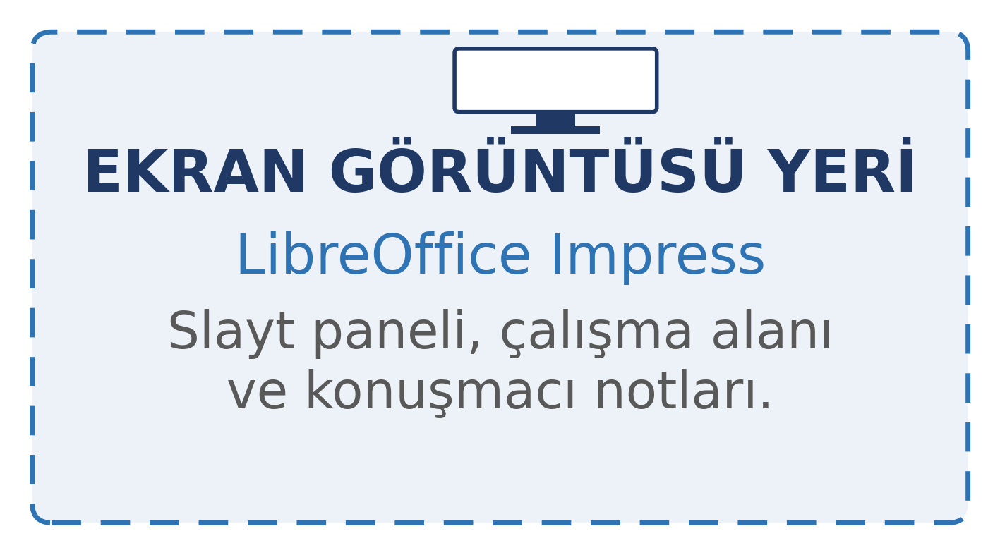
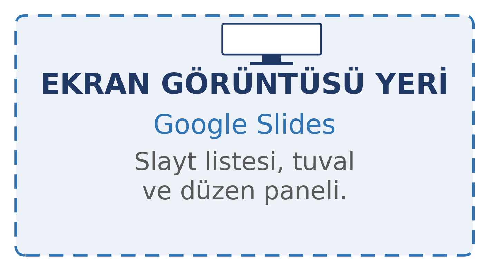
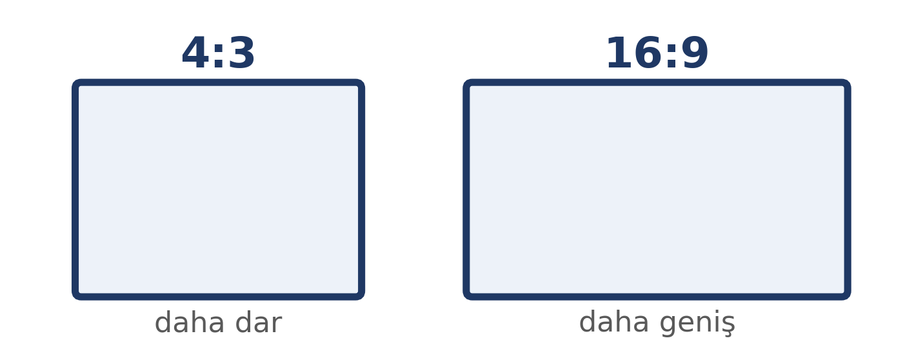
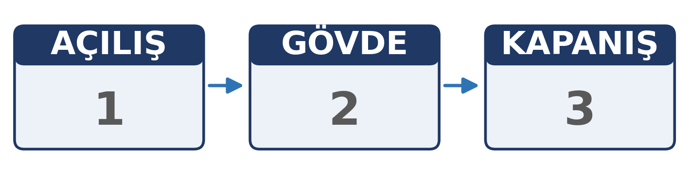
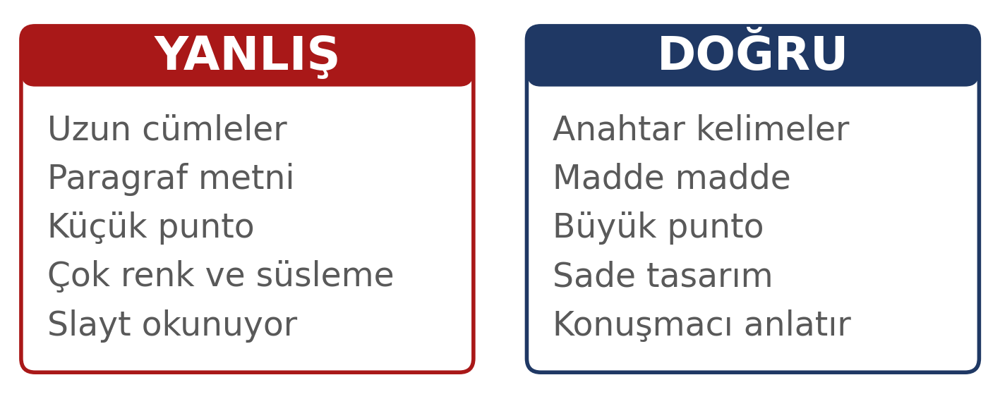
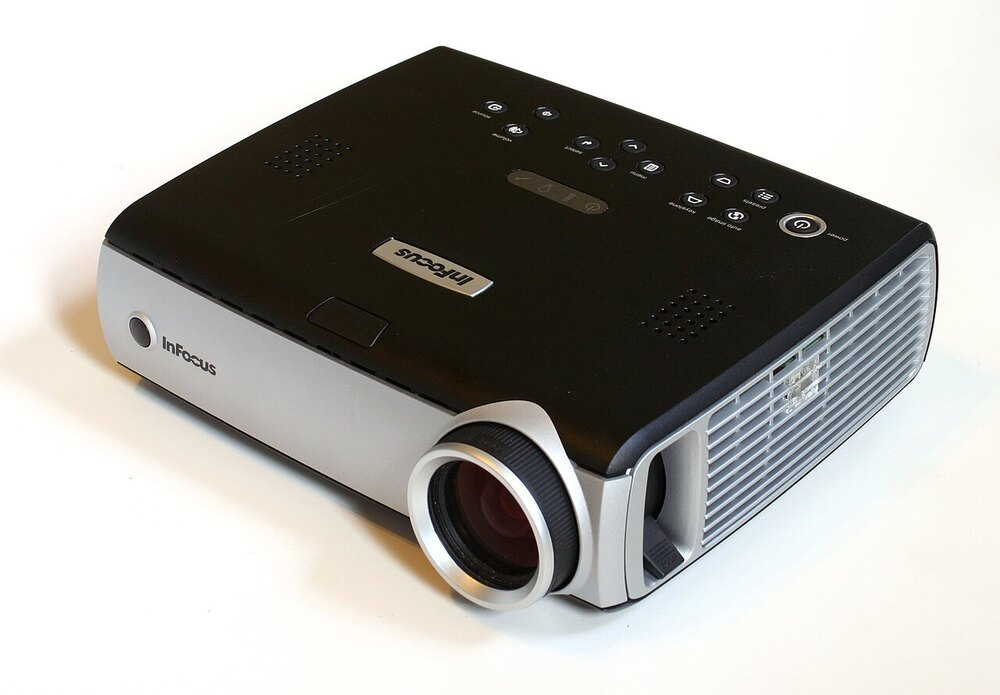
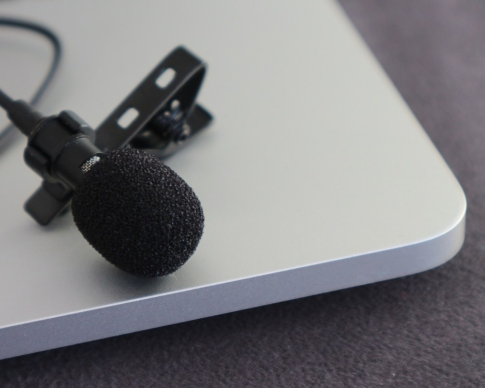

# Giriş

Üniversite hayatınızda ve iş hayatında fikirlerinizi **anlatmanız** gerekecek: sınıfta bir ödevi sunmak, bir projeyi tanıtmak, bir öneriyi savunmak. Sunu yazılımları bu iş için araçtır — ama iyi bir sunum, iyi bir slayttan fazlasıdır.

Sunu uygulamalarının da bilgisayara kurulan ve tarayıcıda çalışan **çevrimiçi** sürümleri vardır; aradaki farklar için 7. haftadaki karşılaştırmaya bakın. Bu derste **sunu**, slaytlardan oluşan görsel dosya; **sunum** ise konuşmacının sesi, beden dili ve izleyiciyle etkileşimiyle gerçekleştirdiği etkinliktir. Sunu yazılımı sunuyu hazırlar; sunumu konuşmacı yapar.

Bu haftanın temel iddiası şu: **slayt, konuşmanın yerini almaz; onu destekler.** Az metin, aynı mesajı izleyiciye daha kolay ulaştırır; slaytı okumaya başlayan dinleyici ise konuşmacıyı dinlemeyi bırakır.

::: {.callout-note}
## Bu haftanın temel fikri

Slayt bir **vitrindir**, depo değil. Üzerinde anahtar kelimeler olur; ayrıntıyı konuşmacı anlatır.
:::

# Bu Haftanın Öğrenme Çıktıları

- Sunu yazılımında slayt oluşturur; düzenini, dosya biçimini ve dışa aktarmayı seçer.
- Sununun yapısını (açılış, gövde, kapanış) planlar.
- Slaytta metin yoğunluğunu ve okunabilirliği ayarlar.
- Görselleri telif kurallarına uygun biçimde kullanır.
- Tasarım tutarlılığını sağlar; tablo ve grafiği slayda uygun biçimde yerleştirir.
- Etkili bir sunum yapar; erişilebilir bir sunu hazırlar.

# Sunu Yazılımı

Sunu yazılımı, slaytları hazırlamak ve sırayla göstermek için kullanılan **uygulama yazılımıdır**. Kelime işlemcide sayfa, hesap tablosunda **çalışma sayfası** neyse sunuda **slayt** odur: fikirlerin tek tek ekranlara yerleştirildiği birim.

Slaytları tek tek biçimlendirmek yerine **ana slayt** ve **düzen** ile ortak görünüm kurulur. Bu, 7. haftadaki **stillerle** aynı mantıktır: bir kez ayarlanır, bütün slaytlara uygulanır.

Öne çıkan uygulamalar iki grupta toplanır: tarayıcıda çalışan **Google Slides**, bilgisayara kurulan **LibreOffice Impress**, **Microsoft PowerPoint** ve Apple cihazlarda gelen **Keynote**. **Prezi** ve **Canva** gibi çevrimiçi araçlar da sunu hazırlamak için kullanılır; Prezi doğrusal olmayan bir tuval, Canva ise hazır şablonlar ve sürükle-bırak düzen sunar. İkisinin de ücretsiz sürümleri vardır. Menü adları ve yerleri değişse de slayt, düzen, not ve sunu kavramları hepsinde vardır.

## Sunu yazılımı ne yapar?

```{=latex}
\begin{center}
\setlength{\arrayrulewidth}{0.3pt}%
\renewcommand{\arraystretch}{1.15}%
\begin{tabular}{@{}>{\raggedright\arraybackslash}p{3.4cm}>{\raggedright\arraybackslash}p{11.0cm}@{}}
\toprule
\textbf{Kavram} & \textbf{Anlamı}\\
\midrule
Slayt & Sununun tek bir ekranı\\
Tuval & Slaytın üzerinde tasarım yapılan alan\\
Düzen & Başlık + içerik, iki sütun gibi hazır yerleşim\\
Yer tutucu & Metin, görsel veya tablo için ayrılmış alan\\
Ana slayt & Bütün slaytların ortak yazı tipi, renk ve logosunu belirleyen katman\\
Konuşmacı notu & Slaytta görünmeyen, konuşmacının kendisine ayırdığı ayrıntı\\
Konuşmacı görünümü & Sıradaki slaytı, notları ve süreyi gösteren ikinci ekran\\
\bottomrule
\end{tabular}
\end{center}
```

::: {#fig-sunum-ekran layout-ncol=2}
{width=95%}

{width=95%}

İki sunu uygulamasında aynı bölümler; menü adları ve yerleri değişir.
:::

## Masaüstü sürüm, çevrimiçi sürüm

Sunu uygulamalarının bazıları bilgisayara **kurulur**, bazıları doğrudan **tarayıcıda** çalışır. İkisi de benzer temel işlevleri sunar; farklar erişim, işbirliği ve dosyanın nerede tutulduğuyla ilgilidir.

```{=latex}
\begin{center}
\setlength{\arrayrulewidth}{0.3pt}%
\renewcommand{\arraystretch}{1.15}%
\begin{tabular}{@{}>{\raggedright\arraybackslash}p{2.6cm}>{\raggedright\arraybackslash}p{5.4cm}>{\raggedright\arraybackslash}p{5.4cm}@{}}
\toprule
 & \textbf{Masaüstü sürüm} & \textbf{Çevrimiçi sürüm}\\
\midrule
Kurulum & Gerekir & Gerekmez; tarayıcı yeter\\
İnternet & Sunum sırasında gerekmez & Genellikle gerekir\\
Erişim & Yalnızca o bilgisayardan & Hesabınıza girebildiğiniz her cihazdan\\
Ortak çalışma & Sınırlı & Aynı anda birden çok kişi\\
Verinin yeri & Kendi bilgisayarınız & Hizmeti sunan şirketin sunucuları\\
\bottomrule
\end{tabular}
\end{center}
```

Çevrimiçi sürümler, grup ödevlerinde aynı sunu üzerinde birlikte çalışırken ve okul ile ev arasında geçiş yaparken kolaylık sağlar. Ancak **sunu dosyası**, hizmeti sağlayan şirketin sunucularında tutulur; kişisel veya gizli bilgi içeren sunu dosyalarında dikkatli olun (11. hafta) ve yerel bir kopya bulundurun (4. hafta).

## Dosya biçimleri ve dışa aktarma

Sununun düzenlenebilir dosyası ile paylaşılan kopyası aynı şey değildir.

- **`.pptx`:** PowerPoint'in biçimi; en yaygın düzenlenebilir sunu biçimidir. Çoğu sunu uygulaması açar; yazı tipi ve video uyumu değişebilir.
- **`.odp`:** LibreOffice gibi açık kaynak paketlerin biçimi. Her uygulama tam desteklemeyebilir.
- **`.pdf`:** Görünümü sabitler; teslim ve yedek için uygundur. Video, animasyon ve geçiş efektleri çalışmaz.

Düzenlemeye devam edecekseniz `.pptx` ya da `.odp`; karşı tarafa gönderecekseniz **PDF** uygun olur. PDF, yazı tiplerini büyük ölçüde gömer ve slaytların görünümünü korur; ancak **video, animasyon ve geçiş efektlerini taşımaz.** Sunuda video varsa asıl dosyayı ve videoyu ayrıca yanınızda bulundurun.

Sunuyu hazırladıktan sonra başka bir bilgisayarda açıp prova yapın; yazı tipleri, görseller ve videolar beklediğiniz gibi görünmüyorsa düzeltin.

## Slayt düzeni, notlar ve konuşmacı görünümü

**Ana slayt** ve **düzen**, sununun görsel omurgasıdır. Ana slaytta yazı tipi, renk, logo ve alt bilgi bir kez ayarlanır; böylece her slaytta aynı görünüm korunur. **16:9** oranı çoğu ekran için uygundur; sunum yapılacak ortamdaki ekranın veya perdenin oranı farklıysa **4:3** de kullanılabilir.

{width=72%}

**Konuşmacı notu**, slaytta yazmayan ayrıntıyı saklar. **Konuşmacı görünümü** ise sunum sırasında sıradaki slaytı, notları ve geçen süreyi gösterir; genellikle ikinci bir ekran gerektirir. Bu görünüm, slayta bakmadan konuşmayı kolaylaştırır.

**Animasyon ve geçiş efektleri** sırayı göstermek veya bir noktayı vurgulamak için kullanılır; abartılı efektler dinleyicinin dikkatini dağıtır ve PDF’e aktarıldığında çalışmaz.

## Sunu yazılımı turu

Bir sunu hazırlarken izlenecek temel adımlar şunlardır. Çoğu uygulamada slayt paneli solda, tuval ortada, düzen/özellikler paneli sağda; konuşmacı notları slaytın altında yer alır.

1. Uygulamayı açın; slayt paneli, tuval ve düzen panelini tanıyın; boş bir sunu oluşturun.
2. Ekran oranını seçin: çoğu ekran için **16:9**, bazı ekranlarda **4:3**.
3. Bir **tema**, **ana slayt** ve **düzen** seçin.
4. Slayt ekleyin; başlık ve içerik yer tutucularını doldurun.
5. **Konuşmacı notlarını** yazın; **konuşmacı görünümünü** deneyin.
6. Slayt gösterisini başlatın; sunuyu **PDF** olarak dışa aktarın.

# Sununun Yapısı

Bu bölümde **süre** ile, sunum sırasında sunuya ayrılan zamanı kastediyoruz. Dersin odağı sunumun tamamı değil, onun bir parçası olan **sununun hazırlanmasıdır.**

## Kime, ne amaçla, ne kadar sürede?

| Soru | Neye karar verir |
|:---|:---|
| **Kime?** | Dil, örnek, ayrıntı düzeyi |
| **Ne amaçla?** | Bilgilendirme, ikna, savunma, karar aldırma |
| **Ne kadar sürede?** | Slayt sayısı, prova, kapanışın uzunluğu |

Aynı içerik, birinci sınıf öğrencisine ve bir komisyona aynı biçimde anlatılmaz. Süre kısaldıkça slayt sayısı da azalır; ancak kesin sayıyı slayt başına dakika hesabı değil, **prova** belirler.

## Üç bölüm ve süre payları

İyi bir sunu genellikle üç bölümden oluşur; aşağıda verilen süre payları kesin kural değil, tavsiyedir.

{width=76%}

```{=latex}
\begin{center}
\setlength{\arrayrulewidth}{0.3pt}%
\renewcommand{\arraystretch}{1.15}%
\begin{tabular}{@{}>{\raggedright\arraybackslash}p{2.5cm}>{\raggedright\arraybackslash}p{9.3cm}>{\raggedright\arraybackslash}p{2.9cm}@{}}
\toprule
\textbf{Bölüm} & \textbf{Ne yapar} & \textbf{Süre payı}\\
\midrule
Açılış & Konuyu ve amacı tanıtır, dinleyicinin dikkatini toplar & $\sim$\%10\\
Gövde & Ana mesajları sırayla işler & $\sim$\%80\\
Kapanış & Özetler ve ne yapılması gerektiğini söyler & $\sim$\%10\\
\bottomrule
\end{tabular}
\end{center}
```

Ders sunularımızda olduğu gibi, kısa sunularda açılış ve kapanış birer slayt olabilir; gövde yine de sununun ağırlığını taşır.

## Açılış

Sununun ilk slaytlarında **bugün ne anlatacağınızı** söyleyin; doğrudan ayrıntıya girmeyin. İyi bir açılış konuyu tanıtır, **neden önemli olduğunu** söyler ve genellikle bir soru ya da çarpıcı bir veriyle başlar. Kendini tanıtmakla sınırlı kalan bir giriş, dinleyicinin ilgisini toplamaya yetmez.

## Gövde

Ana mesajların işlendiği bölümdür. Burada sık yapılan hata, çok fazla mesaj vermeye çalışmaktır. **Üç ana mesaj** kuralı iyi bir ölçüdür: dinleyicinin ana hattı izlemesini kolaylaştırır. Çok fazla mesaj verirseniz, dinleyicilerin aklında hangi birkaç mesajın kalacağını seçemezsiniz.

## Kapanış

Sununun en çok atlanan ama en etkili kısmıdır. Kapanış, ana mesajları hatırlatır ve **ne yapılması gerektiğini** söyler. "Teşekkürler" demek bir kapanış değildir; teşekkür, kapanıştan sonra gelen kısa bir nezaket cümlesidir.

# Slayt Tasarımı

## Metin yoğunluğu

{width=80%}

Bir slaytta uyulacak basit kurallar:

- **Madde madde yazın**, paragraf yazmayın.
- **Anahtar kelimeler** kullanın; cümleyi konuşurken kurun.
- **Satır başına 6–8 kelime**, slayt başına 6 maddeyi geçmeyin.
- **Punto büyük olsun:** gövde metni için 24 punto iyi bir alt sınırdır; başlık daha büyük olmalı. Salon büyüdükçe puntoyu artırın.
- **Sade ve sakin olun:** Boşluk bırakın; hareketli efekt ve ses yerine durağan slaytları tercih edin.

::: {.callout-warning}
## Slaytı okumayın

Slaytta yazanı kelimesi kelimesine okumak, sunumda sık yapılan bir hatadır. Dinleyici zaten okuyabiliyor. Konuşmacının işi **okunanı açıklamak**, tekrar etmek değil. Konuşmacı notlarınızdan veya elinizdeki kısa notlardan yararlanabilirsiniz.

**Pratik ölçü:** Slaytı, üzerindeki yazıyı okumadan anlatabiliyor musunuz? Cevap "hayır" ise slaytta fazla yazı var demektir.
:::

## Tasarım tutarlılığı

Tutarlılık, profesyonel görünümün temelidir:

- **Renk paleti:** En fazla iki üç renk. Kurumsal renk varsa ona sadık kalın.
- **Yazı tipi:** Tüm slaytlarda aynı yazı tipi ve punto düzeni.
- **Yerleşim:** Başlık hep aynı yerde, gövde hep aynı hizada.
- **Slayt numarası:** Her slaytta numara ve toplam sayı görünsün (ör. 4 / 12); izleyici nerede olduğunu ve ne kadar kaldığını bilir.
- **Görsel dil:** Aynı üslubu koruyun; fotoğraf ve şema bir arada kullanılabilir, ancak renk ve çizgi dili tutarlı olsun.

Bu dersin sunuları iyi bir örnektir: aynı renk paleti, aynı başlık düzeni ve kurumsal renkler kullanılır.

::: {.callout-tip}
## Ana slaytı kullanın

Sıfırdan tasarım yapmak yerine **ana slaytı** bir kez ayarlayın: yazı tipi, renk, logo ve alt bilgi bütün slaytlara uygulanır. Sonradan yapılan bir değişiklik de tüm sunuya yansır.
:::

# Görsel Kullanımı ve Telif

Görseller sunuyu güçlendirir — ama yalnızca doğru kullanıldığında.

## Görsel seçimi

- **İlgili olmalı:** Süs olsun diye görsel koymak dikkati dağıtır.
- **Kaliteli olmalı:** Bulanık görsel, içeriği de zayıf gösterir.
- **Bir işlevi olmalı:** Her görsel bilgi vermeli, örnek göstermeli veya atmosfer kurmalı. Dekoratif görsel dikkat dağıtıyorsa kullanılmamalı.
- **Metni tekrarlamamalı:** Görsel, yazılanı tekrarlamak yerine ona katkı yapmalı.

## Telif ve lisans

Ücretsiz stok siteleri (**Pexels**, **Unsplash**, **Pixabay**) ve **Wikimedia Commons**, lisansı uygun görseller için iyi başlangıçlardır. Creative Commons lisansları genellikle atıf gerektirir; ayrıntılar 11. haftada ele alınacak.

::: {.callout-warning}
## Kaynak göstermek telif sorununu çözmez

Bir görselin altına kaynak yazmak, onu kullanma hakkını vermez. **Lisansı uygun olan** görselleri seçin; kaynak gösterme ayrı bir yükümlülüktür.

Ücretsiz stok sitelerini, Wikimedia Commons’ı ve Creative Commons arama araçlarını tercih edin; yine de sitenin lisans sayfasını okuyun.
:::

# Tablo ve Grafik Yerleştirme

Slaytta tablo ve grafik kullanacaksanız, bunlar **basitleştirilmelidir**.

- **Tabloda az satır ve sütun:** Eldeki büyük tabloyu olduğu gibi aktarmayın; yalnızca vurgulamak istediğiniz satırları gösterin.
- **Grafikte büyük punto:** Eksen etiketleri projeksiyonda arka sıradan okunabilecek büyüklükte olmalı.
- **Tek mesaj:** Her grafik tek bir karşılaştırmayı göstermeli; üç eğriyi üst üste koyup hepsini anlatmaya çalışmayın.
- **Vurgulama:** Anlatmak istediğiniz değeri renkle ya da işaretle belirtin.
- **Kaynak ve tarih:** Grafiğin kaynağını ve kaynağın tarihini yazın.

Geçen hafta gördüğümüz **yanıltıcı grafikler** konusunu hatırlayın. Size ait grafiklerde eksenlerin değiştirildiği ya da kesildiği durumlarda bunu açıkça belirtin.

# Etkili Sunum Teknikleri

Slayt hazırlamak işin yarısıdır; sunmak diğer yarısı.

## Sunmadan önce

- **Prova yapın.** Yüksek sesle, ayakta, süre tutarak.
- **Süreyi ölçün.** Verilen süreyi aşmak, sunumda sık karşılaşılan bir hatadır.
- **Teknik kontrol yapın.** Projeksiyon, ses, dosya biçimi ve 4:3/16:9 oranı — önceden deneyin.
- **Yedek kopya taşıyın.** PDF’in yanında asıl dosyayı da bulundurun; PDF video ve animasyonları taşımaz.

::: {#fig-sunum-donanim layout-ncol=2}
{width=90%}

{width=90%}

Sunum için kullanılan projeksiyon ve mikrofon cihazları.
:::

## Sunarken

- **Dinleyiciye bakın.** Slayta değil.
- **Yavaş ve net konuşun.** Heyecanlı bir konuşmacı hızlanır.
- **Sesinizi ayarlayın.** Arka sıradan duyulmalı.
- **Ellerinizle oynamayın.** Sakin duruş güven verir.
- **Slaytı okumayın.** Söyleyeceğinizi bilin; konuşmacı notlarınızdan veya elinizdeki kısa notlardan yararlanın.
- **Geçişleri planlayın.** "Bir sonraki slaytta…" gibi ifadeler akışı kolaylaştırır.

## Soru-cevap

Soru-cevap genellikle sunumun sonunda yapılır; bazı durumlarda sunum sırasında da soru alınabilir. Birkaç nokta işe yarar:

- **Bilmediğiniz soruya "bilmiyorum" deyin.** Uydurmaktan iyidir.
- **Soruyu tekrar edin.** Hem herkes duyar hem siz düşünmek için zaman kazanırsınız.
- **Kısa yanıtlayın.** Uzun yanıt, soruyu soranı da dinleyiciyi de yorar.

::: {.callout-tip}
## En iyi prova, duyulmaktır

Sunumunuzu bir arkadaşınıza yapın. Anlatırken nerede takıldığınızı ve hangi slaytta kafa karıştırdığınızı en iyi o zaman görürsünüz.
:::

## Uzaktan sunum

Google Meet, Zoom, Microsoft Teams gibi platformlarda yapılan sunumlarda birkaç nokta işi kolaylaştırır:

- **Ekran paylaşımı:** Bütün ekranı değil, sunum penceresini paylaşın; bildirimleri kapatın.
- **Kamera:** Işık yüzünüze gelsin, göz hizasında durun. Kamera her zaman zorunlu değildir; ama açıksa yüzünüz görünmeli.
- **Mikrofon:** Kulaklık veya yaka mikrofonu kullanın; hoparlörden gelen ses yankı yapabilir.
- **Sohbet:** Soruları sohbetten izleyin; kalabalık oturumlarda bir moderatör yardımcı olabilir.
- **Kayıt:** Kayıt alıyorsanız katılımcıları önceden bilgilendirin; kaydı yalnızca belirtilen amaç için saklayın.
- **Yedek:** Bağlantı kopma riskine karşı kablosuz ağı ve telefonun internet bağlantısını önceden kontrol edin; gerekirse telefonla bağlanın.
- **Süre:** Uzaktan dinleyicinin dikkati daha çabuk dağılır; sunumu kısa tutun ve soruya yer açın.

# Erişilebilir Sunu

Sununuz hem paylaşıldığında okunabilmeli hem de sunum sırasında izlenebilmelidir.

## Sunuyu erişilebilir hazırlayın

- **Görsellere alternatif metin ekleyin.** Ekran okuyucu, görselin ne anlattığını bu metinden okur.
- **Slayt başlıklarını anlamlı yazın:** "Slayt 5" değil, "Sonuçlar".
- **Okuma sırasını kontrol edin:** Ekran okuyucu, slayttaki öğeleri bu sıraya göre izler.

## Sunum sırasında erişilebilirlik

- **Okunabilir punto kullanın:** Küçük punto salondan okunmaz.
- **Yeterli kontrast sağlayın:** Açık gri metin beyaz zeminde kaybolur.
- **Yalnızca renkle anlatmayın:** "Kırmızı olanlar" yerine metinle de belirtin.
- **Videolara altyazı ekleyin.**
- **Animasyonu azaltın:** Hareket, bazı dinleyiciler için dikkat dağıtıcı olabilir.

Birçok sunu uygulamasında **erişilebilirlik denetleyicisi** vardır; sunuyu paylaşmadan önce çalıştırabilirsiniz.

# Uygulama: Kısa Bir Sunu Hazırlayın

**Hangi araçla:** çevrimiçi ücretsiz bir sunu aracı (Google Slides gibi) ya da kurulabilen ücretsiz bir paket (LibreOffice Impress gibi). Aşağıdaki adımlar ikisinde de aynıdır.

1. **Kime, ne amaçla, ne kadar sürede?** Bir konu seçin; dinleyiciyi, amacı ve süreyi yazın. O konuda anlatmak istediğiniz **üç ana mesajı** belirleyin. Konu ve mesaj taslağı için yapay zekâdan yararlanabilirsiniz; metni, sayıları ve kaynakları doğrulamak sizin sorumluluğunuzdadır.

2. **Yapıyı kurun.** Açılış, gövde ve kapanış için kaçar slayt kullanacağınızı planlayın. Sunuda kullanacağınız başlıkları taslak olarak sıralayın; hangi akışı izleyeceğinizi yazın. Kapanışta ne söyleyeceğinizi şimdiden yazın.

3. **Slaytları hazırlayın.** Bir **ana slayt** ve **düzen** seçin. Ekran oranını ortama göre belirleyin; çoğu ekran için 16:9, bazı ekranlarda 4:3 uygundur. Her slaytta en fazla altı madde ve az metin kullanın. Bir görsel ekleyin — lisansı uygun olan. Görsele altyazı ve alternatif metin yazın.

4. **Notları yazın ve prova yapın.** Konuşmacı notlarını yazın; konuşmacı görünümünü deneyin. Sunumu yüksek sesle, süre tutarak bir kez baştan sona anlatın. Nerede takıldınız?

5. **Dışa aktarın ve kontrol edin.** Sunuyu **PDF** olarak dışa aktarın; asıl dosyayı da saklayın. Videolu bir sunudaysanız videoyu ayrıca taşıyın. PDF’i başka bir cihazda açıp yazı tiplerinin ve görsellerin yerinde olduğunu kontrol edin.

Bu uygulama notla değerlendirilmez. Teslimden önce kime, ne amaçla ve ne kadar sürede sunacağınızı; üç ana mesajı; altı madde sınırını; görselin lisansını ve alternatif metnini; PDF ile asıl dosyanın yedeğini kontrol edin.

# Özet

- **Sunu yazılımı**, slaytları hazırlayıp sırayla gösteren uygulama yazılımıdır; **ana slayt** ve **düzen** ortak görünümü kurar.
- **`.pptx` ve `.odp`** düzenlenebilir; **`.pdf`** görünümü sabitler ama video, animasyon ve geçiş efektlerini taşımaz.
- Sunu **açılış, gövde ve kapanış**tan oluşur; paylar yaklaşık %10 – %80 – %10’dur.
- Slaytta **az metin, anahtar kelime ve en fazla altı madde** kullanılır; gövde metni en az 24 punto olmalıdır.
- Görsellerin **lisansı** kontrol edilir; kaynak göstermek tek başına kullanım hakkı vermez.
- Tablo ve grafikler **basitleştirilir**; sütun grafiğinde özel bir neden yoksa eksen sıfırdan başlar.
- **Prova** ve **uzaktan hazırlık**: yüksek sesle prova, ses, bildirim ve yedek bağlantı.

# Kendini Sınama Soruları

1. Sunu yazılımında **ana slayt** ve **düzen** ne işe yarar?
2. `.pptx`, `.odp` ve `.pdf` arasındaki fark nedir; hangi durumda hangisi kullanılır?
3. PDF’e aktarılan bir sunuda hangi öğeler çalışmaz?
4. Bir sununun üç bölümü ve yaklaşık süre payları nedir?
5. Slaytta metin yoğunluğu için hangi pratik ölçü kullanılabilir?
6. Creative Commons lisanslı bir görseli kullanırken ne yapmak gerekir?
7. Kaynak göstermek neden telif sorununu tek başına çözmez?
8. Sunum öncesi yapılması gereken üç hazırlık nedir?
9. Uzaktan sunumda sesin ve bağlantının sorunsuz olması için üç önlem yazın.
10. Soru-cevap bölümünde bilmediğiniz bir soru gelirse ne yapmalısınız?

# Kaynaklar

- **Creative Commons — Lisanslar** — CC lisanslarının koşulları.\
  (creativecommons.org/licenses)
- **Pexels Lisansı**, **Unsplash Lisansı** ve **Pixabay Lisansı** — ücretsiz stok görsellerin kullanım koşulları.\
  (pexels.com/license, unsplash.com/license, pixabay.com/service/license-summary)
- **Wikimedia Commons** — kamu malı ve Creative Commons lisanslı görseller.\
  (commons.wikimedia.org)
- **W3C Erişilebilirlik Girişimi (WAI)** — sunu ve web içeriği erişilebilirliği ilkeleri.\
  (w3.org/WAI)
- **LibreOffice Impress Kılavuzu** — ana slayt, düzen, notlar ve dışa aktarma.\
  (help.libreoffice.org)
- **Google Slides Yardım** — sunu oluşturma, erişilebilirlik ve dışa aktarma.\
  (support.google.com/docs)
- **Görsel kaynakları:** Projeksiyon cihazı — *InFocus IN34*, Dave Pape, kamu malı. Yaka mikrofonu — *Technology-g9f60c2df6 1920*, Florian-Media, CC0. Bu haftanın şemaları ve ekran görüntüsü yer tutucuları bu ders için hazırlanmıştır. Ekran görüntüleri LibreOffice Impress ve Google Slides uygulamalarından alınacaktır.

Haftaya özel ek okuma önerileri ve güncel bağlantılar, dersin çevrimiçi ortamında ayrıca paylaşılır.
