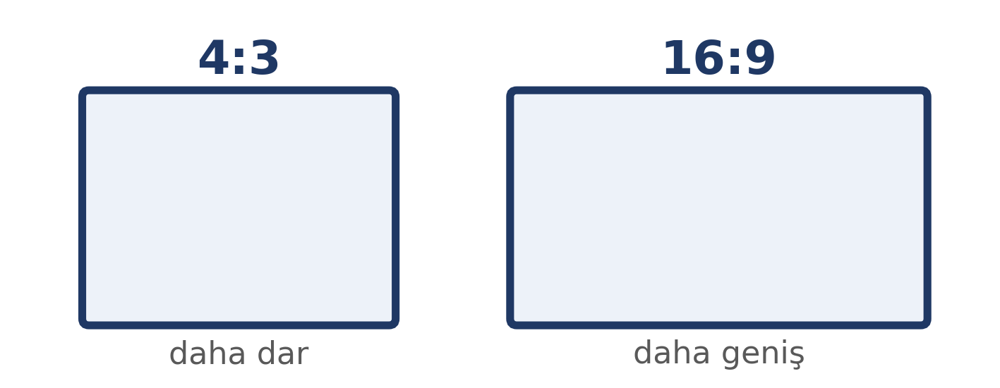
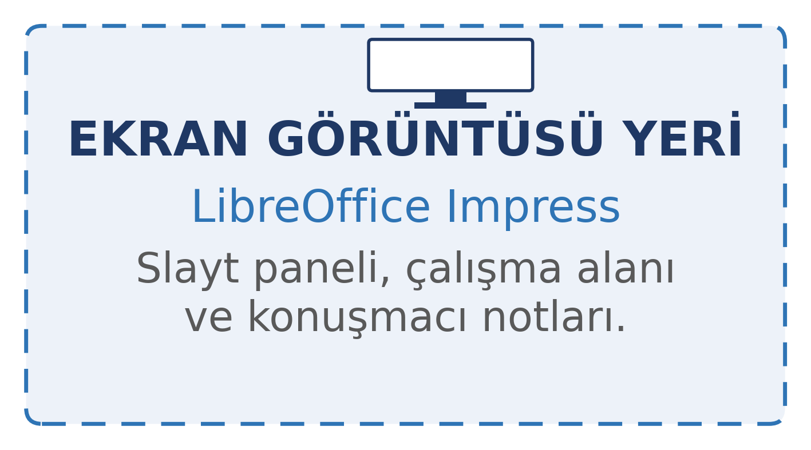
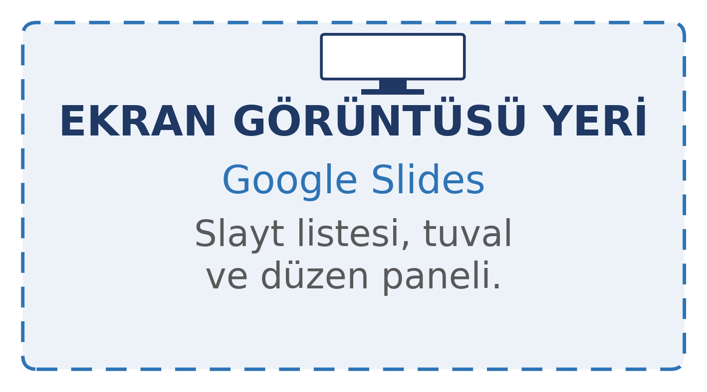
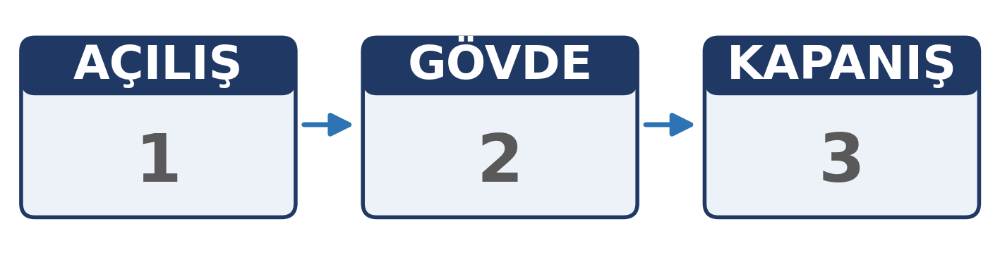
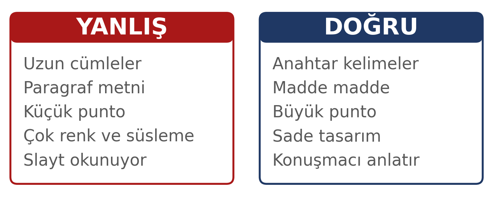
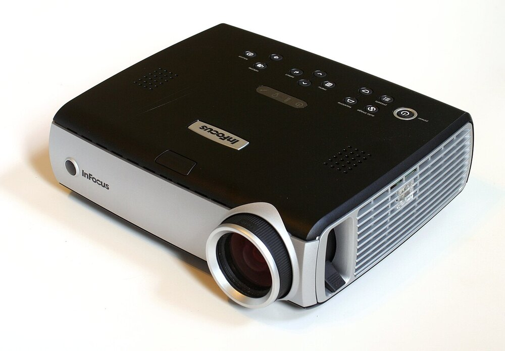
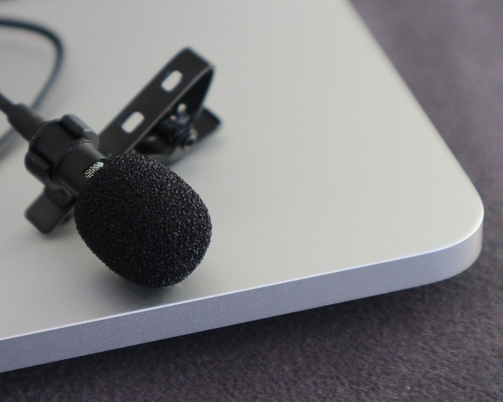

# Bu Haftanın Çerçevesi

## Öğrenme Çıktıları

- Sunu yazılımında slayt oluşturur; düzenini, dosya biçimini ve dışa aktarmayı seçer.
- Sununun yapısını (açılış, gövde, kapanış) planlar.
- Slaytta metin yoğunluğunu ve okunabilirliği ayarlar.
- Görselleri telif kurallarına uygun kullanır.
- Tasarım tutarlılığını sağlar; tablo ve grafiği uygun yerleştirir.
- Etkili bir sunum yapar; erişilebilir bir sunu hazırlar.

# Sunu Yazılımı

## Sunu Yazılımı Nedir?

Sunu yazılımı, slaytları hazırlayıp sırayla göstermek için kullanılan **uygulama yazılımıdır**.

- **Slayt:** Sununun tek ekranı; **tuval:** tasarım alanı.
- **Düzen:** Hazır yerleşim; **yer tutucu:** metin/görsel alanı.
- **Ana slayt:** Ortak yazı tipi, renk ve logoyu belirler.
- **Konuşmacı notu:** Slaytta görünmez; **konuşmacı görünümü:** sıradaki slayt ve süre.

Örnekler: **Google Slides**, **LibreOffice Impress**, **PowerPoint**, **Keynote**; ayrıca **Prezi** ve **Canva**.

## Masaüstü mü, Çevrimiçi mi?

| | Masaüstü sürüm | Çevrimiçi sürüm |
|:---|:---|:---|
| Kurulum | Gerekir | Gerekmez; tarayıcı yeter |
| İnternet | Sunum sırasında gerekmez | Genellikle gerekir |
| Erişim | Yalnızca o bilgisayardan | Hesabınızın olduğu her cihazdan |
| Ortak çalışma | Sınırlı | Aynı anda birden çok kişi |
| Verinin yeri | Kendi bilgisayarınız | Sağlayıcının sunucuları |

Çevrimiçi sürümde sunu dosyası, hizmet sağlayıcının sunucusunda tutulur; yerel bir kopya ve PDF de bulundurun.

## Dosya Biçimleri ve Dışa Aktarma

| Biçim | Ne için? | Dikkat |
|:---|:---|:---|
| `.pptx` | PowerPoint'in en yaygın biçimi | Yazı tipi ve video uyumu değişebilir |
| `.odp` | Açık kaynak paketlerin biçimi | Her uygulama tam desteklemeyebilir |
| `.pdf` | Sabit görünüm, teslim ve yedek | Video, animasyon ve geçiş efektleri çalışmaz |

**Asıl dosyayı ve PDF’i birlikte taşıyın.** Videolu sunuda videoyu ayrıca bulundurun.

## Sunu Yazılımı Turu

1. Uygulamayı açın; slayt paneli, tuval ve düzen panelini tanıyın.
2. Ekran oranını seçin: çoğu ekran için 16:9, bazı ekranlarda 4:3.
3. Tema, ana slayt ve düzeni seçin.
4. Slayt ekleyin; başlık ve içerik yer tutucularını doldurun.
5. Konuşmacı notlarını yazın; konuşmacı görünümünü deneyin.
6. Slayt gösterisini başlatın; sunuyu **PDF** olarak dışa aktarın.

## Ekran Oranı: 4:3 ve 16:9

{width=82%}

4:3 daha dar, 16:9 daha geniştir; sunum yapılacak ortamın oranına göre seçin.

## Ekran Görüntüleri

{width=48%} {width=48%}

Solda LibreOffice Impress, sağda Google Slides: slayt paneli, tuval ve notlar.

# Sununun Yapısı

## Kime, Ne Amaçla, Ne Kadar Sürede?

| Soru | Neye karar verir |
|:---|:---|
| **Kime?** | Dil, örnek, ayrıntı düzeyi |
| **Ne amaçla?** | Bilgilendirme, ikna, savunma, karar |
| **Ne kadar sürede?** | Slayt sayısı, prova, kapanış |

Süre, sunum sırasında **sunuya ayrılan zamandır**. Kesin slayt sayısını **prova** belirler.

## Üç Bölüm ve Süre Payları

{width=76%}

İyi bir sunu genellikle üç bölümden oluşur; süre payları kesin kural değil, tavsiyedir.

**Süre payı:** Açılış ~%10 · Gövde ~%80 · Kapanış ~%10

## Açılış

Önce **bugün ne anlatacağınızı** söyleyin; doğrudan ayrıntıya girmeyin.

İyi açılış: konuyu tanıtır, **neden önemli** olduğunu söyler; bir soru ya da çarpıcı bir veriyle başlar.

Kendini tanıtmakla sınırlı bir giriş yeterli değildir.

## Gövde

Ana mesajlar burada işlenir. Sık hata: çok fazla mesaj.

**Üç ana mesaj** kuralı, dinleyicinin ana hattı izlemesini kolaylaştırır. Çok fazla mesaj verirseniz, hangi birkaç mesajın akılda kalacağını seçemezsiniz.

## Kapanış

Sununun en çok atlanan ama en etkili kısmı.

Ana mesajları hatırlatır ve **ne yapılması gerektiğini** söyler.

"Teşekkürler" demek bir kapanış değildir.

# Slayt Tasarımı

## Metin Yoğunluğu

{width=80%}

## Slayt Kuralları

- **Madde madde yazın**, paragraf yazmayın
- **Anahtar kelimeler** kullanın
- Satır başına **6–8 kelime**, slayt başına **6 madde**
- Gövde metni **en az 24 punto**; başlık daha büyük
- **Sade ve sakin olun:** Boşluk bırakın; hareketli efekt ve ses yerine durağan slaytlar
- Salon büyüdükçe puntoyu artırın

## Slaytı Okumayın

Slaytta yazanı kelimesi kelimesine okumak, sunumda **sık yapılan bir hatadır**.

Dinleyici zaten okuyabiliyor. Konuşmacının işi **açıklamak**; notlarınızdan veya kısa not kâğıtlarından yararlanın.

**Ölçü:** Slayda bakmadan anlatabiliyor musunuz? "Hayır" ise fazla yazı var.

## Tasarım Tutarlılığı

- **Renk paleti:** en fazla iki üç renk
- **Yazı tipi:** tüm slaytlarda aynı
- **Yerleşim:** başlık hep aynı yerde
- **Slayt numarası:** numara ve toplam sayı görünsün (4 / 12)
- **Görsel dil:** aynı üslup; fotoğraf ve şema bir arada olabilir

Ders sunularımız buna örnektir: aynı renk paleti, aynı başlık düzeni, kurumsal renkler.

# Görsel Kullanımı ve Telif

## Görsel Seçimi

- **İlgili olmalı** — süs değil
- **Kaliteli olmalı** — bulanık görsel içeriği de zayıflatır
- **Bir işlevi olmalı** — bilgi, örnek veya atmosfer; dikkat dağıtıyorsa çıkarın
- **Metni tekrarlamamalı**

## Telif ve Lisans

- Ücretsiz stok: **Pexels**, **Unsplash**, **Pixabay**
- **Wikimedia Commons**
- CC lisansları genellikle atıf gerektirir; ayrıntı 11. haftada

## Kaynak Göstermek Telifi Çözmez

Bir görselin altına kaynak yazmak, onu kullanma hakkı vermez.

**Lisansı uygun olan** görselleri seçin; atıf ayrı bir yükümlülüktür.

::: {.callout-warning}
**Ücretsiz stok siteleri kamu malı değildir.** Pexels, Unsplash gibi siteler ücretsiz kullanım verir; ancak içerik teliflidir ve lisans koşulları vardır.
:::

# Tablo ve Grafik

## Slayt İçin Basitleştirin

- **Tabloda az satır:** yalnızca vurgulamak istedikleriniz
- **Grafikte büyük punto:** eksen etiketleri projeksiyonda arkadan okunmalı
- **Tek mesaj:** her grafik tek bir karşılaştırma; üç eğriyi üst üste koymayın
- **Vurgulama:** istediğiniz değeri belirtin
- **Kaynak ve tarih:** grafiğin kaynağı ve kaynağın tarihi

Size ait grafiklerde eksenlerin değiştirildiği ya da kesildiği durumlarda bunu açıkça belirtin.

# Etkili Sunum Teknikleri

## Sunmadan Önce

- **Prova yapın:** yüksek sesle, ayakta, süre tutarak
- **Süreyi ölçün:** aşmak sık karşılaşılan bir hatadır
- **Teknik kontrol:** projeksiyon, ses, dosya biçimi, 4:3/16:9
- **Yedek kopya:** PDF ve asıl dosya; PDF video/animasyon taşımaz

{width=32%} {width=30%}

## Sunarken

- **Dinleyiciye bakın**, slayta değil
- **Yavaş ve net** konuşun
- **Sesiniz arka sıradan** duyulsun
- **Slaytı okumayın**; notlarınızdan yararlanın
- **Geçişleri planlayın:** "bir sonraki slaytta…"

## Soru-Cevap

Soru-cevap genellikle sonda; gerektiğinde sunum sırasında da alınabilir.

- **"Bilmiyorum" demekten çekinmeyin** — uydurmaktan iyidir
- **Soruyu tekrar edin:** herkes duyar, siz düşünürsünüz
- **Kısa yanıtlayın**

## Uzaktan Sunum

Google Meet, Zoom, Microsoft Teams gibi platformlarda:

- **Ekran paylaşımı:** yalnızca sunum penceresi; bildirimleri kapatın
- **Kamera:** ışık önde, göz hizası; zorunlu değil
- **Mikrofon:** kulaklık veya yaka mikrofonu; yankıyı azaltın
- **Sohbet:** soruları izleyin; gerekirse moderatör
- **Kayıt:** katılımcıları bilgilendirin; amacı dışında saklamayın
- **Yedek:** kablosuz ağı ve telefon internetini önceden kontrol edin

# Erişilebilirlik

## Sununuz Herkes İçin

- **Sunuyu erişilebilir hazırlayın:** alt metin, anlamlı başlık, okuma sırası
- **Sunum sırasında:** okunabilir punto, yeterli kontrast
- **Renk:** yalnızca renkle anlatmayın
- **Video ve hareket:** altyazı, animasyonu azaltın

Paylaşmadan önce uygulamanın **erişilebilirlik denetleyicisini** çalıştırabilirsiniz.

# Kapanış

## Uygulama: Kısa Bir Sunu Hazırlayın

**Hangi araçla:** Google Slides gibi çevrimiçi bir araç ya da LibreOffice Impress gibi kurulabilen bir paket.

1. Kime, ne amaçla, ne kadar sürede? **Üç ana mesajı** yazın
2. Açılış–gövde–kapanış planı yapın; başlıkları taslak olarak sıralayın
3. Ana slayt/düzeni ve ekran oranını (16:9 veya 4:3) seçin; az metin, bir görsel, altyazı + alt metin
4. Konuşmacı notlarını yazın; yüksek sesle, süre tutarak **prova** yapın
5. **PDF**’e aktarın; asıl dosyayı ve videoyu ayrıca saklayın

Taslak için yapay zekâdan yararlanabilirsiniz; doğrulama sizde.

Notla değerlendirilmez.

## Özet

- **Sunu yazılımı**: slayt, ana slayt, düzen, notlar
- **`.pptx`/`.odp`** düzenlenebilir; **PDF** sabit görünüm, video yok
- **Açılış – gövde – kapanış**: ~%10 – %80 – %10
- **Az metin**, 6 madde, en az 24 punto
- Görsellerde **lisans**; kaynak göstermek yetmez
- Tablo/grafik sade; **prova**, yedek ve uzaktan hazırlık

## Gelecek Hafta

**Bilgi güvenliği** — parola yönetimi, iki adımlı doğrulama, oltalama, zararlı yazılımlar, güvenlik pratikleri.
