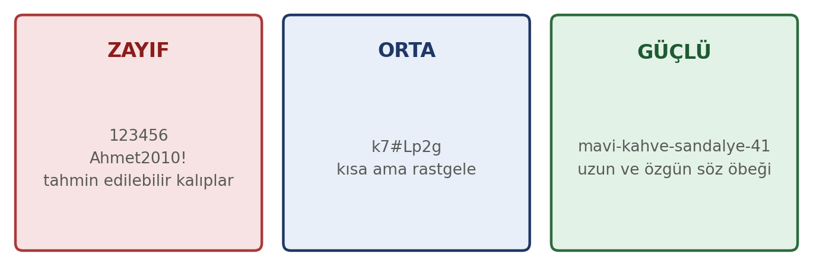
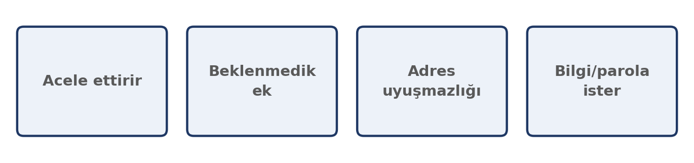
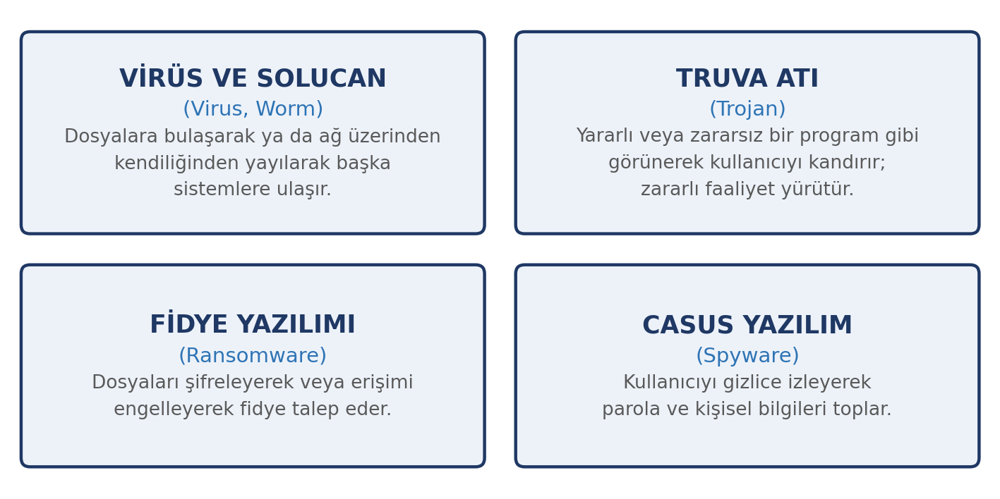
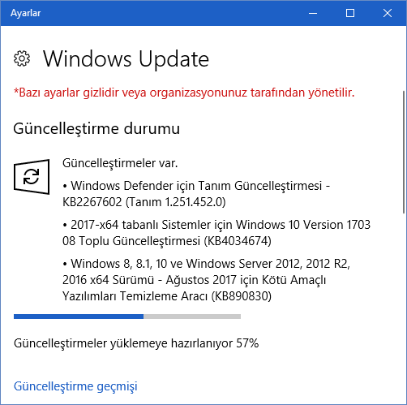
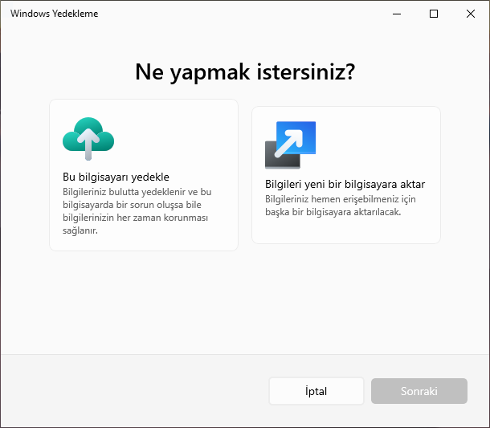
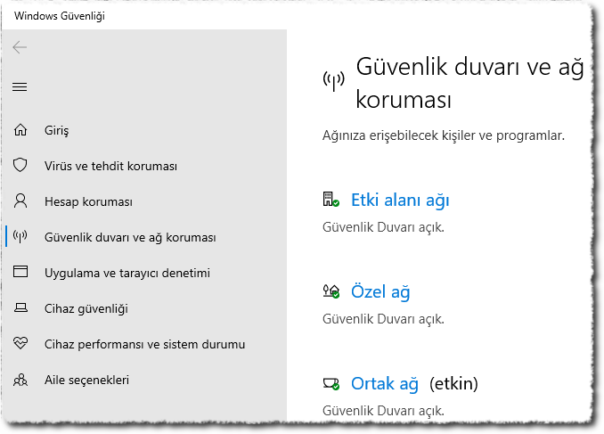
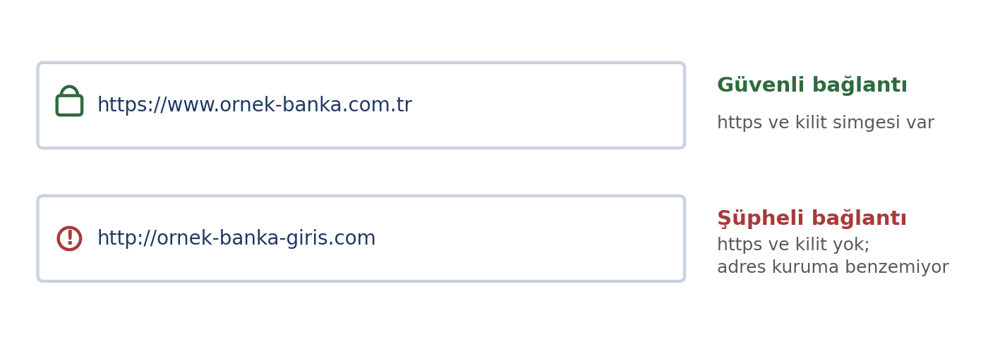

# Bu Haftanın Çerçevesi

## Öğrenme Çıktıları

- Bilgi güvenliğinin üç ilkesini açıklar.
- Güçlü parola oluşturur, parola yöneticisi kullanır.
- Çok adımlı doğrulamanın (MFA) önemini açıklar.
- Oltalama saldırılarını tanır.
- Zararlı yazılım türlerini bilir.
- Güncelleme ve yedekleme alışkanlığı geliştirir.

# Güvenliğin Üç Temeli

## Gizlilik · Bütünlük · Erişilebilirlik

::: {.columns}
::: {.column width="50%"}


:::

::: {.column width="46%"}

| İlke | İhlal örneği |
|:---|:---|
| Gizlilik | Hesabın ele geçirilmesi |
| Bütünlük | Notların değiştirilmesi |
| Erişilebilirlik | Fidye yazılımı |

:::
:::

## En Zayıf Halka İnsandır

Sistemleri kırmak zor, **insanı ikna etmek kolaydır**.

Saldırıların büyük kısmı teknik değil, **ikna** yoluyla yapılır.

# Parola Yönetimi

## Parola mı, Şifreleme mi?

- **Parola:** Erişim için girdiğiniz gizli dize
- **Şifreleme:** Verinin okunamaz hâle getirilmesi

Günlük dilde ikisine de "şifre" denir; teknik olarak farklıdır.

## Parola Gücü

{width=76%}

## Güçlü Parola Kuralları

- **Karakter sayısı** önemlidir
- **Her hesap için farklı** parola
- **Kişisel bilgi içermesin** — doğum tarihi, isim, plaka
- **Kalıp kullanmayın** — `123456`, `qwerty`, `Ahmet2010!`

::: {.callout-warning}
**Aynı parolayı birden fazla hesapta kullanmayın.** Tek bir sızıntı, o parolayı kullandığınız bütün hesapları ele geçirir.
:::

## Parola Yerine Söz Öbeği

Birbirinden ilgisiz kelimeleri birleştirmek hem akılda kalır hem tahmin edilemez.

`mavi-tohum-sandalye-41!` gibi bir **yapı** — ama kendi örneğinizi üretin.

## Parola Yöneticisi

::: {.columns}
::: {.column width="52%"}

- Her hesap için **rastgele** parola üretir
- Şifreli bir **kasada** saklar
- Tek bir **ana parola** hatırlamanız yeter
- Otomatik doldurur

:::

::: {.column width="44%"}


:::
:::

## Çok Adımlı Doğrulama (MFA)

**Çok adımlı doğrulama (MFA)** şemsiye terimdir; **2FA** bunun en yaygın biçimidir. **Bildiğiniz bir şey** (parola) + **sahip olduğunuz bir şey** (telefon, uygulama kodu, donanım anahtarı). Parolanız çalınsa bile hesabınız korunur; **uygulama tabanlı kodlar**, SMS kodundan daha güvenlidir.

{width=94%}

## Nerede Mutlaka Açık Olmalı?

::: {.columns}
::: {.column width="60%"}

- **E-posta** — diğer bütün parolalar oraya sıfırlanır
- **e-Devlet ve bankacılık**
- **Sosyal medya hesapları**

:::

::: {.column width="36%"}


:::
:::

# Sosyal Mühendislik

## İnsanı Hedef Alan Saldırılar

Saldırganlar çoğu zaman teknik bir açıklık aramaz; **insanı** hedefler.

- **Güven kazanmak:** Kendini yetkili ya da tanıdık gibi tanıtmak
- **Taklit etmek:** Telefonda bir kurumun ya da yakının yerine geçmek
- **Yardım ediyor görünmek:** Sorun yaratıp çözümü kendisi sunmak
- **Ortak tanıdık:** "Ahmet de beni tanıyor" gibi
- **Çöp karıştırmak:** Atılan belgelerden bilgi toplamak

Ortak yanı: sizi **düşünmeden hareket etmeye** itmeleri.

# Oltalama

## Sizi Kandırarak Bilgi Almak

E-posta, SMS, telefon araması ya da sahte siteyle yapılır.

{width=76%}

## Biçimler

| Biçim | Nasıl işler |
|:---|:---|
| E-posta | Kurumdan gelmiş gibi görünür |
| SMS | Kargo, banka, fatura bildirimi |
| Telefon | Kendini banka görevlisi tanıtır |
| Mesajlaşma | WhatsApp, Facebook'ta tanıdık görünen hesaptan gelen bağlantı |
| Sahte site | Gerçek sitenin kopyası |

## Dört Altın Kural

1. **Acele ettiren mesaj şüphelidir**
2. **Bağlantıya tıklamayın** — doğru adresi kendiniz yazın
3. **Başka kanaldan doğrulayın**
4. **Parolanızı kimseye vermeyin**

Hiçbir kurum e-posta veya telefonla parola istemez.

# Zararlı Yazılımlar

## Zararlı Yazılım Türleri

{width=84%}

Zararlı yazılımlar farklı amaçlarla çalışır; bir yazılım birden fazla özelliği aynı anda gösterebilir.

## Zombi Bilgisayarlar

- Bilgisayar sessizce bir **komut merkezine** bağlanır
- Oradan gelen emirleri uygular; kullanıcı fark etmez
- Bu cihazların oluşturduğu ağa **botnet** denir

Cihazınız farkında olmadan başkalarına saldırmak için kullanılabilir — "bende önemli veri yok" demek yanlıştır.

## Nasıl Bulaşır?

::: {.columns}
::: {.column width="60%"}

- **Beklenmedik ekler** (`.exe`, `.zip`)
- **Sahte indirme siteleri**
- **Korsan / kırılmış yazılımlar**
- **Takılan USB bellekler**
- **Güncellenmemiş yazılım açıkları**

:::

::: {.column width="36%"}

```{=latex}
\begin{center}
\includegraphics[width=\linewidth,height=0.6\textheight,keepaspectratio]{gorseller/foto-usb-bellek.jpg}\\[-1mm]
{\scriptsize\emph{Tanımadığınız USB belleği takmayın}}
\end{center}
```

:::
:::

## Yazılımı Kaynağından İndirin

Yalnızca **üreticinin sitesinden** veya resmî mağazalardan.

Arama sonuçlarındaki **reklam bağlantıları** sahte olabilir.

Korsan yazılımın bedeli parayla değil, **verilerinizle** ödenir.

## VirusTotal ile İkinci Bir Görüş

- **Ne işe yarar?** Şüpheli dosya/bağlantıyı birçok antivirüs motoruyla tarar
- **Ne zaman kullanılır?** Antivirüse rağmen şüphe duyduğunuzda
- **Gizlilik:** Hassas dosyaları yüklemekten kaçının; mümkünse **hash** ile sorgulayın
- **Adres:** [virustotal.com](https://www.virustotal.com)

# Güncelleme ve Yedekleme

## Güncelleme Neden Önemli?

::: {.columns}
::: {.column width="52%"}

Yalnızca yeni özellik eklemez; **bilinen güvenlik açıklarını kapatır**.

Saldırganlar güncellenmemiş sistemleri hedefler.

:::

::: {.column width="44%"}



:::
:::

## Yedekleme: Fidyeye Karşı En İyi Savunma

::: {.columns}
::: {.column width="52%"}

Dosyalar şifrelendiğinde **yedek varsa** fidye ödemek gerekmez.

4\. haftanın **3-2-1 kuralını hatırlayın**.

Yedeği **bağlı tutmayın** — fidye yazılımı bağlı diskleri de şifreler.

:::

::: {.column width="44%"}



:::
:::

# Cihaz ve Hesap Güvenliği

## Günlük Önlemler

- **Ekran kilidi** kullanın
- **Otomatik kilitleme** süresini kısaltın
- **Ortak cihazda oturumu kapatın** — sekmeyi kapatmak yetmez
- **Tarayıcıya parola kaydetmeyin** (ortak cihazda)
- **Genel WiFi'da hassas işlem yapmayın**
- **Kullanmadığınız hesapları kapatın**
- **Veri ihlali bildirimlerini** takip edin

## Güvenlik Duvarı ve Varsayılan Ayarlar

::: {.columns}
::: {.column width="52%"}

- **Güvenlik duvarı:** Gelen-giden trafiği denetler, izin verilmeyeni engeller
- İşletim sistemlerinde **hazır ve açık** gelir; kapatmayın
- Çoğu sistemde antivirüs de yerleşik gelir

Varsayılan ayarlar sıradan bir kullanıcı için genellikle **yeterlidir**.

:::

::: {.column width="44%"}



:::
:::

## İnternet'ten Alışveriş ve Bankacılık

::: {.columns}
::: {.column width="52%"}

- **`https` ve kilit simgesini** kontrol edin; adresi **kendiniz yazın**
- Bankacılık parolanızı **kimseyle paylaşmayın**
- **Sanal kart** kullanın (düşük limitli)
- Ödemeleri **hesap özetinden** doğrulayın

:::

::: {.column width="44%"}



:::
:::

# Doğru Bilinen Yanlışlar

## Yaygın Yanlış İnanışlar

| Yanlış inanış | Gerçek |
|:---|:---|
| "Antivirüs varsa güvendeyim" | Tek başına yetmez; zayıf halka insan |
| "Beni hedef almazlar" | Saldırılar otomatiktir |
| "Gizli moddayım, güvendeyim" | Gizli mod anonim yapmaz |
| "Parolam karmaşık" | Aynı parolayı her yerde kullanıyorsanız risk var |
| "Sadece güvenli sitelere giriyorum" | Güvenli bir sitenin reklamı ya da eklentisi zararlı olabilir |
| "Mac/Linux'a virüs bulaşmaz" | Bulaşır, hedef daha seyrek |
| "Dosyayı sildim, gitti" | Geri dönüşüm kutusu boşaltılmadıysa döner |

# Kapanış

## Uygulama: Kendi Güvenliğinizi Denetleyin

**Hangi araçla:** hesap güvenlik ayarları (e-posta sağlayıcınızın güvenlik sayfası, e-Devlet) ve cihazınızın güncelleme ayarları; adımlar çoğu sistemde benzerdir.

1. Kaç hesapta **aynı** parolayı kullanıyorsunuz? İki hesap için yenisini belirleyin.
2. E-posta ve e-Devlet'te **iki adımlı doğrulamayı** açın.
3. Şüpheli bir e-postayı açmadan inceleyin: gönderen, bağlantı, dil hataları.
4. Cihazınızın güncelleme durumunu kontrol edin.

Notla değerlendirilmez.

## Özet

- **Gizlilik · bütünlük · erişilebilirlik**
- Parola: **karakter sayısı fazla, her hesapta farklı**; parola yöneticisi kullanın
- **2FA** e-posta ve e-Devlet'te mutlaka açık
- **Oltalama** acele ettirir; tıklamayın, doğrulayın
- **Yazılımı kaynağından indirin**
- **Güncelleme** açıkları kapatır, **yedek** fidyeye karşı korur
- En zayıf halka **insandır**

## Gelecek Hafta

**Kişisel veriler ve dijital etik** — kişisel veri nedir, KVKK farkındalığı, dijital ayak izi, gizlilik ayarları, telif ve lisanslar.
