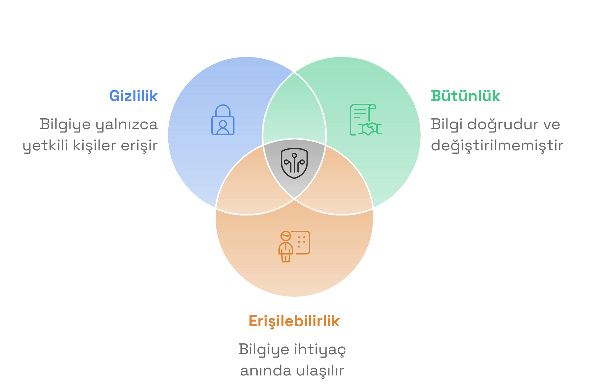
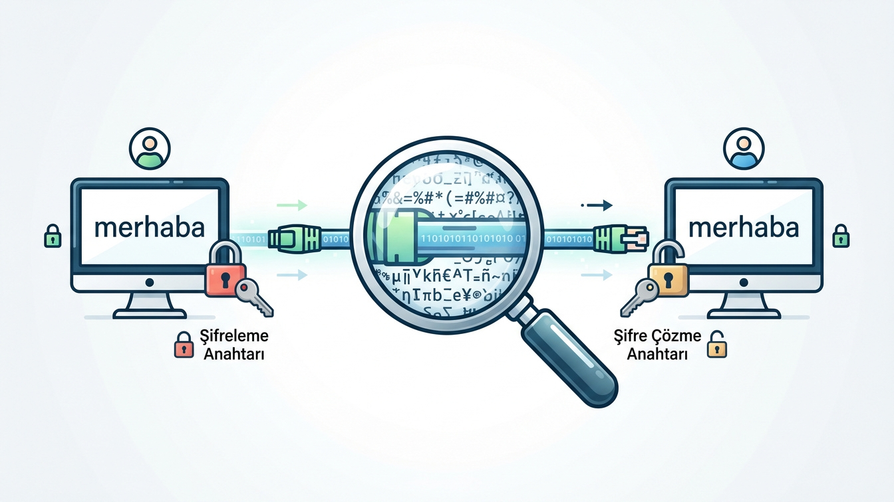
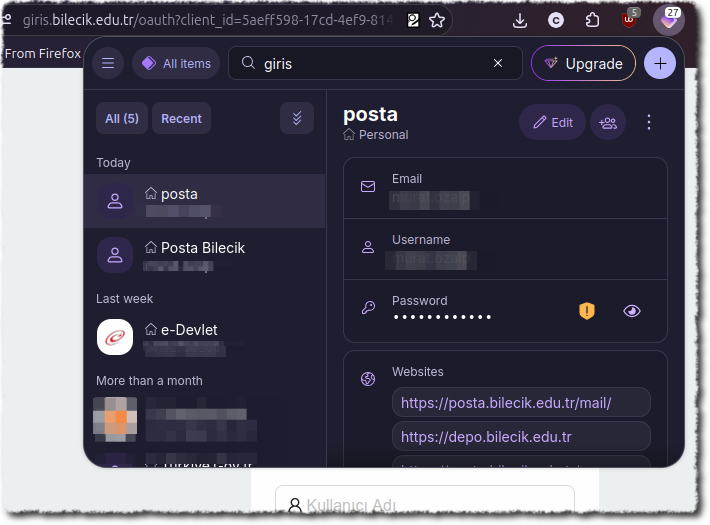
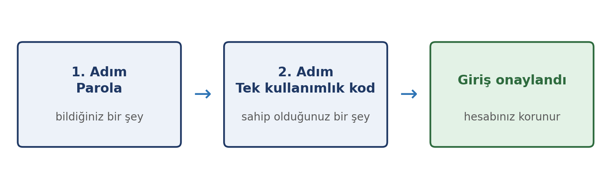
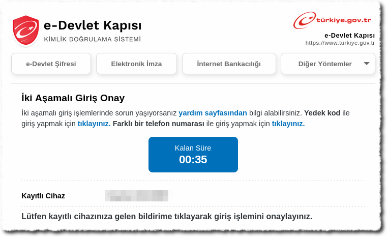
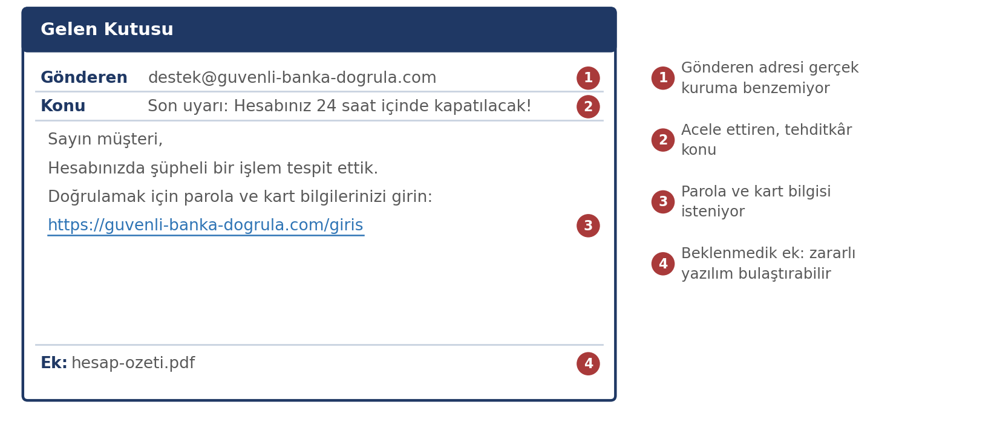
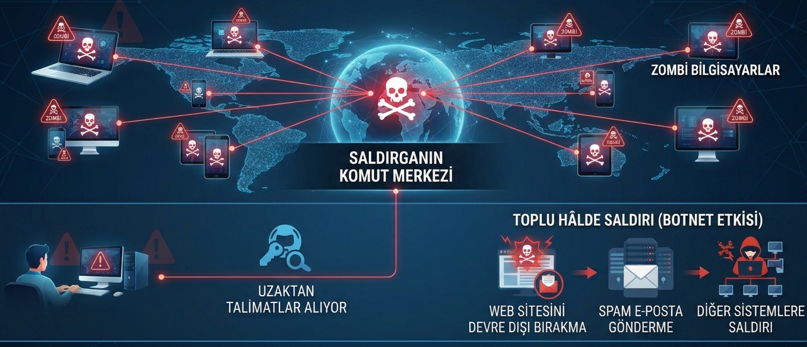
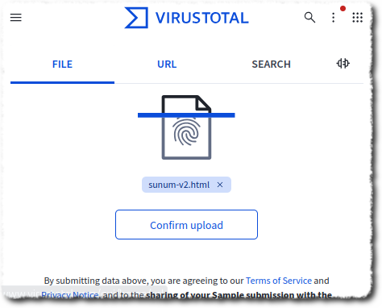

# Bu Haftanın Çerçevesi

## Öğrenme Çıktıları

- Bilgi güvenliğinin üç ilkesini açıklar.
- Güçlü parola oluşturur, parola yöneticisi kullanır.
- Çok adımlı doğrulamanın (MFA) önemini açıklar.
- Oltalama saldırılarını tanır.
- Zararlı yazılım türlerini bilir.
- Güncelleme ve yedekleme alışkanlığı geliştirir.
- Cihaz ve hesap güvenliği için doğru ayarları uygular.

# Güvenliğin Üç Temeli

## Gizlilik · Bütünlük · Erişilebilirlik

{width=54%}

```{=latex}
\begin{center}
{\small
\begin{tabular}{@{}>{\raggedright\arraybackslash}p{2.6cm}>{\raggedright\arraybackslash}p{4.6cm}>{\raggedright\arraybackslash}p{4.4cm}@{}}
\textbf{İlke} & \textbf{Ne demek} & \textbf{İhlal örneği}\\
\midrule[0.3pt]
Gizlilik & Yetkili kişiler erişir & Hesabın ele geçirilmesi\\
Bütünlük & Doğru ve değiştirilmemiş & Notların değiştirilmesi\\
Erişilebilirlik & İhtiyaç anında ulaşılır & Fidye yazılımı\\
\bottomrule[0.3pt]
\end{tabular}}
\end{center}
```

## En Zayıf Halka İnsandır

Sistemleri kırmak zor, **insanı ikna etmek kolaydır**. Saldırıların büyük kısmı teknik değil, **ikna** yoluyla yapılır.

# Parola Yönetimi

## Parola mı, Şifreleme mi?

{width=70%}

- **Parola:** Erişim için girdiğiniz gizli dize
- **Şifreleme:** Verinin okunamaz hâle getirilmesi

Günlük dilde ikisine de "şifre" denir; teknik olarak farklıdır.

## Parola Gücü

{width=100%}

Birbirinden ilgisiz kelimeleri birleştirmek hem akılda kalır hem tahmin edilemez. `mavi-tohum-sandalye-41!` gibi bir **yapı** — ama kendi örneklerinizi üretin.

## Güçlü Parola Kuralları

- **Karakter sayısı** önemlidir
- **Her hesap için farklı** parola
- **Kişisel bilgi içermesin** — doğum tarihi, isim, plaka
- **Kalıp kullanmayın** — `123456`, `qwerty`, `Ahmet2010!`

::: {.callout-warning}
**Aynı parolayı birden fazla hesapta kullanmayın.** Tek bir sızıntı, o parolayı kullandığınız bütün hesapları ele geçirir.
:::

## Parola Yöneticisi

{width=56%}

- Her hesap için **rastgele** parola üretir; bunları şifreli bir **kasada** saklar
- Tek bir **ana parola** hatırlamanız yeter; parolaları siteye otomatik doldurur

## Çok Adımlı Doğrulama (MFA)

::: {.columns}
::: {.column width="56%"}

**MFA** şemsiye terimdir; **2FA** bunun en yaygın biçimidir. **Bildiğiniz bir şey** (parola) + **sahip olduğunuz bir şey** (telefon, uygulama kodu, donanım anahtarı). Parolanız çalınsa bile hesabınız korunur; **uygulama tabanlı kodlar**, SMS kodundan daha güvenlidir.

:::

::: {.column width="42%"}

```{=latex}
\begin{center}
\includegraphics[width=\linewidth,height=3.2cm,keepaspectratio]{gorseller/foto-otp-cihazi.jpg}\\[-1mm]
{\scriptsize\emph{Donanım OTP cihazı}}
\end{center}
```

:::
:::

{width=90%}

## Nerede Mutlaka Açık Olmalı?

{width=58%}

- **E-posta** — diğer bütün parolalar oraya sıfırlanır
- **e-Devlet ve bankacılık**
- **Sosyal medya hesapları**

# Sosyal Mühendislik

## İnsanı Hedef Alan Saldırılar

Saldırganlar çoğu zaman teknik bir açıklık aramaz; **insanı** hedefler.

- **Güven kazanmak:** Kendini yetkili ya da tanıdık gibi tanıtmak
- **Taklit etmek:** Telefonda bir kurumun ya da yakının yerine geçmek
- **Yardım ediyor görünmek:** Sorun yaratıp çözümü kendisi sunmak
- **Ortak tanıdık:** "Ahmet de beni tanıyor" gibi
- **Çöp karıştırmak:** Atılan belgelerden bilgi toplamak

Ortak yanı: sizi **düşünmeden hareket etmeye** itmeleri.

# Oltalama

## Sizi Kandırarak Bilgi Almak

E-posta, SMS, telefon araması ya da sahte siteyle yapılır. Aşağıdaki kurgusal örnekte numaralı işaretler şüpheli noktaları gösterir.

{width=100%}

## Biçimler

```{=latex}
\begin{center}
\begin{tabular}{@{}>{\raggedright\arraybackslash}p{2.4cm}>{\raggedright\arraybackslash}p{7.8cm}@{}}
\textbf{Biçim} & \textbf{Nasıl işler}\\
\midrule[0.3pt]
E-posta & Kurumdan gelmiş gibi görünür\\
SMS & Kargo, banka, fatura bildirimi\\
Telefon & Kendini banka görevlisi tanıtır\\
Mesajlaşma & Tanıdık görünen hesaptan gelen bağlantı\\
Sahte site & Gerçek sitenin birebir kopyası\\
\bottomrule[0.3pt]
\end{tabular}
\end{center}
```

## Dört Altın Kural

1. **Acele ettiren mesaj şüphelidir**
2. **Bağlantıya tıklamayın** — doğru adresi kendiniz yazın
3. **Başka kanaldan doğrulayın**
4. **Parolanızı kimseye vermeyin**

Hiçbir kurum e-posta veya telefonla parola istemez.

# Zararlı Yazılımlar

## Zararlı Yazılım Türleri

**Zararlı yazılım** (İngilizce *malicious software* → **malware**): bir cihaza zarar vermek, bilgi çalmak ya da cihazı kötü amaçlarla kullanmak için yazılmış program.

{width=54%}

```{=latex}
\begin{center}
{\small
\begin{tabular}{@{}>{\raggedright\arraybackslash}p{4.2cm}>{\raggedright\arraybackslash}p{8.6cm}@{}}
\textbf{Tür} & \textbf{Temel özelliği}\\
\midrule[0.3pt]
Virüs ve solucan & Dosyalara bulaşır, ağda kendiliğinden yayılır\\
Truva atı & Yararlı görünüp kandırır\\
Fidye yazılımı & Dosyaları şifreler\\
Casus yazılım & İzler, bilgi toplar\\
\bottomrule[0.3pt]
\end{tabular}}
\end{center}
```

## Zombi Bilgisayarlar

**Kötü kişiler** tarafından ele geçirilen bilgisayar, uzaktaki **komut merkezinden** talimat alır; bu cihazların oluşturduğu ağa **botnet** denir.

{width=86%}

Toplu hâlde kullanılır: siteyi devre dışı bırakma, spam, **kripto para madenciliği**, saldırı. Farkında olmadan başkalarına hizmet eder; hukuki sorun çıkarabilir.

## Nasıl Bulaşır?

Truva atı ya da güncellenmemiş yazılım açığıyla sessizce ele geçirilir.

::: {.columns}
::: {.column width="60%"}

- **Beklenmedik ekler** (`.exe`, `.zip`)
- **Sahte indirme siteleri**
- **Korsan / kırılmış yazılımlar**
- **Takılan USB bellekler**
- **Güncellenmemiş yazılım açıkları**

:::

::: {.column width="36%"}

```{=latex}
\begin{center}
\includegraphics[width=\linewidth,height=0.5\textheight,keepaspectratio]{gorseller/foto-usb-bellek.jpg}\\[-1mm]
{\scriptsize\emph{Tanımadığınız USB belleği takmayın}}
\end{center}
```

:::
:::

## Yazılımı Kaynağından İndirin

- Yalnızca **üreticinin sitesinden** veya resmî mağazalardan indirin.
- Arama sonuçlarındaki **reklam bağlantıları** sahte olabilir.
- Korsan yazılımın bedeli parayla değil, **verilerinizle** ödenir.

## VirusTotal ile İkinci Bir Görüş

::: {.columns}
::: {.column width="52%"}

- **Ne işe yarar?** Şüpheli dosya/bağlantıyı birçok antivirüs motoruyla tarar
- **Ne zaman kullanılır?** Antivirüse rağmen şüphe duyduğunuzda
- **Gizlilik:** Hassas dosyaları yüklemekten kaçının; mümkünse **hash** ile sorgulayın
- **Adres:** [virustotal.com](https://www.virustotal.com)

:::

::: {.column width="44%"}



:::
:::

# Güncelleme ve Yedekleme

## Güncelleme Neden Önemli?

Yalnızca yeni özellik eklemez; **bilinen güvenlik açıklarını kapatır**. Saldırganlar güncellenmemiş sistemleri hedefler; aşağıda Windows ve Pardus güncelleme ekranları.

::: {.columns}
::: {.column width="48%"}

```{=latex}
\begin{center}
\includegraphics[width=\linewidth,height=5.0cm,keepaspectratio]{gorseller/ekran-guncelleme-windows.png}
\end{center}
```

:::

::: {.column width="48%"}

```{=latex}
\begin{center}
\includegraphics[width=\linewidth,height=5.0cm,keepaspectratio]{gorseller/ekran-guncelleme-pardus.png}
\end{center}
```

:::
:::

## Yedekleme: Fidyeye Karşı En İyi Savunma

::: {.columns}
::: {.column width="34%"}

Dosyalar şifrelendiğinde **yedek varsa** fidye ödemek gerekmez.

4\. haftanın **3-2-1 kuralını hatırlayın**.

:::

::: {.column width="32%"}

```{=latex}
\begin{center}
\includegraphics[width=\linewidth,height=5.2cm,keepaspectratio]{gorseller/ekran-yedekleme.png}
\end{center}
```

:::

::: {.column width="32%"}

```{=latex}
\begin{center}
\includegraphics[width=\linewidth,height=5.2cm,keepaspectratio]{gorseller/ekran-fidye-koruma.png}
\end{center}
```

:::
:::

# Cihaz ve Hesap Güvenliği

## Günlük Önlemler

- **Ekran kilidi** kullanın
- **Otomatik kilitleme** süresini kısaltın
- **Ortak cihazda oturumu kapatın** — sekmeyi kapatmak yetmez
- **Tarayıcıya parola kaydetmeyin** (ortak cihazda)
- **Genel WiFi'da hassas işlem yapmayın**
- **Kullanmadığınız hesapları kapatın**
- **Veri ihlali bildirimlerini** takip edin

## Güvenlik Duvarı ve Varsayılan Ayarlar

::: {.columns}
::: {.column width="56%"}

- **Güvenlik duvarı:** Gelen-giden trafiği denetler, izin verilmeyeni engeller
- İşletim sistemlerinde **hazır ve açık** gelir; kapatmayın
- Varsayılan ayarlar sıradan bir kullanıcı için genellikle **yeterlidir**

**Diğer bazı Windows güvenlik özellikleri:** Defender, Kullanıcı Hesabı Denetimi, Kurcalama Koruması, Denetimli Klasör Erişimi.

:::

::: {.column width="40%"}

```{=latex}
\begin{center}
\includegraphics[width=\linewidth,height=5.4cm,keepaspectratio]{gorseller/ekran-guvenlik-ayarlari.png}
\end{center}
```

:::
:::

## İnternet'ten Alışveriş ve Bankacılık

- **`https` ve kilit simgesini** kontrol edin; adresi **kendiniz yazın**
- Bankacılık parolanızı **kimseyle paylaşmayın**
- **Sanal kart** kullanın (düşük limitli)
- Ödemeleri **hesap özetinden** doğrulayın

{width=86%}

# Doğru Bilinen Yanlışlar

## Yaygın Yanlış İnanışlar

```{=latex}
\begin{center}
{\small
\begin{tabular}{@{}>{\raggedright\arraybackslash}p{5.4cm}>{\raggedright\arraybackslash}p{7.6cm}@{}}
\textbf{Yanlış inanış} & \textbf{Gerçek}\\
\midrule[0.3pt]
"Antivirüs varsa güvendeyim" & Tek başına yetmez; zayıf halka insan\\
"Beni hedef almazlar" & Saldırılar otomatiktir\\
"Gizli moddayım, güvendeyim" & Gizli mod anonim yapmaz\\
"Parolam karmaşık" & Aynı parolayı her yerde kullanırsanız risk var\\
"Sadece güvenli sitelere giriyorum" & Reklamı veya eklentisi zararlı olabilir\\
"Mac/Linux'a virüs bulaşmaz" & Bulaşır, hedef daha seyrek\\
"Dosyayı sildim, gitti" & Geri dönüşüm kutusu boşaltılmadıysa döner\\
\bottomrule[0.3pt]
\end{tabular}}
\end{center}
```

# Kapanış

## Uygulama: Kendi Güvenliğinizi Denetleyin

**Hangi araçla:** hesap güvenlik ayarları (e-posta sağlayıcınızın güvenlik sayfası, e-Devlet) ve cihazınızın güncelleme ayarları; adımlar çoğu sistemde benzerdir.

1. Kaç hesapta **aynı** parolayı kullanıyorsunuz? İki hesap için yenisini belirleyin.
2. E-posta ve e-Devlet'te **iki adımlı doğrulamayı** açın.
3. Şüpheli bir e-postayı açmadan inceleyin: gönderen, bağlantı, dil hataları.
4. Cihazınızın güncelleme durumunu kontrol edin.

Notla değerlendirilmez.

## Özet

- **Gizlilik · bütünlük · erişilebilirlik**
- Parola: **karakter sayısı fazla, her hesapta farklı**; parola yöneticisi kullanın
- **2FA** e-posta ve e-Devlet'te mutlaka açık
- **Oltalama** acele ettirir; tıklamayın, doğrulayın
- **Yazılımı kaynağından indirin**
- **Güncelleme** açıkları kapatır, **yedek** fidyeye karşı korur
- En zayıf halka **insandır**

## Gelecek Hafta

**Kişisel veriler ve dijital etik** — kişisel veri nedir, KVKK farkındalığı, dijital ayak izi, gizlilik ayarları, telif ve lisanslar.
